# Brushes and CSG

Brushes are what you build most of a level from. They are quick to draw, snap cleanly to the grid and turn into meshes
with matching collision in Godot. Everything here uses the **Select** tool (Q), unless a section names another tool.

## Draw and move

Drag anywhere off the selection, in any view, and a box follows the mouse. The 2D views print its size next to it. How
thick the box is depends on where you drag:

| Where you drag | Thickness |
| --- | --- |
| The 3D view | One grid step, starting on the surface under the cursor |
| A 2D view with something selected | The depth of the selection, like in Hammer and TrenchBroom. With a floor selected you can draw more floors of the same height from the Top view alone |
| A 2D view with nothing selected | The depth of the last brush you drew, 128 units for the very first one |

Untick *New brush depth from selection* in *File > Preferences* to always use the last brush's depth.

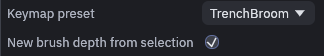

A drag that starts on the selection moves it instead. To draw a new box over it, pick the **Block** tool right of
Select in the toolbar, Shift+B in the Hammer preset. Every drag then draws, a click still selects, and in a 2D view a
drag on an edge of the selection still resizes it.

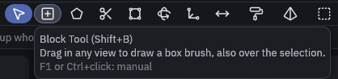

Once a brush is selected you can move it around:

| Input | Result |
| --- | --- |
| Drag the selection | Move it, Shift locks to the main axis. The Hammer preset has no axis lock |
| Ctrl+drag the selection | Move a copy, the original stays. The Hammer preset also copies with Shift+drag |
| Alt+drag the selection (3D) | Move vertically. Started off the selection, Alt+drag orbits the camera |
| Arrow keys, Page Up, Page Down | Nudge by one grid step |
| `[` and `]` | Halve and double the grid |

In 3D the selection also gets a move, rotate and scale gizmo. Rotation snaps to 15°, or 1° with Shift. If it gets in
your way, turn it off under *View > Transform Gizmo*.

## Exact position and size

Sometimes you want exact numbers, like a door cutter exactly as deep as the wall. Select the brush and type them into
the **Inspector** on the right.

Position is the lowest corner, the smallest X, Y and Z, which is the corner that usually sits on the grid. A new size
grows the selection away from that corner, so the position stays put. Dragging a field steps by the grid while
snapping is on, a typed value is kept exactly. The same fields show up for meshes, a brush entity and a selection of
several objects.

## Reshape

You can reshape a selected brush without leaving the Select tool:

| Input | Result |
| --- | --- |
| Shift+drag a face of a selected brush (3D), TrenchBroom preset | Push or pull that face. Click the brush to select it first, a face picked with Shift+click alone is not enough and the drag draws a new brush instead |
| Ctrl+Shift+drag a face of a selected brush (3D), TrenchBroom preset | Extrude a new brush out of that face |
| Drag a selection edge (2D) | Resize along that side. The side lights up yellow and the cursor changes where a drag resizes. Ctrl copies the selection instead, and so does Shift in the Hammer preset |
| E, with brush faces selected | Extrude each selected face into a new brush, in the Blender preset, see [below](#extrude-faces-with-e) |

In the Hammer preset Shift+drag copies the selection instead, so there is no push, pull or extrude on a face. Resize by
the edges in a 2D view, or use the transform gizmo.

While snapping is on, a face you drag lands on a grid line, even when the brush was off the grid before. Slanted faces
move in grid steps instead.

In the Top, Front and Side views the sides of what you selected are handles, and what a drag grabs depends on the
selection:

* **One brush.** Any side you see edge on is a handle, slanted ones too. Drag the sloped side of a wedge and it moves
  along its own direction, so the slope keeps its angle.
* **Several brushes.** Only the box around the whole selection has handles, so the sides are always straight.
* **Selected faces.** Select faces first (Shift+click, or key 3 in the Blender preset) and a drag only moves the faces
  you selected. Selected faces that lie in one plane move together.

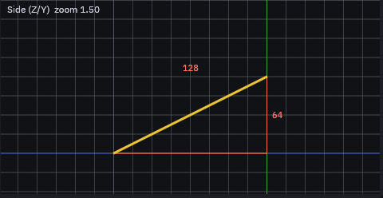

A side only counts as a handle when it shows up as a line in that view, so a brush turned off the view axes still moves
as a whole when you drag it near the middle. In the Hammer preset only the straight sides of the box around the
selection are handles, as in Hammer's wireframe views, and a slanted side moves the whole brush. A drag that would
leave a brush with no volume or a dent stops at the last shape that worked, drag back to get closer.

A press only turns into a drag once the pointer has moved 6 pixels, more on a scaled display. A shorter drag counts as
a click and selects what lies under the cursor instead, which may be another brush. Zoomed far out, 6 pixels can be
more than a grid step, so zoom in for a small change, or type the size in the Inspector, see
[Exact position and size](#exact-position-and-size).

### Extrude faces with E

Blender users know E as extrude. In the Blender preset it pulls a new brush out of each selected brush face, and the
old brush stays as it is. The steps:

1. Press 3 for Face mode, or switch the toolbar to Face.
2. Click a face of a brush in the 3D view. Ctrl+click adds more faces.
3. Press E. The status bar reads **Extrude** and a hint in the corner of the view says how to finish.
4. Move the mouse to set the length. It follows the grid while snapping is on, and Ctrl switches snapping off for the
    moment. Or type a number and press Enter for an exact length, Backspace fixes a typo.
5. Click or press Enter. You get one undo step called **Extrude**.

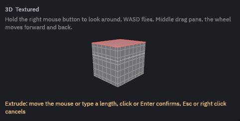

Esc or a right click cancels and puts everything back. Moving into the brush, or typing a length of zero or less, makes
nothing. Afterwards the far face of each new brush is selected, still in Face mode, so pressing E again extrudes the
next step.

> [!NOTE]
> Every face moves along its own direction by the same length and becomes its own brush. Faces that meet at a corner
> therefore leave that corner open, a gap the size of the length. Fill it with a small box, or extrude one face at a
> time.

E is the same command in the **Brush** section of the command palette and at the top of the right click menu when
faces are selected. In the Mesh tool E keeps extruding mesh faces, see [Meshes](meshes.md). TrenchBroom and Hammer
leave E free.

For slopes, ramps and angled walls, press C for the **Clip** tool:

1. Click two or three points along the cut. They snap to the grid, and in 3D they land on the surface you click.
2. Press Tab to pick what to keep, the front, the back or both halves. The text at the bottom of the view tells you
   which one is active.
3. Press Enter to cut. Backspace removes the last point if you misclicked.

To drag single corners, press V for the **Vertex** tool, or Tab with brushes selected. It shows handles on the corners,
and small blue dots on the edge midpoints and face centers.

* Drag a handle to move that corner.
* Click a dot to select it, or drag it away from the brush to add a corner there.
* Press Delete to remove the selected vertices.
* With the Hammer preset, drag across empty space in a 2D view to select every corner inside the box, Ctrl+drag adds
  them to the selected ones. In the Top view that takes the top and bottom corners alike, so a drag on one of them then
  moves the whole edge.

In the 3D view a dot slides straight out of the brush, so look at its face or edge from a bit to the side, a dot
pointing right at the camera does not move.

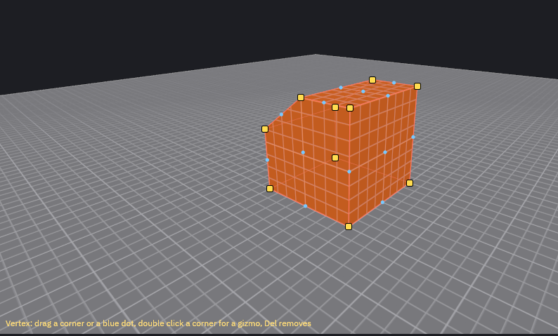

> [!NOTE]
> A brush cannot have dents, so a move that would make one is refused. You get a red ghost where it would land and a
> line in the status bar. Pull the dot outward instead, or convert the brush to a [mesh](meshes.md) for dents and
> overhangs.

### Symmetric editing

To shape both sides of a brush at once, turn on symmetry in the Vertex tool. Its options bar has a menu that reads
**symmetry off**. Pick **X**, **Y** or **Z** and the closed menu reads **symmetry X**, **symmetry Y** or
**symmetry Z**. A second menu after the label **Symmetry Plane** then shows where the plane sits, **selection center** (the middle of the selected
brushes), **world origin** or **custom**, and a number field appears next to it for **custom**. The field starts at the
plane you were just using, so nothing jumps.

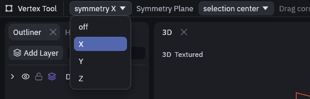

While symmetry is on, the views draw the plane over the selected brushes, red for X, green for Y and blue for Z.
Drag a handle, or pull a dot out of a face or an edge, and the corner on the other side of the plane moves the mirrored
way, in the same undo step. A corner counts as the other side when it sits within half a unit of the mirror image, so a
corner without a partner just moves alone. It also works across brushes: select both pillars of a pair, drag a corner of
one, and the matching corner of the other follows.

A corner you have selected yourself always moves exactly as you drag it. That keeps whole-object moves working with
symmetry on. If either side would turn a brush concave, the whole move is refused, so the halves never drift apart.

The setting is not saved. It is off again every time you start the editor, and it is shared by the
[Mesh tool](meshes.md).

## Polygon brush

For a floor plan, a pillar with five sides or any outline a box cannot make, press the **Polygon** tool in the toolbar,
the pentagon next to Select. It has no key, *Tools > Polygon Tool* does the same.

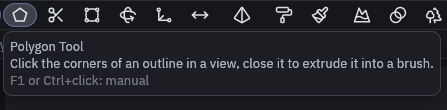

1. Click the corners of the outline in a 2D view. They snap to the grid, and a line follows the mouse to show the next
   edge. In the 3D view, click a surface first and the outline lies on that surface instead.
2. Click the first corner again, or press Enter, to close the outline. Backspace removes the last corner and Escape
   throws the outline away.
3. The outline is extruded and the new brush is selected, in the current material. In a 2D view it is as deep as a
   box drawn there would be, see [Draw and move](#draw-and-move). In 3D it is one grid step thick, pointing out of
   the surface.

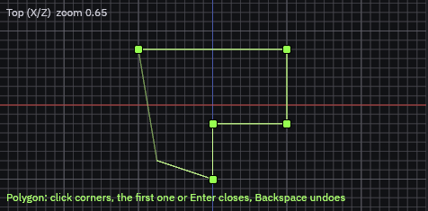

A brush cannot have dents, so an outline with a dent, like an L or a U, is cut into a few convex brushes that sit side
by side. All of them are selected, and one undo takes them back. Winding does not matter, and corners in a straight
line are dropped. An outline that crosses itself is refused with a line in the status bar, press Backspace to remove
the corner that made the crossing.

### Holes

For a courtyard, a floor with a stairwell or a wall with a window, cut holes into the outline before it is extruded.

1. Click the corners of the outline, then hold Shift and click its first corner. The outline stays on screen instead of
   turning into a brush.
2. Click the corners of a hole inside it. To add another hole, hold Shift on the hole's first corner again.
3. Click the first corner of the last hole, or press Enter, to make the brush.

The holes go right through, and what is left is cut into convex brushes like any other outline. A hole has to lie
wholly inside the outline and must not touch another hole, else the status bar says so and nothing is made. Backspace
with no corner placed opens the last closed outline again.

Over MCP, `create_polygon_brush` takes `holes`, a list of outlines in the same `[x, y, z]` form as `points`.

### Walls

To lay out the walls of a room or a corridor, pick **Walls** instead of **Outline** in the mode list of the tool
options bar above the views while the Polygon tool is active. Next to it you set the wall **thickness** (16 units), the **height** (128 units, 4 m) and the side the
walls grow on. The corners you click are then a path, and every stretch between two corners becomes a wall brush. While
you draw, the walls up to the mouse show as faint outlines.

| Side | The walls lie | Use it when |
| --- | --- | --- |
| **Outside** (default) | Outside the path, or away from its turn for an open path | You click the edge of the floor, and the room keeps that size inside |
| **Centered** | Half on each side of the path | You click the middle of the walls, as on a drawn plan |
| **Inside** | Inside the path | You click the outer footprint of the building |

Press Enter to end an open path, like a single wall or an L of two. Click the first corner again to close the path, and
a last wall joins it back to the start, which makes the four walls of a room. Neighbouring walls are mitred so they
meet at the corners without a gap or an overlap. A corner sharper than about 30 degrees would make a long spike, so
those walls end square instead.

The walls of one path go into a new group called Walls, which is selected, so you can move, hide or delete them as one.
Open the group to change a single wall. The walls are plain brushes from then on, they do not remember the path, so to
change the thickness of a whole room, draw it again. To cut a door or window, use a [cutter](#cutters) or Subtract.

> [!NOTE]
> Walls on the grid stay on the grid at right angles. At other angles the mitred corner lands between grid points.

The MCP tool `create_polygon_brush` takes the corners as `points`, the view direction as `axis` (`x`, `y` or `z`) or an
arbitrary `normal`, and the thickness as `height`. Give `wall` a thickness to make walls along the path instead, and
`closed` to join the last corner back to the first.

### Trim

Pick **Trim** in the same mode list to run a skirting board, a kerb or a cornice along a path. You click the corners
the way you click walls, Enter ends an open path and the first corner closes it. Every stretch gets the trim's cross
section, mitred at the corners, and the brushes land in a new selected group called Trim.

| Option | What it sets |
| --- | --- |
| Profile | **Skirting**, **Kerb**, **Cornice** (a stepped moulding) or **Ledge** (a sloped sill) |
| **depth** and **height** | How far the trim sticks out from the path and how tall it is, 4 by 12 units by default |
| Side | **Inside** (default) puts the trim on the side the path turns toward, **Outside** on the other side, **Centered** across the path |

To line a room, click the same corners you clicked for its walls on Outside. The trim then sits against the inner face
of the walls. The trim starts on the plane you click, so for a cornice draw it in a view where that plane is at the
ceiling, or move the group up afterwards. A stepped profile like Cornice is cut into a brush per step and stretch.

`create_polygon_brush` makes trim with `trim`, a profile name or a list of `[x, y]` points of your own cross section,
x away from the path and y along the axis. `trim_size` sets `[depth, height]` for a named profile, and `closed` and
`align` work as for walls.

### Strips

Pick **Strip** in the mode list for a pavement, a road or a raised walkway. Set its **width** (64 units) and
**height** (8 units) next to the list, then click the corners the way you click walls. The strip runs centred on the
path, and Enter or the first corner ends it like a wall path. A new strip goes into a group called Strip.

When you draw a strip that runs into the brushes of an existing Strip group, the new strip is cut back where it
overlaps them and joins that group. That is how you make junctions: start a branch in the middle of a road for a T, or
draw straight across it for a crossing, and the pieces meet flush with no overlapping faces. A strip that crosses itself
is cut the same way. Only brushes in a group named Strip count, so renaming the group keeps later strips out of it.

`create_polygon_brush` makes a strip with `strip`, its width, and `height`. The reply's `joined` says whether it joined
an existing Strip group.

### Rounded corners

For a round tower, a curved kerb or a room with soft corners, set **radius** in the tool options bar next to the mode
list. It is 0 by default, which keeps the corners sharp. Above 0, every corner you click becomes an arc that radius
big, and a **segments** field appears for how many straight pieces each arc is made of (4 by default, up to 16). The
rounding works the same in all three modes and also rounds the holes of an outline. The preview shows the rounded shape
while you draw.

Where two corners sit too close for the radius, each arc shrinks so it takes at most half of the stretch between them,
so arcs never overlap. A square with a radius of half its side becomes a circle. The two ends of an open path stay
sharp. A rounded outline is still convex where the clicked one was, so it stays one brush, while walls and trim get a
brush for every piece of each arc.

`create_polygon_brush` takes `round` as `[radius, segments]`, for outlines, holes, walls and trim alike.

## Rotate, scale and measure

| Tool | Input | Result |
| --- | --- | --- |
| **Rotate** (R) | Drag a ring around the selection | Rotates in 15° steps, with Shift in 1° steps. A 2D view has one ring, around the axis it looks along |
| **Scale** (T) | Drag a handle on the selection's bounds | Resizes on the grid, with Alt on both sides at once so the center stays put. The 3D view has a handle on each side |
| **Measure** (M) | Drag, or click two points | Shows the distance in units and meters, and at the bottom of the view its X, Y, Z and horizontal parts |

### Transform by numbers

For an exact move, turn or resize, select the objects and open *Brush > Transform > Transform Selection…*. In the Hammer
preset **Ctrl+M** opens it too. It is also in the command palette (Ctrl+Shift+P).

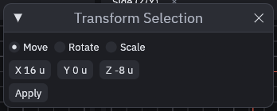

1. Pick **Move**, **Rotate** or **Scale**. Each keeps its own X, Y and Z values until you quit the editor, also after you close the window.
2. Type the numbers. **Move** is in units, **Rotate** in degrees and **Scale** is a factor, so 2 doubles the size and
    0.5 halves it.
3. Press **Apply** or Enter. The selection changes as one undo step.

Rotate and Scale work around the selection's center, snapped to the grid like the other tools. A line below the fields
tells you why Apply is greyed out: nothing is selected, a scale factor is 0, or the values would change nothing. A
negative scale factor mirrors the selection on that axis.

## Align and distribute

To line up several objects, select them and open *Brush > Transform*. Each brush, mesh, entity and group counts as one
object, and a group or brush entity moves as a whole.

1. Select two or more objects.
2. Open *Brush > Transform > Align* and pick an axis and an edge, for example **Align Y Min** to put every bottom on the
   lowest one. **Min**, **Center** and **Max** refer to the combined bounds of the selection, and Y is up.
3. To space objects evenly, select three or more and pick *Brush > Transform > Distribute* and an axis. The objects
   with the lowest and highest center on that axis stay where they are, and the ones between them move so every gap is
   the same.

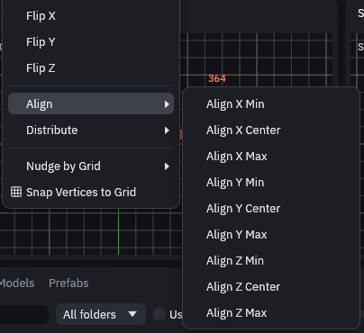

Each command is one undo step and moves by exact amounts, so the results are not snapped to the grid. If the objects
already line up, the status bar says so and nothing changes. Objects that overlap along the axis end up with the same
overlap between each pair.

### Drop to Floor

To set crates, props or a group down on the ground, select them and pick *Brush > Transform > Drop to Floor*. Each
object moves straight down until it touches the first visible brush, terrain or object under it, so a crate on a slope
or a stair edge lands where it meets it. The lowest objects drop first, so a stack of selected crates settles on top of
each other. Trigger and cutter brushes are ignored, and an object with nothing under it stays where it is. The drop is
one undo step.

Over MCP, run `run_action` with `drop_to_floor`. It fails when nothing moves.

## Mirror

For a symmetric building, a pair of windows or a left and a right wing, build one half and let the editor keep the other
half as its reflection. **Mirror Linked** copies the selection as a [linked copy](organizing.md#groups) flipped across a
plane, so a change in either half shows up in both.

1. Select what you built. A selected group is mirrored as it is, and anything else you selected is wrapped in a group
    named *Mirrored* first.
2. Open *Edit > Groups*. Under **Mirror Plane** you decide where the plane sits, see the table below. The default is
    **max side**, which puts the plane on the selection's edge so the halves meet.
3. Click **Mirror Linked X**, **Mirror Linked Y** or **Mirror Linked Z**, the axis the plane stands across. The mirrored
    copy is selected afterwards, and the status bar says where the plane went.

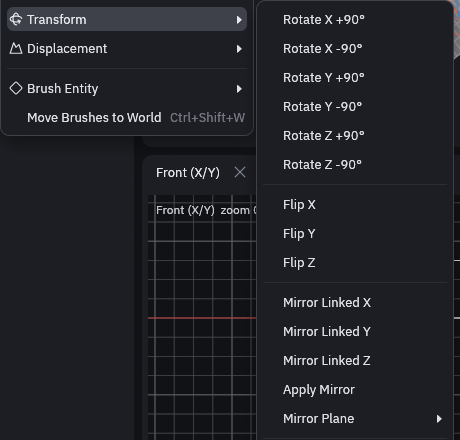

The **Transform** section of the Inspector has the same three buttons and a **Mirror Plane** menu. While a half of a
mirrored pair is selected, the Inspector also shows a **Mirror** section below it, already open, with the plane, the gap
and the buttons for the pair.

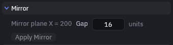

The **Mirror Plane** menu in the Inspector holds the same choices as the submenu.

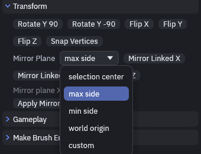

| Mirror Plane | Where the plane goes |
| --- | --- |
| **selection center** | Through the middle of the selection. The copy lands on top of it, so use this for something that sits across the plane already |
| **max side** | On the side of the selection with the larger coordinate. The copy sits beside it and the halves meet |
| **min side** | The same on the side with the smaller coordinate |
| **world origin** | Through 0 on the axis, however far away the selection is |
| **custom** | At the position you type next to the menu, in map units (32 per meter) |

The setting is shared by every map tab and is not saved, it starts at **max side** again when you launch the editor.

While a half of a mirrored pair is selected, the views draw the plane as an outline in the color of its axis, red for
X, green for Y and blue for Z, and the other half gets a violet outline so you can see which one belongs to your
selection. A 2D view that looks along the plane shows it as a thick line reaching past both halves, so it stands out
from the grid and from the edges where the halves meet. The Mirror section in the Inspector reads
*Mirror plane X = 200*, the position along that axis. Move one half towards the other or away from it and the outline
moves too, it stays halfway between the halves as in the picture below. Slide a half along the plane, or rotate it so
it is no longer a plain mirror, and the outline goes away. For a rotated half the Mirror section says it *was
rotated and no longer mirrors its partner*, rotate it back to get the plane, **Gap** and **Apply Mirror** back.

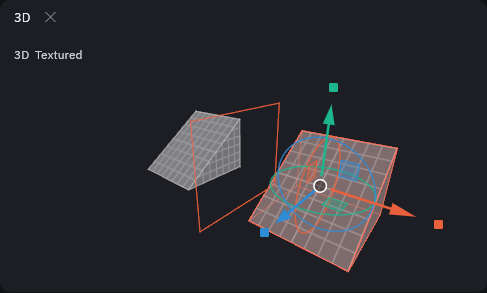

### Moving the halves

Each half moves on its own. Drag one and the other stays where it is, the same as for any linked copy. That keeps the
plane honest, you decide what happens to each side. What you edit inside a half is still mirrored, see below.

* **To move both together**, select one half and run *Edit > Groups > Select Linked Groups*, then drag. The same
  command is in the right click menu of the Outliner and the views.
* **To space the halves apart**, type a number into **Gap** in the Mirror section. It is the distance between the two
  halves in map units, and both move by the same amount, so the plane stays where it is. Dragging the field is one undo
  step. The gap goes up to 65536 units, 2048 m. A negative gap pulls them into each other, down to minus the width of the
  narrower half, below that it stops. Gap counts brushes and meshes, not decals or entities. If the pair has more
  linked copies, the Gap moves every copy on each side along with its half, hidden ones included. Mirror a pair again
  and the four quarters share each plane, so the section lists each plane once and its Gap moves all four. A locked
  copy stops it, the status bar names it, unlock it first.
* **To put the halves back across from each other** after you slid one along the plane, click **Mirror Again** in
  the Mirror section. The partner moves to the mirror image of the selected half in one undo step, and the status bar says how
  far it moved. The button only shows while a half is slid, and the section says by how much, for example *half is slid
  15 units along the mirror plane X = -40*. While it shows, the section has no **Gap** field and no **Apply Mirror**, they
  come back once the halves mirror again. Moving a half towards or away from the other is not a slide, the plane just
  follows and **Gap** shows the new distance. Hidden copies move back with the rest, a locked one stops **Mirror Again** and the status bar names it.
* **To free one half**, run *Edit > Groups > Separate Linked Groups* on it. The two become plain groups you can change
  however you like, and the plane no longer applies. Searching the command palette for *Make Unique* finds it too.

> [!WARNING]
> The gap is empty space, nothing fills it. On a mirrored room the floor, walls and ceiling are all open along that
> strip, and a player in Godot falls straight through it. Set **Gap** back to 0 before you close the room with
> **Apply Mirror**.

Double click a half to open it, then edit inside it as in any linked group, and the other half follows when you finish
the edit, for example when you let go of a drag. That includes moved vertices, resized brushes and face materials, all mirrored, with the faces
still pointing outwards and the textures mirrored too. If a single edit reaches both halves and would leave them
different, for example nudging a vertex of each by the same amount, which the mirror turns into two different moves,
the editor refuses it and tells you in the status bar.

When the design is done, select either half and click **Apply Mirror** (in the Mirror section of the Inspector, and in
*Edit > Groups*, where it is greyed out until a mirrored pair is selected). It turns the pair into plain geometry in
one undo step, with the link gone. The halves have to meet, so while **Gap** is above half a unit the button in the
Inspector is greyed out, set it to 0 first. The menu entry stays clickable and the status bar says the halves do not
meet. A negative gap, with the halves pushed into each other, is fine.

* Brushes whose two halves form one convex shape are joined into a single brush.
* Meshes are joined and their seam is welded, so a closed shape stays closed. Vertices within half a unit of the plane
  count as part of the seam. Only the seam is welded, so mesh halves should meet at the plane rather than overlap, or
  the overlapping part stays doubled.
* Everything else, such as a brush pair that would not be convex together, stays as separate plain brushes in one group.

The result stays in the group of the first half, *Mirrored* when the editor made it, and *Edit > Groups > Ungroup*
takes it out. If the halves do not meet, the status bar tells you so and nothing changes, and
*Edit > Groups > Separate Linked Groups* is the way to keep both halves as separate plain copies instead.

> [!NOTE]
> Mirror Linked flips everything the way **Flip** does. A terrain mirrors across X and Z, and across Y it stays upright
> instead of turning upside down. An entity mirrors its angles, and Terrain3D nodes are skipped.

The MCP action `mirror_linked` takes `axis`, `plane` (center, max, min, world or custom), `at` and `gap`, and
`set_mirror_gap` takes `gap` and an optional `axis`. `mirror_again` puts the partner back across from the selected half,
`select_linked` selects every copy of the linked groups in the selection and `separate_linked_groups` frees them.
`apply_mirror` takes `distance`, the largest gap it applies at and the weld tolerance at the seam, in units. `get_state` lists the planes of the selection as
`mirror_planes`, each with its `gap`. A pair with a slid half has no plane, `get_state` lists it as `mirror_slides`
instead, with the `slide` and its `distance`, the same distance `mirror_again` moves the partner back. `set_editor` takes
`edit_symmetry` for the Vertex tool.

## Shear

The Shear tool slants the selection, so a box becomes a parallelepiped. Use it for leaning walls, slanted doorways and
ramps that a plain scale cannot make.

1. Select what you want to slant, brushes, groups and brush entities all work.
2. Pick the Shear tool with Shift+R, or in *Tools > Shear Tool*. An orange box shows the selection's bounds.

    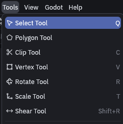

3. Point at a side of the box. In the 3D view the side lights up when the pointer is over it, in a 2D view the edge
    nearest the pointer does.
4. Drag the side. It slides parallel to itself while the opposite side stays where it is, and the selection follows live.

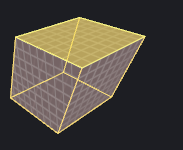

The slide snaps to the grid. Which way it runs depends on the view:

| View | The side slides |
| --- | --- |
| A 2D view | Along the view's axis that is parallel to the side |
| The 3D view | In whichever direction you drag further. Hold Shift to slide both ways at once |

Esc cancels the drag, and one undo takes back the whole shear. Textures stay locked to the faces while UV lock is on.

Brushes and meshes slant. Point entities and prefab instances move along with the part of the box they sit in but
keep the way they face. Terrains and scatters cannot slant, so they stay where they are.

Over MCP, `transform` takes `shear` with a `side` (such as `+y`), the axis it slides `along` and the `amount`.

## Shape Generator

For cylinders, arches, stairs, roofs and other shapes that would take a lot of hand drawn brushes, use the Shape
Generator.

1. Draw a box where the shape should go and leave it selected, or select nothing to give the generator a box of its
   own, see below.
2. Open *Brush > Shape Generator…* (Ctrl+Shift+B).
3. Pick the **Shape** and its options. With a selection the dialog says the bounds it fills, and that it replaces the
   selection. The views draw the shape in cyan lines while you change the options, so you can see it before anything
   changes.
4. Click **Create**.

The new shape stays selected, so you can change an option and click **Create** again to swap it for the next try,
for example to go through a few rock seeds. Under the options the dialog counts the objects and triangles it would
make. The triangle count turns yellow past 10,000, since a shape that heavy can slow the editor down.

To reuse a shape you have tuned, such as a pillar or a rock you like, type a name in the field next to **Preset** at
the top of the dialog and click **Save Preset**. It keeps the shape and all its options, not the box. Pick it from the
**Preset** list later, in this map or any other, to load those settings again. Saving under a name that exists replaces
that preset, and **Delete** removes the preset named in the field.

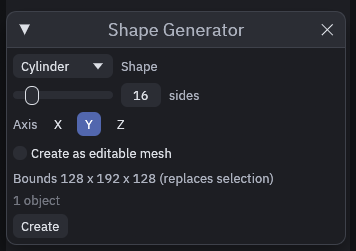

### Without a selection

With nothing selected you do not need a brush first. The dialog hands you a box of its own, drawn in indigo lines in
every view, with the cyan shape inside it. It starts around the last brush you drew or clicked, rounded to the grid.

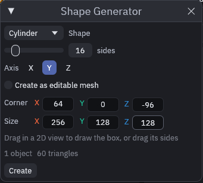

Set the box in either of two ways:

* Type its **Corner** (the lowest X, Y and Z) and its **Size** under the options. The box scales away from the corner,
  like [the Inspector's fields](#exact-position-and-size). The Text shape only uses the corner, so it has no **Size**.
* With the Select tool in a 2D view, drag one of the box's sides to resize it, or drag anywhere else to draw a new box,
  the way you draw a brush. The box keeps its depth along the axis the view looks down.

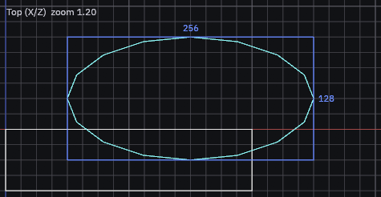

Nothing is added to the map, and nothing lands in the undo history, until you click **Create**. The shape then goes into
the current group or layer and stays selected, so the next **Create** replaces it. A drag in the 3D view still draws a
real brush, and since that brush is then selected, the dialog switches to filling it. Closing the dialog forgets the
box, and the next time it starts around the last brush again.

`get_state` reports the box as `ui.shape_bounds`, with `min` and `max`, while the dialog shows it, and null otherwise.
Use the same numbers as `min` and `max` of `create_brush` or `create_mesh` to build the shape without the dialog.

The torus, arch wall, gable roof, spire and grid are always made as a [mesh](meshes.md). Cylinders, cones, spheres and
rocks are brushes unless you tick **Create as editable mesh**, and **Smooth shading** then rounds them off. A few
shapes have options of their own. **Rock** fills the box with a stone:

| Shape | Option | What it does |
| --- | --- | --- |
| Cylinder, Cone | **Axis** | Stands upright on **Y**. Pick **X** or **Z** to lay it down inside the same box, for pipes, logs or a beam, instead of rotating it afterwards |
| Arch, Arch Wall | **Angle** | How much of a circle the arch sweeps, 10 to 180 degrees. On an Arch, 180 is a half ellipse as wide and as tall as the box. Below 180 it is a segment of a circle whose ends stand on the bottom corners of the box, so it gets flatter as the angle drops and the box height only caps how high it rises, see [Doorways and tunnel floors](#doorways-and-tunnel-floors). On an Arch Wall the angle shapes the top of the opening, 180 being a half circle. A flat arch thins its wall when it would not leave an opening |
| | **Radius** | The radius of that circle in map units. It follows the angle, and typing a radius sets the angle, down to half the arch width |
| Tunnel | **Profile** | The cross section, **Square**, **Arched** or **Round**, with options for the floor, ceiling, walkways, axis, a bend and a slope. See [Tunnels](tunnels.md) |
| Rock | **Roughness** | How lumpy the stone is |
| | **Facets** | Chips flat faces into it |
| | **Flat base** | Cuts the underside flat so it sits on the ground |
| | **Seed** | A different stone of the same kind |
| | **Detail** | With **Create as editable mesh**, how finely the surface is divided |
| Pillar | **sides** | A column filling the box: a square plinth and abacus, and a round base, shaft and capital with that many sides, each round part one brush. The round parts take the smaller of the box's width and depth |
| Text | **Text** | The letters to build, A-Z, 0-9 and some punctuation, Enter for a new line. The shape turns them into block letters made of brushes, for signs and floor lettering |

As a brush the rock is one low poly convex stone that works with CSG and collides like any brush. As an editable mesh it
keeps its dents and overhangs.

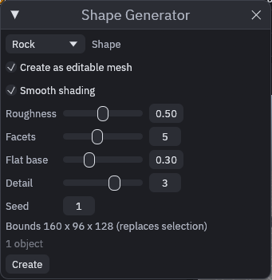

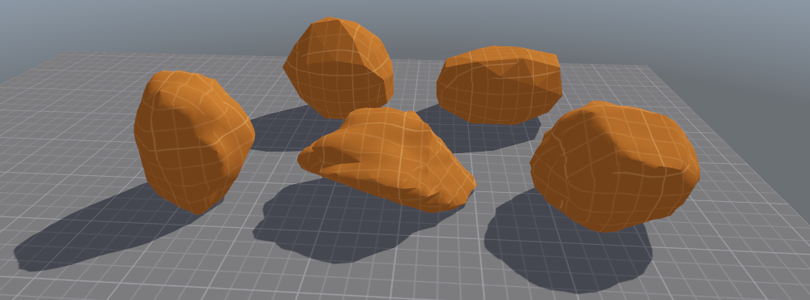

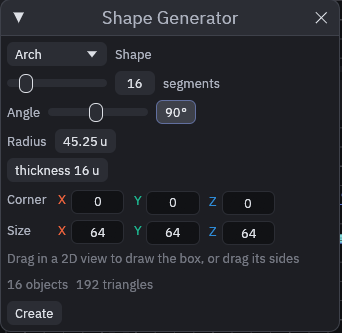

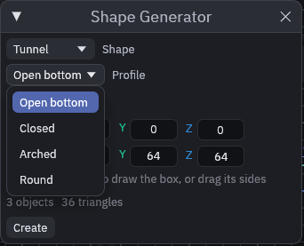

### Doorways and tunnel floors

An **Arch** is only the curved ring. Its two ends stand on the bottom of its box, so the box bottom is where the curve
starts, not the ground of a doorway. Below 180 degrees the ring is also lower than its box, it rises half its width
times tan(angle / 4). In a box 192 wide and 128 high, 180 gives a ring 128 u high, while 120 rises only about 55 u
(1.7 m) and 90 about 40 u, too low to walk under.

To build an archway you can walk through, stand the arch on jambs:

1. Draw two jamb brushes, for example 16 wide and 96 high (3 m), with a 128 u gap between them.
2. Draw a box on top of the jambs, from the outer side of one to the outer side of the other (160 wide), as high as the
   arch may rise, and open the Shape Generator with it selected.
3. Pick **Arch** and set **Angle**. At 120 degrees with the default 16 u thickness the ring rises about 46 u, so the
   opening under it is about 126 u (3.9 m) high at its middle.

The ring leaves open corners between its curve and the top corners of its box, so a wall around it needs brushes beside
the jambs and over those corners. For a solid wall with an arched opening in it, use **Arch Wall** instead. It is one
[mesh](meshes.md) with the opening already cut down to the floor of its box, and in Godot it collides as its exact
shape, so the opening stays walkable.

A **Square** or **Arched** tunnel without **Floor** has no floor, the player walks on whatever lies at the bottom of
the box. With **Floor**, and in a **Round** tunnel, the floor is its own slab, one thickness above the box bottom, 16 u
(0.5 m) by default. That is a step a 1.8 m tall character cannot walk up. When you chain tunnels into one corridor,
lower a box with a floor by its thickness so its inner floor lines up with the floor before it, or lead up to it with
a ramp.

## Bevel Edges

To take the hard edge off a step, a pillar or a door frame, bevel it. The brush keeps one piece and stays convex,
each bevel only adds faces.

1. Select the brushes. To bevel only some edges, switch to the Vertex tool, click one corner of an edge and Ctrl+click
   the other. An edge counts when both its corners are picked, so picking all four corners of a face takes its four
   edges.
2. Open *Brush > Bevel Edges…*. A cyan outline shows the brushes as they would come out. With no corners picked, every
   edge of the selected brushes is bevelled.
3. Set **Width**, how far the cut reaches into both faces beside the edge, and **Segments**. One segment cuts the edge
   off flat, more round it off along an arc.
4. Click **Bevel**. One undo puts the edges back.

The new faces carry on the texture of the face they lean towards. A width that would reach across a whole face beside
the edge is refused, try a smaller one.

The MCP tool `bevel_edges` takes the brushes as `ids` or the selection, `edges` as pairs of corners, `width` and
`segments`.

## Add Roof

To put a roof on a house, block out its walls or its floor plan first. Each selected brush becomes one wing of the
roof, and the roof rests on the highest top among them.

1. Select the brushes the roof covers, one per wing: one for a plain house, two for an L or a T.
2. Open *Brush > Add Roof…*. A cyan outline shows the roof it would make, in the current material.
3. Set **Pitch**, the slope of every roof face in degrees, and **Ends**: **Gable** stops a ridge in an upright triangle,
   **Hip** slopes it down too.
4. Click **Add Roof**. The roof brushes are selected, and one undo removes them.

Each ridge runs along the longer side of its wing. Where a wing runs into another one, its ridge goes on to the middle
of that wing, so the two roofs meet in valleys, and only the free ends get a gable or a hip. All wings share one pitch,
so a narrower wing gets a lower ridge. The roof is solid and its brushes do not overlap.

The MCP tool `create_roof` takes the wings as brush `ids` or the selection, or as `wings` of `min` and `max` corners
on the floor plan with a `base` height, plus `pitch`, `ends` and `material`.

## Bridge Faces

To close the gap between two pieces, bridge their faces. The new brush wraps both faces, so the top faces of a low
and a high platform give a ramp between them, and two walls facing each other give a beam or a plug that fills the
gap.

1. Select the two faces in the 3D view. Shift+click picks the first and Ctrl+Shift+click adds the second, or use the
   Texture tool and click and Ctrl+click. Both faces may sit on one brush.
2. Open *Brush > Bridge Faces*. The new brush is selected and joins the group or entity of the first face's brush.

Each new face copies the material and alignment of the face on either brush that points most the same way, so a ramp
between two floors keeps the floor on top.
Two faces in one plane hold nothing between them, and the status bar says so.

Over MCP, select the faces and call `run_action` with `bridge_faces`.

## Sweep Faces

To carry a corridor, pipe or trim on round a corner, sweep the faces at its end. Each face is pushed along a path
and leaves a run of brushes behind it, with the materials of the brush it came from.

1. Select the faces at the end of the run in the 3D view, for example the floor and both walls of a corridor.
   Shift+click picks the first and Ctrl+Shift+click adds the others, or use the Texture tool and click and Ctrl+click,
   which also works in the Hammer preset.
2. Open *Brush > Sweep Faces…*. A cyan outline shows the brushes it would make.
3. Pick **Straight**, **Arc** or **S-bend** and set the path. **Radius** is measured from the center of the turn to the
   middle of the faces, and **Direction** is seen looking at the faces.
4. Click **Create**. The new brushes are selected, and they join the group or entity of the brush they came from, so
   sweeping the end of a `func_door` makes the door longer.

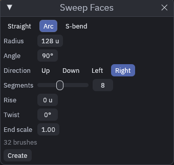

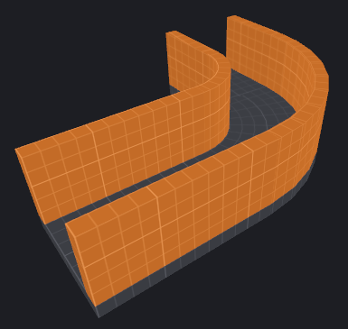

These options shape the run:

| Option | What it does |
| --- | --- |
| **Segments** | More of them make a smoother curve |
| **Rise** | Lifts the end, so an arc with rise becomes a spiral ramp |
| **Twist** | Turns the faces about themselves along the way |
| **End scale** | Grows or shrinks the faces on the way, 1 keeps them as they are |

An arc tighter than the faces are wide would fold over on its inner side, the dialog says the smallest radius that works
instead. All picked faces travel the same way, along their average direction, so pick faces that point the same way, like
the end of a corridor. Faces at an angle to each other would go out on a slant.

For a path of your own shape:

1. Place a few points ahead of the faces with the **Path** tool (Shift+P, see
   [Placing and wiring](../gameplay/placing.md#placing-entities)).
2. Pick **Curve** in the dialog. The curve leaves the faces straight out and runs smoothly through the points in order.
   With one point it bends as a circular arc, so a point as far to the side as it is ahead turns the run a quarter
   and ends it square. With more points the run ends along the line from the second last point to the last.
   **Points** picks which chain to follow, by default the one that starts nearest the faces.
3. Move a point or add one to the chain and the cyan outline follows, so you can shape the run before you click
   **Create**. A bend tighter than the faces are wide is refused, spread the points further apart then.

The MCP tool `sweep_faces` takes the same settings, with the faces as `[brush id, face index]` pairs or the selected
faces when none are given. A curve takes `points` as `[[x, y, z], ...]`, or `chain`, the targetname or id of the first
point entity of a chain.

## Place Along Path

To run a fence, a rail, a road or a cable along a curve, lay out the curve with points and let the editor place the
pieces along it.

1. Place a few points with the **Path** tool (Shift+P, see [Placing and wiring](../gameplay/placing.md#placing-entities)).
   The curve runs smoothly through them in order.
2. Build one piece, such as a fence post or a short slab of road, and select it.
3. Open *Brush > Place Along Path…*. The dialog takes the selection as its piece, and a cyan outline shows what it
   would make. **Points** picks which chain to follow, by default the one that starts nearest the piece.
4. Pick a mode and click **Create**. What it made is selected, and one undo takes all of it away again.

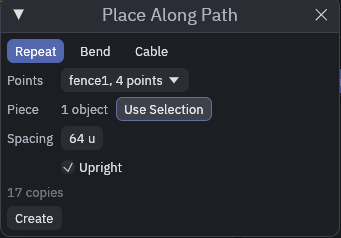

| Mode | What it makes |
|---|---|
| **Repeat** | Copies of the piece about **Spacing** apart, evened out so the first and last copy sit on the ends of the path. **Upright** keeps them standing straight on a slope. |
| **Bend** | The piece laid end to end and bent along the path, one mesh for each of its brushes and meshes, with the texture running on. The copies stretch a little so only whole ones fit. On a long path a detailed piece bends in coarser steps, and one too detailed to bend is refused rather than stalling the editor. |
| **Cable** | A round cable in the current material that hangs **Sag** units below the straight line in the middle of each span. It needs no piece. |
| **Stairs** | Straight flights of steps in the current material, **Width** wide, from point to point, with a landing at each point between the ends. Each point's height is the floor there, and each flight takes as many steps as it needs to stay at or under **Step height**. **Clip ramp** adds a clip brush over each flight so players walk up it smoothly. **Winding corners** turns a corner of 30 to 120 degrees on wedge steps instead of a landing when both flights climb the same way, the point's height then sits in the middle of the turn. It needs no piece. |

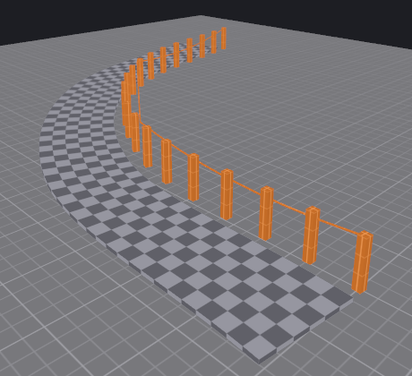

The longer side of the piece, X or Z, runs along the path and its bottom sits on it, so build a post standing up and a
road slab lying flat. The dialog keeps its piece while it is open, so you can select and move the path's points to
reshape the curve and the outline follows. Click **Use Selection** to swap in another piece.

The MCP tool `place_along_path` takes `mode` (`repeat`, `bend`, `cable` or `stairs`), the piece as `ids` or the selection, and the
curve as `points` or `chain` like `sweep_faces`, plus `spacing`, `upright`, `sag`, `radius`, `sides`, `width`, `step_height`, `clip_ramp`, `winders` and `material`.

## CSG

The CSG operations are under *Brush > CSG*, which also holds their two settings.

All four also have a button in the toolbar, to the right of the snapping and UV lock buttons.

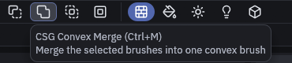

| Operation | Key | Result |
| --- | --- | --- |
| Subtract | Ctrl+K | Carves the selection out of every brush it touches, then deletes the selection. A selection that touches no other brush is kept and the status bar says so |
| Hollow | Ctrl+Shift+K | Turns a brush into walls around its old volume, 16 units thick unless you change *Wall thickness* in the same menu. A brush too thin for two walls is left alone |
| Convex Merge | Ctrl+M | Fuses the selection into one convex brush that wraps it |
| Intersect | Ctrl+L | Keeps only where the selected brushes overlap |

To punch a doorway or window, place a brush where the hole goes and Subtract it,
[Build your first room](../getting-started.md) walks you through one. The faces a cut opens take the cutter's material,
unless you tick *Carved faces keep the target's material* in the same menu.

### Cutters

Subtract changes the wall for good, so moving the doorway later means patching the wall back together. A cutter keeps
the hole movable instead:

1. Place a brush where the hole goes.
2. Select it, right click and pick *Create Brush Entity*, then pick **func_cutter**.
3. The brush turns see-through like a trigger, and every brush it overlaps shows the hole.

Move, resize or delete the cutter and the hole follows. The walls stay whole in the map, only the Godot build and the
3D view use the cut pieces, and the faces the hole opens take the wall's material. When the hole should stay where it
is, select the cutter and Subtract it (Ctrl+K) to cut the walls for real.

> [!NOTE]
> Clicking through the hole still selects the wall. Baked lighting does not reach cut pieces, so they build without
> light map coordinates and look unlit in a baked map. Bake the cutter with Subtract before you bake the lighting.
> A cutter only cuts the brushes of its own map, not the contents of a prefab instance.

## Displacements

For uneven ground inside a brush level, like a rubble slope, you can turn a face into a displacement and sculpt it.

1. Select a four sided face with Shift+click (in the Hammer preset, with the Texture tool), or select the brush to use
   its top face.
2. Open *Brush > Displacement* and pick one of the **Create** entries. A higher power gives a finer grid.
3. The **Sculpt** tool (G) switches on by itself, drag over the face to shape it.

For bigger outdoor areas a [terrain](terrain.md) works better.
