# Brushes and CSG

Brushes are what you build most of a level from. They are quick to draw, snap cleanly to the grid and turn into meshes
with matching collision in Godot. Everything here uses the **Select** tool (Q), unless a section names another tool.

## Draw and move

Drag anywhere off the selection, in any view, and a box follows the mouse. The 2D views print its size next to it. In
the 3D view it starts on the surface under the cursor and is one grid step thick. In a 2D view it takes the depth of
what is selected, like in Hammer and TrenchBroom. With a floor selected you can draw more floors of the same height
from the Top view alone. With nothing selected it takes the depth of the last brush you drew, 128 units for the very
first one. Untick *New brush depth from selection* in *File > Preferences* to always use the last brush's depth.

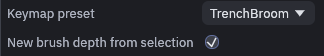

Once a brush is selected you can move it around:

| Input | Result |
| --- | --- |
| Drag the selection | Move it, Shift locks to the main axis |
| Ctrl+drag the selection | Move a copy, the original stays |
| Alt+drag the selection (3D) | Move vertically. Started off the selection, Alt+drag orbits the camera |
| Arrow keys, Page Up, Page Down | Nudge by one grid step |
| `[` and `]` | Halve and double the grid |

In 3D the selection also gets a move, rotate and scale gizmo. Rotation snaps to 15°, or 1° with Shift. If it gets in
your way, turn it off under *View > Transform Gizmo*.

## Exact position and size

Sometimes you want exact numbers, like a door cutter exactly as deep as the wall. Select the brush and type them into
the **Inspector** on the right.

Position is the lowest corner, the smallest X, Y and Z, which is the corner that usually sits on the grid. A new size
grows the selection away from that corner, so the position stays put. Dragging a field steps by the grid while
snapping is on, a typed value is kept exactly. The same fields show up for meshes, a brush entity and a selection of
several objects.

## Reshape

You can reshape a selected brush without leaving the Select tool:

| Input | Result |
| --- | --- |
| Shift+drag a selected face (3D) | Push or pull that face |
| Ctrl+Shift+drag a selected face (3D) | Extrude a new brush out of it |
| Drag a selection edge (2D) | Resize. The edge lights up yellow and the cursor changes where a drag resizes |

While snapping is on, a face you drag lands on a grid line, even when the brush was off the grid before. Slanted faces
move in grid steps instead.

For slopes, ramps and angled walls, press C for the **Clip** tool:

1. Click two or three points along the cut. They snap to the grid, and in 3D they land on the surface you click.
2. Press Tab to pick what to keep, the front, the back or both halves. The text at the bottom of the view tells you
   which one is active.
3. Press Enter to cut. Backspace removes the last point if you misclicked.

To drag single corners, press V for the **Vertex** tool, or Tab with brushes selected. It shows handles on the corners,
and small blue dots on the edge midpoints and face centers. Click a dot to select it, or drag it away from the brush
to add a corner there. Delete removes the selected vertices.

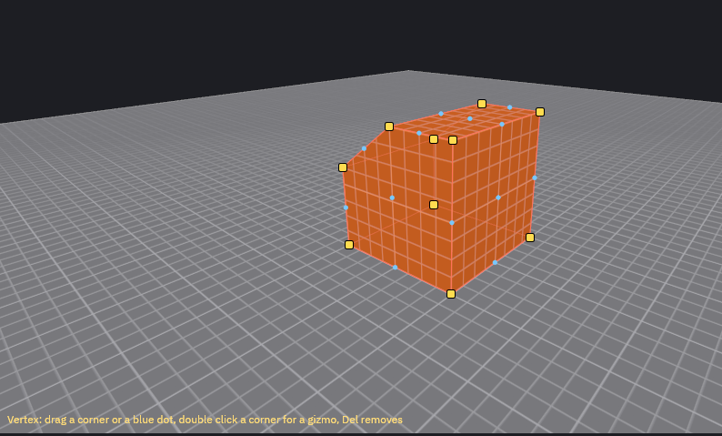

> [!NOTE]
> A brush cannot have dents, so a move that would make one is refused. You get a red ghost where it would land and a
> line in the status bar. Pull the dot outward instead, or convert the brush to a [mesh](meshes.md) for dents and
> overhangs.

## Polygon brush

For a floor plan, a pillar with five sides or any outline a box cannot make, press the **Polygon** tool in the toolbar,
the pentagon next to Select. It has no key, *Tools > Polygon Tool* does the same.

1. Click the corners of the outline in a 2D view. They snap to the grid, and a line follows the mouse to show the next
   edge. In the 3D view, click a surface first and the outline lies on that surface instead.
2. Click the first corner again, or press Enter, to close the outline. Backspace removes the last corner and Escape
   throws the outline away.
3. The outline is extruded and the new brush is selected, in the current material. In a 2D view it is as deep as a
   box drawn there would be, see [Draw and move](#draw-and-move). In 3D it is one grid step thick, pointing out of
   the surface.

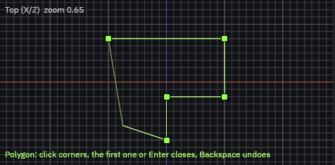

A brush cannot have dents, so an outline with a dent, like an L or a U, is cut into a few convex brushes that sit side
by side. All of them are selected, and one undo takes them back. Winding does not matter, and corners in a straight
line are dropped. An outline that crosses itself is refused with a line in the status bar, press Backspace to remove
the corner that made the crossing.

The MCP tool `create_polygon_brush` takes the corners as `points`, the view direction as `axis` (`x`, `y` or `z`) or an
arbitrary `normal`, and the thickness as `height`.

## Rotate, scale and measure

| Tool | Input | Result |
| --- | --- | --- |
| **Rotate** (R) | Drag a ring around the selection | Rotates in 15° steps, with Shift in 1° steps. A 2D view has one ring, around the axis it looks along |
| **Scale** (T) | Drag a handle on the selection's bounds | Resizes on the grid, with Alt on both sides at once so the center stays put. The 3D view has a handle on each side |
| **Measure** (M) | Drag, or click two points | Shows the distance in units and meters, and at the bottom of the view its X, Y, Z and horizontal parts |

## Align and distribute

To line up several objects, select them and open *Brush > Transform*. Each brush, mesh, entity and group counts as one
object, and a group or brush entity moves as a whole.

1. Select two or more objects.
2. Open *Brush > Transform > Align* and pick an axis and an edge, for example **Align Y Min** to put every bottom on the
   lowest one. **Min**, **Center** and **Max** refer to the combined bounds of the selection, and Y is up.
3. To space objects evenly, select three or more and pick *Brush > Transform > Distribute* and an axis. The objects
   with the lowest and highest center on that axis stay where they are, and the ones between them move so every gap is
   the same.

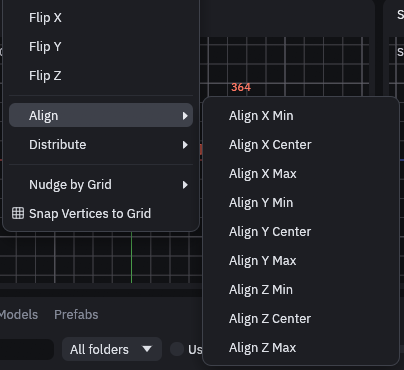

Each command is one undo step and moves by exact amounts, so the results are not snapped to the grid. If the objects
already line up, the status bar says so and nothing changes. Objects that overlap along the axis end up with the same
overlap between each pair.

## Shear

The Shear tool slants the selection, so a box becomes a parallelepiped. Use it for leaning walls, slanted doorways and
ramps that a plain scale cannot make.

1. Select what you want to slant, brushes, groups and brush entities all work.
2. Pick the Shear tool with Shift+R, or in *Tools > Shear Tool*. An orange box shows the selection's bounds.
3. Point at a side of the box. In the 3D view the side lights up when the pointer is over it, in a 2D view the edge
    nearest the pointer does.
4. Drag the side. It slides parallel to itself while the opposite side stays where it is, and the selection follows live.

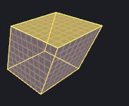

The slide snaps to the grid. In a 2D view it runs along the view's axis that is parallel to the side. In the 3D view it
follows whichever direction you drag further, and holding Shift frees it to slide both ways at once. Esc cancels the
drag, and one undo takes back the whole shear. Textures stay locked to the faces while UV lock is on.

Brushes and meshes slant. Point entities and prefab instances move along with the part of the box they sit in but
keep the way they face. Terrains and scatters cannot slant, so they stay where they are.

Over MCP, `transform` takes `shear` with a `side` (such as `+y`), the axis it slides `along` and the `amount`.

## Shape Generator

For cylinders, arches, stairs, roofs and other shapes that would take a lot of hand drawn brushes, use the Shape
Generator.

1. Draw a box where the shape should go, and leave it selected.
2. Open *Brush > Shape Generator…* (Ctrl+Shift+B).
3. Pick the **Shape** and its options. The dialog says the bounds it fills, and that it replaces the selection. The
   views draw the shape in cyan lines while you change the options, so you can see it before anything changes.
4. Click **Create**.

The new shape stays selected, so you can change an option and click **Create** again to swap it for the next try,
for example to go through a few rock seeds. Under the options the dialog counts the objects and triangles it would
make. The triangle count turns yellow past 10,000, since a shape that heavy can slow the editor down.

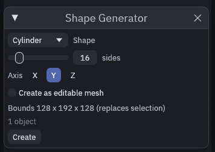

Cylinders and cones stand upright by default. Pick **X** or **Z** under **Axis** to lay one down inside the same box,
for pipes, logs or a beam, instead of rotating it afterwards. The torus, arch wall, gable roof, spire and grid are
always made as a [mesh](meshes.md). Cylinders, cones and spheres can be one too with **Create as editable mesh**, then
**Smooth shading** rounds them off. The **Text** shape builds block letters from brushes, for signs and floor
lettering.

**Rock** fills the box with a stone. **Roughness** sets how lumpy it is, **Facets** chips flat faces into it and
**Flat base** cuts its underside flat so it sits on the ground. Change the **Seed** for a different stone of the same
kind. As a brush the rock is one low poly convex stone that works with CSG and collides like any brush. With **Create
as editable mesh** it keeps its dents and overhangs, and **Detail** sets how finely the surface is divided.

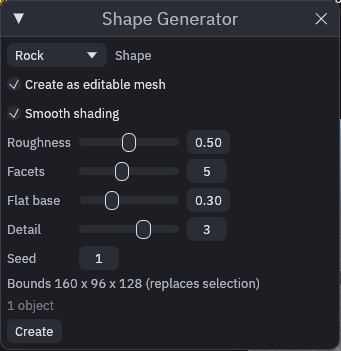

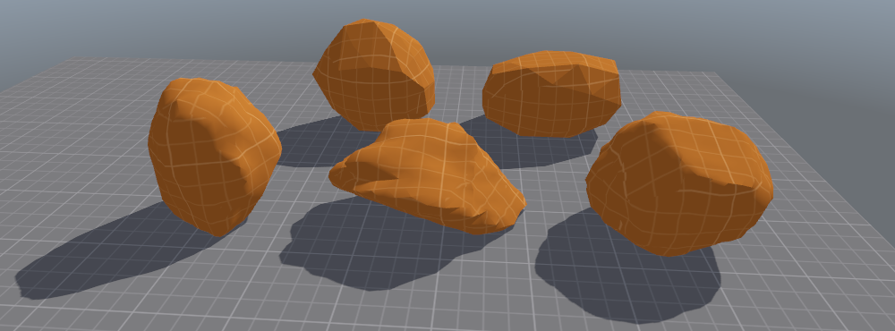

## Sweep Faces

To carry a corridor, pipe or trim on round a corner, sweep the faces at its end. Each face is pushed along a path
and leaves a run of brushes behind it, with the materials of the brush it came from.

1. Shift+click a face at the end of the run in the 3D view, then Ctrl+Shift+click the others, for example the floor
   and both walls of a corridor.
2. Open *Brush > Sweep Faces…*. A cyan outline shows the brushes it would make.
3. Pick **Straight**, **Arc** or **S-bend** and set the path. **Radius** is measured from the center of the turn to the
   middle of the faces, and **Direction** is seen looking at the faces.
4. Click **Create**. The new brushes are selected, and they join the group or entity of the brush they came from, so
   sweeping the end of a `func_door` makes the door longer.

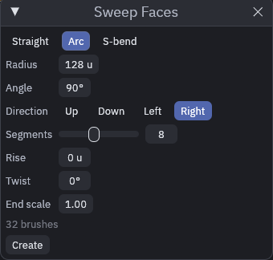

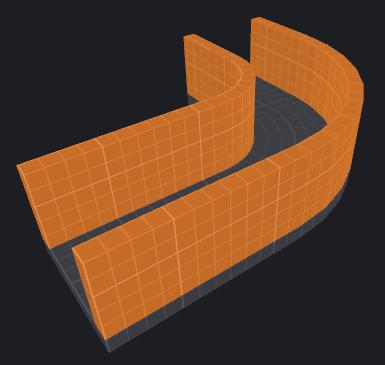

More **Segments** make a smoother curve. **Rise** lifts the end, so an arc with rise becomes a spiral ramp, **Twist**
turns the faces about themselves and **End scale** grows or shrinks them on the way. An arc tighter than the faces are
wide would fold over on its inner side, the dialog says the smallest radius that works instead. All picked faces
travel the same way, along their average direction, so pick faces that point the same way, like the end of a corridor.
Faces at an angle to each other would go out on a slant.

For a path of your own shape, pick **Curve**. Place a few points ahead of the faces with the **Path** tool (Shift+P,
see [Placing and wiring](../gameplay/placing.md#placing-entities)) first. The curve leaves the faces straight out and
runs smoothly through the points in order. **Points** picks which chain to follow, by default the one that starts
nearest the faces. Move a point or add one to the chain and the cyan outline follows, so you can shape the run before
you click **Create**. A bend tighter than the faces are wide is refused, spread the points further apart then.

The MCP tool `sweep_faces` takes the same settings, with the faces as `[brush id, face index]` pairs or the selected
faces when none are given. A curve takes `points` as `[[x, y, z], ...]`, or `chain`, the targetname or id of the first
point entity of a chain.

## Place Along Path

To run a fence, a rail, a road or a cable along a curve, lay out the curve with points and let the editor place the
pieces along it.

1. Place a few points with the **Path** tool (Shift+P, see [Placing and wiring](../gameplay/placing.md#placing-entities)).
   The curve runs smoothly through them in order.
2. Build one piece, such as a fence post or a short slab of road, and select it.
3. Open *Brush > Place Along Path…*. The dialog takes the selection as its piece, and a cyan outline shows what it
   would make. **Points** picks which chain to follow, by default the one that starts nearest the piece.
4. Pick a mode and click **Create**. What it made is selected, and one undo takes all of it away again.

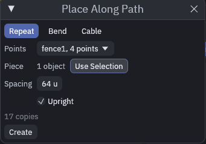

| Mode | What it makes |
|---|---|
| **Repeat** | Copies of the piece about **Spacing** apart, evened out so the first and last copy sit on the ends of the path. **Upright** keeps them standing straight on a slope. |
| **Bend** | The piece laid end to end and bent along the path, one mesh for each of its brushes and meshes, with the texture running on. The copies stretch a little so only whole ones fit. On a long path a detailed piece bends in coarser steps, and one too detailed to bend is refused rather than stalling the editor. |
| **Cable** | A round cable in the current material that hangs **Sag** units below the straight line in the middle of each span. It needs no piece. |

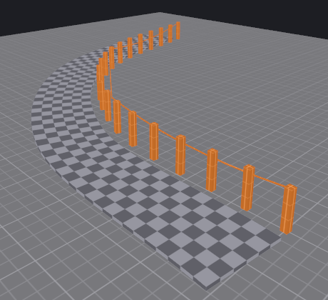

The longer side of the piece, X or Z, runs along the path and its bottom sits on it, so build a post standing up and a
road slab lying flat. The dialog keeps its piece while it is open, so you can select and move the path's points to
reshape the curve and the outline follows. Click **Use Selection** to swap in another piece.

The MCP tool `place_along_path` takes `mode` (`repeat`, `bend` or `cable`), the piece as `ids` or the selection, and the
curve as `points` or `chain` like `sweep_faces`, plus `spacing`, `upright`, `sag`, `radius`, `sides` and `material`.

## CSG

The CSG operations are under *Brush > CSG*, which also holds their two settings.

All four also have a button in the toolbar, to the right of the snapping and UV lock buttons.

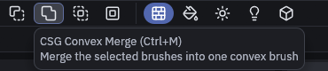

| Operation | Key | Result |
| --- | --- | --- |
| Subtract | Ctrl+K | Carves the selection out of every brush it touches, then deletes the selection. A selection that touches no other brush is kept and the status bar says so |
| Hollow | Ctrl+Shift+K | Turns a brush into walls around its old volume, 16 units thick unless you change *Wall thickness* in the same menu. A brush too thin for two walls is left alone |
| Convex Merge | Ctrl+M | Fuses the selection into one convex brush that wraps it |
| Intersect | Ctrl+L | Keeps only where the selected brushes overlap |

To punch a doorway or window, place a brush where the hole goes and Subtract it,
[Getting started](../getting-started.md) walks you through one. The faces a cut opens take the cutter's material,
unless you tick *Carved faces keep the target's material* in the same menu.

## Displacements

For uneven ground inside a brush level, like a rubble slope, you can turn a face into a displacement and sculpt it.

1. Shift+click a four sided face, or select the brush to use its top face.
2. Open *Brush > Displacement* and pick one of the **Create** entries. A higher power gives a finer grid.
3. The **Sculpt** tool (G) switches on by itself, drag over the face to shape it.

For bigger outdoor areas a [terrain](terrain.md) works better.
