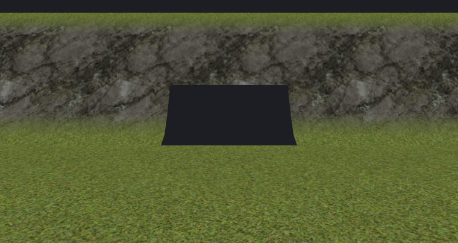
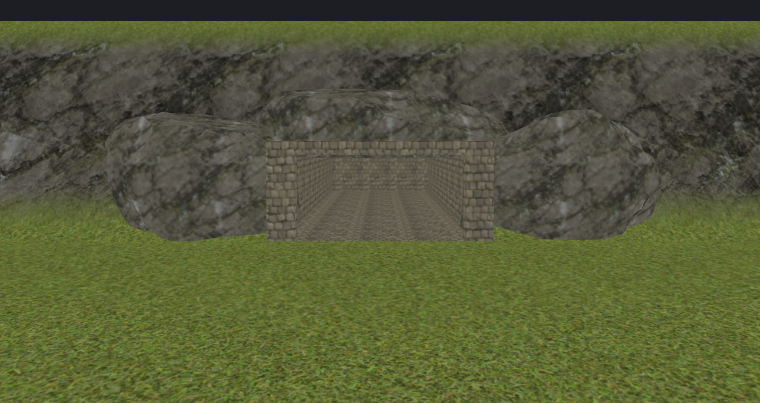

# Caves and overhangs

A [terrain](terrain.md) is a heightfield: every spot on it has exactly one ground height. That makes hills, valleys and
beaches easy, but the ground can never fold over itself, so a terrain alone cannot hold a cave, an arch or a cliff that
leans out over its foot.

The way around it is to let the terrain have the opening, and build everything that folds from other pieces. The
terrain gets a hole, and brushes, displacements and meshes make the cave around it.

## Cut the opening

1. Select the terrain and press G

    That is the Sculpt tool. Its options show up in the tool options bar at the top left.

2. Pick the **Hole** mode

    Open the first menu in the bar and choose **Hole**. **Unhole** in the same menu fills a hole back in.

    

3. Drag over the slope where the entrance goes

    The ground under the brush disappears, and its collision with it. A cell goes when its center lies inside the
    brush circle, so keep the radius above the terrain's cell size, or a click cuts nothing.

    

Holes are whole cells, so the edge of the opening is a staircase. Do not try to make it pretty, cover it in the next
step. Ctrl+Z takes back a stroke, and holes stay at the same place in the map when you
[resize the terrain](terrain.md#changing-the-size).

## Build the cave

Everything from here on is ordinary level building, placed in and around the hole. The terrain does not mind what
sits beyond it.

| Piece | Good for |
| --- | --- |
| [Brushes](brushes.md) | Tunnels and rooms. Make a box, hollow it with Ctrl+Shift+K, and carve the doorway with a second brush and Ctrl+K |
| [Displacements](brushes.md#displacements) | A bumpy floor or a rubble slope inside the cave, sculpted with the Sculpt tool like a small terrain |
| [Meshes](meshes.md) | Rocks, rounded arches and the lips of the opening. The [Shape Generator](brushes.md#shape-generator) makes a **Rock** or an **Arch Wall** mesh in one step, and the Mesh tool reshapes it |

For a cave mouth that looks like it grew there:

1. Put a hollow brush in the hole

    Size it to fill the hole, and let its back run into the hill. The terrain around the hole ends at the brush's
    walls, so whatever the brush covers is hidden.

2. Hide the staircase

    Set a few rock meshes on the rim, half buried in the terrain, so the stepped edge disappears behind them.

    

## Overhangs

An overhang works the same way, only without the hole:

1. Leave the terrain as a plain slope or cliff.
2. Build the part that leans out from a rock mesh or a brush, with its back buried in the cliff so no gap shows.
3. If you want a hollow under it, [cut a hole](#cut-the-opening) in the ground there and put a floor brush at the height
   you want.

## In Godot

Nothing special happens on export, each piece builds the way it does anywhere else.

* The terrain becomes a `TrenchDotTerrain` node. The hole cells are left out of its mesh, and its collision has the
  same hole, so you can walk through the opening.
* Brushes collide as one convex shape each, displacements and meshes as their exact triangles, so a curved tunnel
  floor works too.

Test the cave in the game once with the character, collision is where a gap in the rock shows up first.
