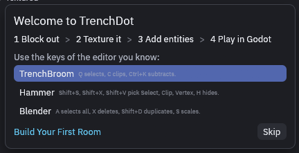
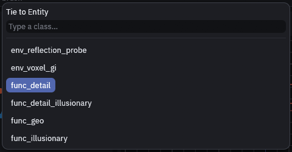
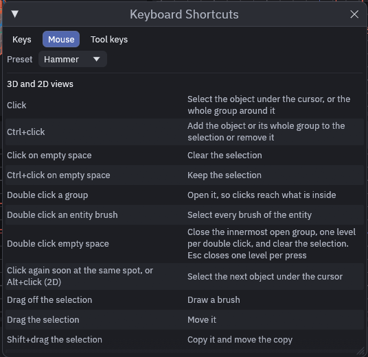

# Coming from Hammer or TrenchBroom

TrenchDot is a brush editor in the TrenchBroom mould, and it builds Godot scenes instead of compiling for an engine.
You draw solid [brushes](brushes.md) on a grid, texture them, add entities and play, so most of what you know carries
over. This page maps the names, keys and mouse gestures, and lists the places where TrenchDot does something else.
[Build your first room](../getting-started.md) walks you through a whole room if you would rather start there.

## Pick your keys

The first time the editor starts, the card in the middle of the 3D view asks which keys you want. Click the row of the
editor you know, TrenchBroom is already marked, or **Skip** to keep it. That is the only question the editor asks.

You can change your mind at any time with *File > Preferences > Keymap preset*, or with **Preset** at the top of
*Help > Keyboard Shortcuts…*. Keys you set yourself there stay on top of any preset.

The Hammer preset gives you Hammer's mouse and keys. Shift+drag clones the selection, Shift+A opens the Texture tool,
Ctrl+M opens Transform Selection, Ctrl+T ties brushes to an entity, and Ctrl+L and Ctrl+I flip along the view. An action
that loses its key to one of them gets a new one, so Close Tab moves to Ctrl+F4 to leave Ctrl+W for Move to World. The
TrenchBroom preset, the default, puts TrenchBroom's keys on top of TrenchDot's own, so Ctrl+I isolates, Ctrl+J merges
and U toggles UV lock, while a TrenchDot key nothing took keeps working, like Ctrl+H to hide. [Keys](#keys) and
[Mouse](#mouse) below show where the presets differ.

## Where things are

| Hammer | TrenchBroom | TrenchDot |
| --- | --- | --- |
| Block tool, a solid | Drag in a view | Drag in any view with the Select tool (Q) to draw a box [brush](brushes.md#draw-and-move), or with the **Block** tool to draw over the selection too. In the Hammer preset only the Block tool (Shift+B) draws, a Select tool drag in a 2D view draws a selection box. Ctrl+Shift+B for arches, stairs and cylinders |
| Selection tool | Select | **Select** tool, Q |
| worldspawn | worldspawn | The map's worldspawn holds the world brushes, select nothing to see its keys in the Inspector |
| Tie to Entity | *Create Brush Entity* in the right click menu | Select the brushes and pick *Brush > Tie to Entity*, Ctrl+T in the Hammer preset, see [below](#where-trenchdot-differs). Right click and *Create Brush Entity*, or double clicking a brush entity card in the **Entities** panel, work too, see [Brush entities](../gameplay/placing.md#brush-entities) |
| Move to World | *Move brushes to Entity* in the right click menu | Ctrl+Shift+W, or Ctrl+W in the Hammer preset |
| Transform (Ctrl+M) | The Rotate and Scale tools | *Brush > Transform > Transform Selection…*, Ctrl+M in the Hammer preset, see [below](#where-trenchdot-differs) |
| Entity tool | Drag from the entity browser | Drag a card from the **Entities** panel into a view, see [Placing entities](../gameplay/placing.md#placing-entities) |
| VisGroups | Layers | [Layers](organizing.md#layers) in the **Outliner**, the eye hides one and the lock stops edits, there are no automatic VisGroups |
| Groups | Groups | [Groups](organizing.md#groups), Ctrl+G |
| Carve | CSG subtract | *Brush > CSG > Subtract*, Ctrl+K, see [CSG](brushes.md#csg) |
| Make Hollow | CSG hollow | *Brush > CSG > Hollow*, Ctrl+Shift+K |
| Clipping tool | Clip tool | **Clip** tool, C |
| Vertex Manipulation | Vertex tool | **Vertex** tool, V |
| Texture Application tool, Face Edit Sheet | Face inspector, material browser | **Texture** tool (Shift+T, or Shift+A in the Hammer preset), which shows the face panel in the Inspector with its **Alignment** section, and the **Materials** panel, see [Texturing](texturing.md). The [UV Editor](uv-editor.md) draws faces flat |
| Displacements | n/a | The **Sculpt** tool shapes [displacements](brushes.md#displacements) and terrain |
| FGD | Entity definition files | The entities of your Godot project, which the addon writes to `trenchdot_game.json` and the **Entities** panel lists |
| Entity I/O | n/a | **Outputs** at the bottom of the Inspector, see [How entity I/O works](../gameplay/io.md) |
| Prefabs | n/a | [Prefabs](organizing.md#prefabs) and the [prefab library](prefab-library.md) |
| Cordon | n/a | [*View > Cordon*](organizing.md#cordon) |
| VMF or MAP file | MAP file | A `.tdm` map. [Import](importing.md) a `.vmf` or `.map` to bring a level over |
| Compile, Run Map | Compile, Launch | There is no compile step. Save the map and Godot rebuilds it, see [Rebuild on save](../godot/live.md#rebuild-on-save). F5 runs the Godot project |

Map units are 32 to the meter and the default grid step is 16.

## Keys

TrenchBroom keys are the defaults of TrenchBroom 2026.2. An empty cell means that program has no key for it.

| Action | TrenchBroom | TrenchBroom preset | Hammer preset |
| --- | --- | --- | --- |
| Select tool | Shift+Esc leaves the current tool | Q | Shift+S |
| Block tool | | | Shift+B |
| Clip tool | C | C | Shift+X |
| Vertex tool | V | V | Shift+V |
| Texture tool | | Shift+T | Shift+A |
| Rotate tool | R | R | R |
| Scale tool | T | T | T |
| Shear tool | G | Shift+R | Shift+R |
| Subtract, hollow | Ctrl+K, Ctrl+Shift+K | Ctrl+K, Ctrl+Shift+K | Ctrl+Shift+C or Ctrl+K, Ctrl+Shift+K |
| Transform Selection | | | Ctrl+M |
| Tie to Entity | | | Ctrl+T |
| Flip horizontally, vertically | Ctrl+F, Ctrl+Alt+F | | Ctrl+L, Ctrl+I |
| Convex merge | Ctrl+J | Ctrl+J or Ctrl+M | Ctrl+Shift+M |
| Intersect | Ctrl+L | Ctrl+L | Ctrl+Shift+L |
| Duplicate, duplicate linked | Ctrl+D, Ctrl+Shift+D | Ctrl+D, Ctrl+Shift+D | Ctrl+D, Ctrl+Shift+D |
| Group, ungroup | Ctrl+G, Ctrl+Shift+G | Ctrl+G, Ctrl+Shift+G | Ctrl+G, Ctrl+U |
| Select all | Ctrl+A | Ctrl+A | Ctrl+A |
| Select none | Ctrl+Shift+A | Ctrl+Shift+A, Esc | Esc |
| Invert selection | Ctrl+Alt+A | Ctrl+Alt+A | Ctrl+Shift+I |
| Select touching | Ctrl+T | Ctrl+T | Ctrl+Shift+T |
| Select inside | Ctrl+E | Ctrl+E | |
| Hide selection | Ctrl+Alt+I | Ctrl+Alt+I or Ctrl+H | H |
| Isolate selection | Ctrl+I | Ctrl+I | Ctrl+H |
| Show all | Ctrl+Shift+I | Ctrl+Shift+I or Ctrl+Shift+H | U |
| Halve, double the grid | `-` and `+` | `[` and `]`, or `-` and `=` | `[` and `]`, or `-` and `=` |
| UV lock | U | U or Ctrl+Shift+U | Shift+L or Ctrl+Shift+U |
| Snap to the grid on or off | Alt+0 | Alt+0 | Shift+W |
| Frame the selection | Ctrl+U | F or Ctrl+U | Ctrl+E or F |
| Maximize the view | Ctrl+Space | Ctrl+Space or Shift+Space | Shift+Z or Shift+Space |
| Turn a quarter turn | Alt+arrows, Alt+Page Up and Page Down | Same | Same |
| Mouse look in 3D | | | Z |
| Repeat the last action | Ctrl+R | Ctrl+R | Ctrl+R |

Ctrl+F opens Find in every preset, so the TrenchBroom preset leaves the flips without a key. Transform Selection, Tie
to Entity and the two flips have no key outside the Hammer preset, they sit in the *Brush* menu
and the command palette, and you can bind them on the **Keys** tab of *Help > Keyboard Shortcuts…*. The Block tool
sits right of Select in the toolbar, and mouse look under *View > Views > Mouse Look*. In the Hammer preset, Rotate Y
90 moved to Ctrl+Shift+R, because Ctrl+L flips. The full list of keys is on [Shortcuts](shortcuts.md).

The Hammer preset adds its keys next to TrenchDot's own rather than TrenchBroom's, so a TrenchDot key keeps working
unless the Hammer column gives it to another action. Q, C, V and Shift+T still pick their tools, Ctrl+J still isolates
and Ctrl+Shift+H still shows all, while Ctrl+T, Ctrl+M, Ctrl+L, Ctrl+I, Ctrl+H, Ctrl+E and Ctrl+U now do what the
Hammer column says.

Select Touching and Select Inside work as in TrenchBroom in every preset, though Select Inside has no key in the Hammer
preset, whose selection box does the same job. The brushes you select with are deleted
afterwards, even when nothing touches them or lies inside, and Ctrl+Z brings them back. Touching means overlapping, a
brush that only shares a face with them is left out, so a floor does not pick up the pillars standing on it.

## Mouse

Hammer lets you pick its camera controls in its options, so the camera rows compare TrenchBroom, whose gestures TrenchDot
follows. The Hammer preset changes how the Select tool picks faces and what a drag does, and a cell that says "Same" is
what the TrenchDot column says.

| Gesture | TrenchBroom | TrenchBroom preset | Hammer preset |
| --- | --- | --- | --- |
| Look around in 3D | Right drag | Right drag | Same, or Space+drag |
| Fly in 3D | WASD while the right button is held, Q and X go up and down | Same, Shift is faster | Same, but E goes up and Q down |
| Move forward and back in 3D | Wheel | Wheel | Same |
| Pan in 3D | Middle drag | Middle drag | Same |
| Orbit | Alt+right drag | Alt+right drag or Alt+left drag | Same |
| Pan in a 2D view | Middle or right drag | Middle or right drag | Same, or Space+drag |
| Zoom in a 2D view | Wheel | Wheel | Same |
| Select | Click | Click | Same |
| Add to or remove from the selection | Ctrl+click | Ctrl+click | Same |
| Select what lies in a box | Draw a brush, then Ctrl+E (Select Inside) | Draw a brush, then Ctrl+E | Drag on empty space in a 2D view, then press Enter or click inside the box. Ctrl+drag adds to the selection |
| Select a group | Click selects the group, double click opens it | Click selects the group, double click opens it | Same |
| Pick what lies behind | Ctrl+wheel | Click again at the same spot, or Alt+click, in the Top, Front and Side views | Same |
| Select a face | Shift+click | Shift+click | Click in the Texture tool (Shift+A) |
| Add a face | Ctrl+Shift+click | Ctrl+Shift+click | Ctrl+click in the Texture tool |
| Select every face of a brush | Shift+double click | *Edit > Select > Brush Faces*, Ctrl+Shift+A in the Hammer preset | Same, or Ctrl+A in the Texture tool |
| Move on the grid | Drag the selection | Drag the selection | Same |
| Move vertically in 3D | Alt+drag | Alt+drag | Same |
| Lock the move to one axis | Shift while dragging | Shift while dragging | Drag a gizmo arrow, Shift does not lock |
| Duplicate while dragging | Ctrl+drag | Ctrl+drag | Shift+drag or Ctrl+drag |
| Push or pull a face | Shift+drag | Shift+drag a face of a selected brush in 3D | None, Shift+drag copies |
| Extrude a new brush | Ctrl+Shift+drag | Ctrl+Shift+drag a face of a selected brush in 3D | None, Ctrl+Shift+drag copies |
| Change the grid size | Ctrl+Alt+wheel | `[` and `]` | Same |
| Open the context menu | Right click | Right click | Same |

## Where TrenchDot differs

* **Alt+left drag orbits too**, next to TrenchBroom's Alt+right drag. In the Select tool an Alt+left drag that starts
  on the selection or its gizmo moves it vertically instead.
* **Tie to Entity opens a class list.** Select the brushes and press Ctrl+T in the Hammer preset, or pick *Brush > Tie
  to Entity* in any preset. The command palette comes up with only the brush entity classes of your game, `func_detail`
  already highlighted, so Ctrl+T then Enter makes the brushes one detail entity. Type to filter the list, Esc closes it
  and changes nothing. Brushes that already are one whole entity are selected instead, change their class in the
  Inspector, so a tie never strips a door of its properties. In the other presets Ctrl+T selects what the selection
  touches, as in TrenchBroom, and that action sits on Ctrl+Shift+T in the Hammer preset.

  

* **Transform Selection is a small window.** Press Ctrl+M in the Hammer preset, or pick *Brush > Transform > Transform
  Selection…*. Choose **Move**, **Rotate** or **Scale**, type X, Y and Z, and click **Apply**. Move takes map units
  and goes exactly where you type, with no grid snap. Rotate takes degrees about the center of the selection. Scale
  takes factors about that center, and a negative factor mirrors. The window stays open so you can apply the same step
  again, and each Apply is one undo step. The shape generator stays on Ctrl+Shift+B in every preset.
* **Flip follows your view in the Hammer preset.** Ctrl+L flips the selection left to right and Ctrl+I top to bottom as
  the view under the pointer shows it, so Ctrl+L in the Top view flips X and Ctrl+I there flips Z. In the other presets
  *Brush > Transform* flips along a world axis you name.
* **Ctrl+Shift+A is Select None**, as in TrenchBroom. The Hammer preset gives it to Select Brush Faces, which picks every face of the selected brushes to texture them one by one, and Esc clears the selection there.
* **A side drag in 2D resizes, slanted sides included.** In the Top, Front and Side views, drag a side of the selected
  brush to resize it along that side, as in TrenchBroom. Ctrl+drag copies the selection instead. The Hammer preset
  grabs only the straight sides of the box around the selection, as Hammer's wireframe views do, and copies with
  Shift+drag too.
* **The Hammer preset changes the Select tool's mouse too.** Shift+drag copies the selection, in every view, and a drag
  never locks to an axis, drag a gizmo arrow for that. Shift+click picks an object like a plain click, because Shift
  belongs to cloning, so faces are picked in the Texture tool (Shift+A) and nothing pushes or pulls a face with Shift. The
  camera keeps the TrenchBroom gestures and adds Hammer's Space+drag and Z for mouse look, and the tools Hammer has no
  key for keep the TrenchBroom ones. In the Vertex tool a drag on empty space in a 2D view selects the corners inside
  the box. **Help > Keyboard Shortcuts…** shows the mouse of the preset you are on.

  

* **There is no compile.** Textures, entities and lighting come from your Godot project, see
  [Build your first room](../getting-started.md).

More about the move from other tools is in [Importing Hammer and TrenchBroom maps](importing.md) and
[Shortcuts](shortcuts.md).
