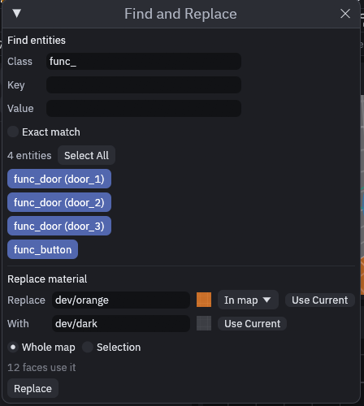

# Find and Replace

Two jobs come up in every bigger map: finding the entities you need and swapping one material for another. Both live in
one window, *Edit > Find and Replace…* or **Ctrl+F**.

## Find entities

1. Type into **Class**, **Key** or **Value**. Fill in one field or all three, the list below updates as you type.
2. Read the count next to **Select All**. Every entity that matches is listed by name.
3. Click **Select All**, or press Enter in a field. Every entity found is selected and the views frame them.
   Click a single name instead to select and frame only that one.

Matching ignores upper and lower case and finds part of a text, so `door` finds `func_door` and `Hall_Door`. Tick
**Exact match** when the whole text has to be the same. **Key** and **Value** are checked on the same property, so
Key `target` with Value `hall` only finds an entity whose `target` contains `hall`. Hidden and locked entities are
left out, since you could not select them anyway.

## Replace a material

1. Put the material to replace in **Replace**. Type its name, drag it from the Materials panel onto the field, pick it
    from **In map**, which lists every material the map uses with its face count, or click **Use Current** to take the
    one picked in the Materials panel.
2. Put the new one in **With** the same way.
3. Choose **Whole map**, or **Selection** to touch only the selected brushes or faces. With faces selected, only those
    faces change.
4. The line under the choice says how many faces use the material. Click **Replace**. The status bar reports
    how many faces changed.

Each face keeps its offset, scale and rotation, so the new texture sits exactly where the old one did. It is one
undo step, **Ctrl+Z** brings every face back. A blend material changes along with its face. Terrain layers and the
**Material** of a [scatter set](scatter.md) or one of its models change too, unless you replace in a face selection.

> [!TIP]
> To swap one material in a single brush only, select the brush, choose **Selection** and replace there. To see which
> faces would change first, right click the material in the Materials panel and choose *Select faces using it*.

## MCP

`find_entities` takes `classname`, `key` and `value` (at least one, text only), `exact` and `limit`, and returns the
matching entities with their properties and bounds. With `select: true` it also selects them, like **Select All**, and
a search that finds nothing leaves the selection as it was.

`replace_material` takes `from` and `to`, and `scope` as `map` (the default) or `selection`. Set `dry_run: true` to
count the faces that would change without touching the map. The reply gives `changed`, `faces`, `terrain_layers` and
`scatter_materials`. It is the same code the window uses, so both end up as the same single undo step.

