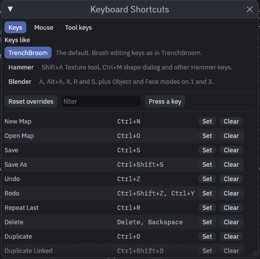
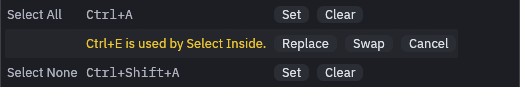

# Shortcuts

These are the default keys, the TrenchBroom preset.

Want other keys? *Help > Keyboard Shortcuts…* lists every binding on its **Keys** tab. Type in the filter to find
one, press **Set** and then the new shortcut. The **Preset** row at the top of that window, or *File > Preferences >
Keymap preset*, switches to Hammer or Blender, see [Other presets](#other-presets). On the first start the welcome card
asks the same question, and **Skip** keeps TrenchBroom.

### Find what a key does

Not sure what a key is for, or whether it is free? Press **Press a key** next to the filter, then the key. The window
lists everything that reacts to it, with any modifier: the menu commands first, exact chord on top, then what the
tools do with it. Esc cancels the lookup, and the **x** next to the key clears it.

### Taking a key that is in use

When the shortcut you press already belongs to another command, the row asks what to do and changes nothing until you
answer.

| Button | Result |
| --- | --- |
| **Replace** | The other command loses the key, it is unbound unless it has another one |
| **Swap** | The other command gets the key the first one had. Greyed out when the first one had none |
| **Cancel** | Nothing changes |

A key that a tool reads itself, such as K for the knife in the Mesh tool, asks too, since that tool takes the key first
while it is active. Press **Set anyway** to use it for the command everywhere else, or **Cancel**.

The **Tool keys** tab lists the keys each tool reads while it is active, such as Enter to apply in the Clip tool. They
are fixed, so the tab is read only, and the key lookup shows them next to the commands that use the same key.

The **Mouse** tab lists what each click and drag does in the views, the Texture tool and the Outliner. Its **Preset**
row is the same one as on the Keys tab, so it switches the keymap of the whole editor, not only this list. Picking
Blender there changes the keys at once, adds the **Object** and **Face** buttons to the toolbar and lists the clicks of
both modes on this tab.

Shortcuts wait while you type in a field or a menu is open. While the pointer is over a floating window, such as the
Shape Generator, only save, undo and redo work, so a key meant for the window never deletes or changes your map.

## Tools

Press a tool's key again to go back to Select. Esc steps back one thing at a time: it cancels a drag or stroke, then
clears the selected faces, then clears the selected objects, then leaves the tool for Select, then closes the open
group, one level per press. It works this way in every preset, and it never changes the Blender preset's Object or Face
mode.

| Key | Tool |
| --- | --- |
| Q | Select, draw brushes and move things |
| C | Clip, to cut brushes along a plane |
| V | Vertex, to drag the corners of brushes |
| R | Rotate |
| T | Scale |
| Shift+R | Shear |
| Tab | Edit the selection where it stands: meshes in the Mesh tool, brushes in the Vertex tool. It never converts a brush, *Mesh > Edit Mesh* does that |
| Shift+T | Texture, to align textures on faces |
| P | Paint, to paint vertex colors onto faces |
| G | Sculpt terrain and displacements |
| Shift+G | Blend terrain layers |
| B | Scatter |
| Shift+E | Volume, to drag out a trigger volume |
| Shift+P | Path, to place a chain of `path_corner` entities |
| M | Measure distances |

## Mouse in the views

| Input | Result |
| --- | --- |
| Drag off the selection | Draw a brush |
| Drag the selection | Move. Ctrl copies, Shift locks the axis, Alt moves vertically in 3D |
| Click | Select the object under the cursor, or the whole group around it. Clicking an object while faces are selected leaves face selection |
| Double click a group | Open it, so clicks reach what is inside |
| Double click an entity brush | Select every brush of the entity |
| Double click empty space | Close the innermost open group, one level per double click, and clear the selection. Esc closes one level per press, see [Tools](#tools) |
| Click again soon at the same spot, or Alt+click (2D) | Select the next object under the cursor, such as a wall under its ceiling in the Top view |
| Ctrl+click | Add an object to the selection or remove it, in the views and the Outliner |
| Shift+click | Select that one face, replacing the selection. On something without faces it works like a click |
| Ctrl+Shift+click | Add a face to the selection or remove it |
| Click on empty space | Clear the selection |
| Ctrl+click on empty space | Keep the selection, so a missed Ctrl+click costs nothing |
| Shift+click in the Outliner | Select the rows from the last clicked one |
| Shift+drag a selected face (3D) | Push or pull it |
| Ctrl+Shift+drag a selected face (3D) | Extrude a new brush |
| Right drag (3D) | Look around. Hold it and use WASD to fly, Q and E to go down and up |
| Middle drag | Pan |
| Alt+left drag (3D) | Orbit. In the Select tool a drag that starts on the selection or its gizmo moves it vertically instead |
| Ctrl+wheel (Sculpt, Blend, Paint, Scatter) | Resize the brush |

## Editing

| Key | Action |
| --- | --- |
| Ctrl+Z, Ctrl+Shift+Z or Ctrl+Y | Undo, redo |
| Ctrl+X, Ctrl+C, Ctrl+V | Cut, copy, paste under the mouse |
| Ctrl+D, Ctrl+Shift+D | Duplicate, duplicate linked |
| F2 | Rename the selected object in the Outliner |
| Ctrl+R | Repeat the last rotate, flip, mirror linked, nudge or duplicate. In mesh editing it makes a loop cut |
| Delete or Backspace | Delete |
| Ctrl+A, Ctrl+Shift+A, Ctrl+I | Select all objects, select none, select inverse. Ctrl+A also drops any selected faces, and in the Blender preset it switches to Object mode. In the Hammer preset Ctrl+Shift+A selects every face of the selected brushes and meshes instead, see [Other presets](#other-presets) |
| Ctrl+F | Find entities and replace a material, see [Find and Replace](find-replace.md) |
| Ctrl+T, Ctrl+E | Use the selected brushes as a stencil and select what they touch, or what lies inside them. The stencil brushes are deleted. Both need brushes selected, faces alone are refused |
| Ctrl+G, Ctrl+Shift+G | Group, ungroup |
| Ctrl+H, Ctrl+J, Ctrl+Shift+H | Hide the selection, isolate it by hiding everything else, show all |
| Arrows, Page Up, Page Down | Nudge by one grid step |

## Brushes, meshes and textures

| Key | Action |
| --- | --- |
| Ctrl+K, Ctrl+M, Ctrl+L | CSG subtract (carve the selection out of what it touches), convex merge, intersect |
| Ctrl+Shift+K | Hollow, turn a solid brush into a room with walls |
| Ctrl+Shift+B | Shape generator, for arches, cylinders, stairs and other ready-made shapes |
| Ctrl+Shift+E, Ctrl+Shift+J | Convert brushes to mesh, join meshes |
| Ctrl+Shift+W | Move brushes to world, taking them out of their entity so they become plain level geometry |
| Ctrl+Shift+U | Toggle UV lock, which keeps textures attached to a brush while it moves |
| Alt+H | Hotspot fit, which fits selected faces to the best matching rectangle of a trim sheet |

## View and files

| Key | Action |
| --- | --- |
| F or Ctrl+U | Frame the selection, or the whole map |
| `[` and `]`, or `-` and `=` | Halve or double the grid |
| F4, F3 | Cycle shading (textured, flat, lit, wireframe), toggle Lit Preview |
| Shift+Space | Maximize the view under the pointer |
| Ctrl+Shift+1 to 9, Ctrl+1 to 9 | Store, recall camera bookmarks |
| Ctrl+=, Ctrl+-, Ctrl+0 | Interface scale up, down, reset |
| F1 | Open the [manual](interface.md#help-and-the-manual) at the tool, panel tab, menu entry or Inspector section under the pointer, anywhere else the command palette |
| Ctrl+click a tool in the toolbar, Cmd+click on macOS | Open its page in the manual |
| Ctrl+Shift+P | Command palette |
| Ctrl+N, Ctrl+O | New map, open map |
| Ctrl+S, Ctrl+Shift+S | Save, save as |
| Ctrl+Shift+N, Ctrl+Tab, Ctrl+W | New tab, next tab, close tab |
| F5 | Run the Godot project |

> [!NOTE]
> F2 used to cycle the shading. It now renames, like in Godot, Blender and most file managers, and shading
> moved to F4. A binding you set yourself in the shortcuts window stays as it was.

## Other presets

A preset only changes the keys below, everything else stays as above. Your own bindings sit on top of any preset,
**Reset overrides** in the shortcuts window clears them.

| Key | Hammer preset |
| --- | --- |
| Ctrl+Shift+A | Select Brush Faces, swap the selected brushes and meshes for all their faces. Select None has no key here, Esc clears in two presses at most |
| Shift+S, Shift+X, Shift+V, Shift+A | Select, clip, vertex, texture tool |
| H, Ctrl+H, U | Hide, isolate, show all |
| Ctrl+W | Move brushes to world |
| Ctrl+M | Shape generator |
| Ctrl+L | Rotate 90° around the vertical axis |
| Ctrl+Shift+M, Ctrl+Shift+L | CSG convex merge, intersect |
| Ctrl+F4 | Close tab |

In the Hammer preset, Ctrl+A with the Texture tool active selects every face of the selected brushes instead of the
objects, which is what you want before aligning a whole room.

| Key | Blender preset |
| --- | --- |
| 1, 3 | Object mode, Face mode. Face mode turns the selected brushes and meshes into their faces, Object mode turns selected faces back into their brushes and meshes |
| A, Alt+A | Select all in the current mode (in Face mode every face of the visible, unlocked brushes and meshes), select none |
| X | Delete |
| Shift+D, Alt+D | Duplicate, duplicate linked |
| S | Scale tool |
| H, Alt+H, / | Hide, show all, isolate |
| Ctrl+J | Join meshes |
| Z | Cycle shading |
| Shift+A | Shape generator |
| F3 | Command palette |
| F4 | Lit Preview |
| Alt+Shift+H | Hotspot fit |

The Blender preset also clicks in the current mode, which the **Object** and **Face** buttons at the end of the tool
buttons in the toolbar show and switch. They appear only with this preset. Ctrl+click does the same as Shift+click here, and a click
in Face mode picks the face under the cursor. The Texture tool keeps its own clicks in every preset, a click selects a
face and Ctrl+click adds or removes one.

A selects all in the current mode, while Ctrl+A always selects all objects and switches to Object mode. Esc clears the
selection but leaves the mode as it is.

| Blender input | Result |
| --- | --- |
| Click (Object mode) | Select the object under the cursor, or the whole group around it |
| Shift+click or Ctrl+click (Object mode) | Add the object or its whole group to the selection or remove it |
| Click (Face mode) | Select the face under the cursor |
| Shift+click or Ctrl+click (Face mode) | Add or remove a face |
| Click on empty space | Clear the selection |
| Shift+click on empty space | Keep the selection |
| Click on something without faces (Face mode) | Nothing changes, an entity or terrain has no faces to pick |
