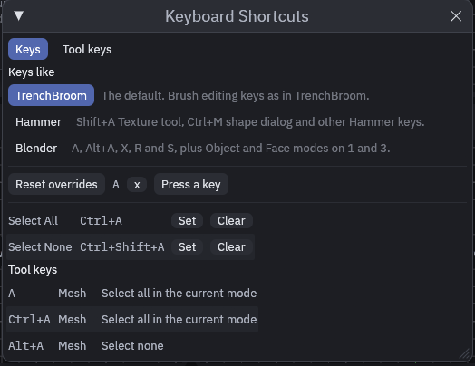
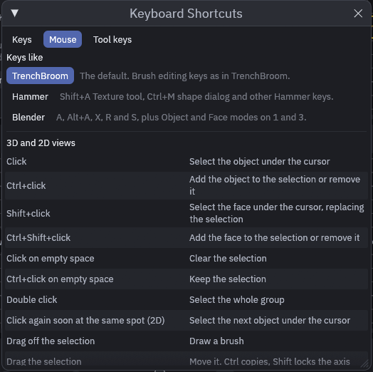

# Shortcuts

These are the default keys and mouse gestures, the TrenchBroom preset.

Want other keys? *Help > Keyboard Shortcuts…* lists every binding on its **Keys** tab. Type in the filter to find
one, press **Set** and then the new shortcut. The **Preset** row at the top of that window, or *File > Preferences >
Keymap preset*, switches to Hammer or Blender, see [Other presets](#other-presets). On the first start the welcome card
asks the same question, and **Skip** keeps TrenchBroom.

### Find what a key does

Not sure what a key is for, or whether it is free? Press **Press a key** next to the filter, then the key. The window
lists everything that reacts to it, with any modifier: the menu commands first, exact chord on top, then what the
tools do with it. Esc cancels the lookup, and the **x** next to the key clears it.

### Taking a key that is in use

When the shortcut you press already belongs to another command, the row asks what to do and changes nothing until you
answer.

| Button | Result |
| --- | --- |
| **Replace** | The other command loses the key, it is unbound unless it has another one |
| **Swap** | The other command gets the key the first one had. Greyed out when the first one had none |
| **Cancel** | Nothing changes |

Changed your mind after **Replace**? Press **Default** on the row of the command that lost the key. It gets the key
back, and the command that took it returns to its own key.

A key that a tool reads itself, such as K for the knife in the Mesh tool, asks too, since that tool takes the key first
while it is active. Press **Set anyway** to use it for the command everywhere else, or **Cancel**.

The **Tool keys** tab lists the keys each tool reads while it is active, such as Enter to apply in the Clip tool. They
are fixed, so the tab is read only, and the key lookup shows them next to the commands that use the same key.

The **Mouse** tab lists what each click and drag does in the views, the Texture tool and the Outliner. Its **Preset**
row is the same one as on the Keys tab, so it switches the keymap of the whole editor, not only this list. Picking
Blender there changes the keys at once, adds the **Object** and **Face** buttons to the toolbar and lists the clicks of
both modes on this tab.

Shortcuts wait while you type in a field or a menu is open. While the pointer is over a floating window, such as the
Shape Generator, only save, undo and redo work, so a key meant for the window never deletes or changes your map.

## Tools

Press a tool's key again to go back to Select. Esc steps back one thing at a time: it cancels a drag or stroke, then
clears the selected faces, then clears the selected objects, then leaves the tool for Select, then closes the open
group, one level per press. The Hammer preset skips the tool step in the Block tool, so you keep drawing until you pick
another tool, Shift+S for Select. Esc never changes the Blender preset's Object or Face mode.

While the Transform Selection window is open, Esc closes it and keeps the selection, and so does the key that opened
it, Ctrl+M in the Hammer preset.

| Key | Tool |
| --- | --- |
| Q | Select, draw brushes and move things |
| C | Clip, to cut brushes along a plane |
| V | Vertex, to drag the corners of brushes |
| R | Rotate |
| T | Scale |
| Shift+R | Shear |
| Tab | Edit the selection where it stands: meshes in the Mesh tool, brushes in the Vertex tool. It never converts a brush, *Mesh > Edit Mesh* does that |
| Shift+T | Texture, to align textures on faces |
| P | Paint, to paint vertex colors onto faces |
| G | Sculpt terrain and displacements |
| Shift+G | Blend terrain layers |
| B | Scatter |
| Shift+E | Volume, to drag out a trigger volume |
| Shift+P | Path, to place a chain of `path_corner` entities |
| M | Measure distances |

## Mouse in the views

| Input | Result |
| --- | --- |
| Drag off the selection | Draw a brush |
| Ctrl+Alt+drag off the selection, Ctrl+Shift+Alt+drag off the selection | Draw a box that selects what it touches in a 2D view or what lies wholly inside it in 3D, or adds that to the selection, in every preset. See [Box select](brushes.md#box-select) |
| Drag the selection | Move. Ctrl copies, Shift locks the axis, Alt moves vertically in 3D. The Hammer preset copies with Shift too and has no axis lock, see [Other presets](#other-presets) |
| Drag a selection edge (2D) | Resize the selection along that side, slanted sides of one brush too. Hold Ctrl when you press the button to copy the selection instead |
| Click | Select the object under the cursor, or the whole group around it. Clicking an object while faces are selected leaves face selection |
| Double click a group | Open it, so clicks reach what is inside |
| Double click an entity brush | Select every brush of the entity |
| Shift+double click a face | Select the faces running on from it across neighboring brushes, up to a 45 degree bend, see [Box select](brushes.md#box-select) |
| Double click empty space | Close the innermost open group, one level per double click, and clear the selection. Esc closes one level per press, see [Tools](#tools) |
| Click again soon at the same spot, or Alt+click (2D) | Select the next object under the cursor, such as a wall under its ceiling in the Top view |
| Ctrl+click | Add an object to the selection or remove it, in the views and the Outliner |
| Shift+click | Select that one face, replacing the selection. On something without faces it works like a click. The Hammer preset picks faces in the Texture tool instead |
| Ctrl+Shift+click | Add a face to the selection or remove it. The Hammer preset picks faces in the Texture tool instead |
| Click on empty space | Clear the selection |
| Ctrl+click on empty space | Keep the selection, so a missed Ctrl+click costs nothing |
| Shift+click in the Outliner | Select the rows from the last clicked one |
| Shift+drag a selected face (3D) | Push or pull a face of a selected brush. The whole brush has to be selected, a face picked with Shift+click alone is not enough. Shift+Alt+drag does the same in every preset, the Hammer preset copies the selection on a plain Shift+drag |
| Ctrl+Shift+drag a selected face (3D) | Extrude a new brush out of a face of a selected brush. Ctrl+Shift+Alt+drag does the same in every preset, the Hammer preset copies the selection on a plain Ctrl+Shift+drag |
| Tab while you drag a face | Switch the drag between Push, Extrude and Cut. Cut carves the space the face sweeps through out of the brushes in its way, see [Cut with a face](brushes.md#cut-with-a-face) |
| Right drag (3D) | Look around. Hold it and use WASD to fly, Q and X to go up and down. The Hammer and Blender presets use E and Q, and **Fly up and down** in Preferences picks either pair for any preset |
| Middle drag | Pan |
| Wheel (3D) | Move forward and back |
| Wheel (2D) | Zoom at the cursor |
| Alt+right drag (3D) | Orbit around the point under the cursor |
| Alt+left drag (3D) | Orbit. In the Select tool a drag that starts on the selection or its gizmo moves it vertically instead, and Ctrl+Alt+drag draws a selection box |
| Ctrl+wheel (Sculpt, Blend, Paint, Scatter) | Resize the brush |

## Editing

| Key | Action |
| --- | --- |
| Ctrl+Z, Ctrl+Shift+Z or Ctrl+Y | Undo, redo |
| Ctrl+X, Ctrl+C, Ctrl+V | Cut, copy, paste under the mouse |
| Ctrl+D, Ctrl+Shift+D | Duplicate, duplicate linked |
| F2 | Rename the selected object in the Outliner |
| Ctrl+R | Repeat the last rotate, flip, mirror linked, nudge or duplicate. In mesh editing it makes a loop cut |
| Delete or Backspace | Delete |
| Ctrl+A, Ctrl+Shift+A, Ctrl+Alt+A | Select all objects, select none, select inverse. Ctrl+A also drops any selected faces, and in the Blender preset it switches to Object mode. In the Hammer preset Ctrl+Shift+A selects every face of the selected brushes and meshes instead, and select inverse is Ctrl+Shift+I because Ctrl+I flips, see [Other presets](#other-presets) |
| Ctrl+F | Find entities and replace a material, see [Find and Replace](find-replace.md) |
| Ctrl+T, Ctrl+E | Use the selected brushes as a stencil and select what they touch, or what lies inside them. Touching means overlapping, a brush that only shares a face with a stencil is left out. The stencil brushes are deleted, even when nothing touches them or lies inside, and Ctrl+Z brings them back. Both need brushes selected, faces alone are refused |
| Ctrl+G, Ctrl+Shift+G | Group, ungroup |
| Ctrl+Alt+I or Ctrl+H, Ctrl+I, Ctrl+Shift+I or Ctrl+Shift+H | Hide the selection, isolate it by hiding everything else, show all |
| Arrows, Page Up, Page Down | Nudge by one grid step |
| Alt+Left, Alt+Right | Turn the selection a quarter turn around the vertical axis |
| Alt+Up, Alt+Down, Alt+Page Up, Alt+Page Down | Turn the selection a quarter turn around the view direction, or around the view's right |

*Select Linked Groups* and *Separate Linked Groups* in the *Edit > Groups* menu have no default key. Use the menu, the
right-click menu of the view, or bind a key to either one on the **Keys** tab.

## Brushes, meshes and textures

| Key | Action |
| --- | --- |
| Ctrl+K, Ctrl+J or Ctrl+M, Ctrl+L | CSG subtract (carve the selection out of what it touches), convex merge, intersect |
| Ctrl+Shift+K | Hollow, turn a solid brush into a room with walls |
| Ctrl+Shift+B | Shape generator, for arches, cylinders, stairs and other ready-made shapes |
| Ctrl+Shift+E, Ctrl+Shift+J | Convert brushes to mesh, join meshes |
| Ctrl+Shift+W | Move brushes to world, taking them out of their entity so they become plain level geometry |
| U or Ctrl+Shift+U | Toggle UV lock, which keeps textures attached to a brush while it moves |
| Alt+H | Hotspot fit, which fits selected faces to the best matching rectangle of a trim sheet |

## View and files

| Key | Action |
| --- | --- |
| F or Ctrl+U | Frame the selection, or the whole map |
| `[` and `]`, or `-` and `=` or Plus | Halve or double the grid. Plus is the + key on keyboards where it has its own key, and on the number pad |
| F4, F3 | Cycle shading (textured, flat, lit, wireframe), toggle Lit Preview |
| Ctrl+Space or Shift+Space | Maximize the view under the pointer |
| Alt+0 | Turn snapping to the grid on or off |
| Ctrl+Shift+1 to 9, Ctrl+1 to 9 | Store, recall camera bookmarks |
| Ctrl+= or Ctrl+Plus, Ctrl+-, Ctrl+0 | Interface scale up, down, reset |
| F1 | Open the [manual](interface.md#help-and-the-manual) at the tool, panel tab, menu entry or Inspector section under the pointer, anywhere else the command palette |
| Ctrl+click a tool in the toolbar, Cmd+click on macOS | Open its page in the manual |
| Ctrl+Shift+P | Command palette |
| Shift+Q | Tools at the pointer, pick one by its number or type its name |
| Alt+B, Alt+Z | Box select on or off, X-ray for the box on or off |
| Ctrl+N, Ctrl+O | New map, open map |
| Ctrl+S, Ctrl+Shift+S | Save, save as |
| Ctrl+Shift+N, Ctrl+Tab, Ctrl+W | New tab, next tab, close tab |
| F5 | Run the Godot project |

> [!NOTE]
> F2 used to cycle the shading. It now renames, like in Godot, Blender and most file managers, and shading
> moved to F4. A binding you set yourself in the shortcuts window stays as it was.

## Other presets

A preset only changes the keys and mouse gestures below, everything else stays as above. Your own bindings sit on top of any preset,
**Reset overrides** in the shortcuts window clears them.

The Hammer and Blender presets start from TrenchDot's own keys rather than TrenchBroom's, so U, Ctrl+Space, Alt+0 and
the Ctrl+Alt keys do nothing there unless their table gives them a job.

| Key | Hammer preset |
| --- | --- |
| Ctrl+Shift+A | Select Brush Faces, swap the selected brushes and meshes for all their faces. Select None has no key here, Esc clears in two presses at most |
| Shift+S, Shift+B, Shift+X, Shift+V, Shift+A | Select, block, clip, vertex, texture tool |
| H, Ctrl+H, U | Hide, isolate, show all |
| Ctrl+J | Isolate too, where the TrenchBroom preset merges |
| Ctrl+E, Ctrl+U | Frame the selection, ungroup |
| Ctrl+Shift+C | CSG subtract, the carve of Hammer |
| Shift+Z, Shift+W, Shift+L | Maximize the view, turn snapping on or off, toggle UV lock |
| Ctrl+W | Move brushes to world |
| Ctrl+T, Ctrl+Shift+T | Tie to Entity, and Select Touching, which moved to Ctrl+Shift+T and still deletes the brushes you select with. It only takes what overlaps them, sharing a face is not enough. Ctrl+T opens the class list with `func_detail` highlighted, so Ctrl+T then Enter makes the selected brushes one detail entity. Type to filter, Esc cancels. A selection that already is a whole brush entity is selected instead, change its class in the Inspector. Also under Brush > Tie to Entity |
| Ctrl+M | Transform Selection, a window that moves, rotates or scales the selection by typed numbers. The shape generator stays on Ctrl+Shift+B |
| Ctrl+L, Ctrl+I | Flip Horizontal, Flip Vertical. They mirror the selection across its center along the screen axes of the view under the pointer, like Hammer. In 3D, horizontal is whichever of X or Z lies closer to the camera's right. While snapping is on the center snaps to half the grid, so a selection centered between those lines shifts by up to half a grid step. Ctrl+Shift+R pivots on the full grid, so it moves a selection centered off the grid too. Turn snapping off to flip or rotate in place. In the Mesh tool Ctrl+L still selects linked |
| Ctrl+Shift+I, Ctrl+Shift+R | Select inverse, rotate 90° around the vertical axis |
| Ctrl+Shift+M, Ctrl+Shift+L | CSG convex merge, intersect |
| Ctrl+F4 | Close tab |
| Z | Mouse look in the 3D view under the pointer. The cursor hides, moving the mouse turns the camera and WASD flies. Z, Esc or a click stops it, and the click does nothing else. View > Views > Mouse Look starts it in any preset |

The older keys of these actions keep working where the Hammer preset leaves them free. Q, C and V still pick the
Select, Clip and Vertex tools, Shift+T the Texture tool, Ctrl+Shift+H shows all, Ctrl+Shift+W moves brushes to world,
Ctrl+K subtracts, Ctrl+Shift+G ungroups, F frames the selection, Shift+Space maximizes the view and Ctrl+Shift+U toggles
UV lock. A key this table gives to another action, such as Ctrl+T, Ctrl+H, Ctrl+M or Ctrl+W, does the
new one instead.

In the Hammer preset, Ctrl+A with the Texture tool active selects every face of the selected brushes instead of the
objects, which is what you want before aligning a whole room.

Shift is for cloning in the Hammer preset. Hold it when you press the button, so a Shift pressed later during a plain
drag does nothing. The 2D edge drag that resizes a selection and the transform gizmo are still there, which is how you
resize by edges or move along one axis. Holding Shift or Ctrl on a side clones instead of resizing, and then the side
does not light up either. In this preset only the sides of the selection's outer box grab, a drag on a slanted outline
moves the brush.

| Hammer input | Result |
| --- | --- |
| Click | Select the object under the cursor, or the whole group around it. Shift+click does the same, because Shift stays free for cloning |
| Ctrl+click | Add an object to the selection or remove it |
| Click on empty space | Clear the selection |
| Ctrl+click on empty space | Keep the selection |
| Click in the Texture tool | Select that one face, replacing the selection. Shift+A opens the tool |
| Ctrl+click in the Texture tool | Add a face to the selection or remove it |
| Drag the selection | Move it, with no axis lock |
| Drag a selection edge (2D) | Resize along it. Shift or Ctrl copies instead |
| Shift+drag the selection, Ctrl+drag the selection | Copy it and move the copy, in every view, as one undo step. On a face of a selected brush in 3D it copies too |
| Shift+Alt+drag a selected face (3D) | Push or pull the face, as Shift+drag does in the TrenchBroom preset |
| Ctrl+Shift+Alt+drag a selected face (3D) | Extrude a new brush out of the face |
| Drag off the selection (2D) | Draw a selection box. It waits until you press Enter or click inside it, then selects every object lying wholly inside, at any depth. Esc or a click outside drops it |
| Ctrl+drag off the selection (2D) | Draw a selection box that adds to the selection |
| Drag off the selection (3D) | Nothing. Pick the Block tool (Shift+B) to draw brushes |
| Space+drag (2D) | Pan, like a middle drag. Binding plain Space to an action turns the Space camera off |
| Space+drag (3D) | Look around, like a right drag. WASD flies while you hold it |
| Drag off the corners in the Vertex tool (2D) | Select the corners of the selected brushes inside the box, the ones stacked behind each other too. A drag on a corner still moves it |
| Ctrl+drag off the corners in the Vertex tool (2D) | Add the corners inside the box to the selected corners |

| Key | Blender preset |
| --- | --- |
| 1, 3 | Object mode, Face mode. Face mode turns the selected brushes and meshes into their faces, Object mode turns selected faces back into their brushes and meshes |
| A, Alt+A | Select all in the current mode (in Face mode every face of the visible, unlocked brushes and meshes), select none |
| E | Extrude the selected brush faces into new brushes, in Face mode outside the Mesh tool |
| X | Delete |
| Shift+D, Alt+D | Duplicate, duplicate linked |
| S | Scale tool |
| H, Alt+H, / | Hide, show all, isolate |
| Ctrl+J | Join meshes |
| Ctrl+I | Select inverse |
| Z | Cycle shading |
| Shift+A | Shape generator |
| F3 | Command palette |
| F4 | Lit Preview |
| Alt+Shift+H | Hotspot fit |

The Blender preset also clicks in the current mode, which the **Object** and **Face** buttons at the end of the tool
buttons in the toolbar show and switch. They appear only with this preset. Ctrl+click does the same as Shift+click here, and a click
in Face mode picks the face under the cursor. The Texture tool keeps its own clicks in every preset, a click selects a
face and Ctrl+click adds or removes one.

A selects all in the current mode, while Ctrl+A always selects all objects and switches to Object mode. Esc clears the
selection but leaves the mode as it is.

| Blender input | Result |
| --- | --- |
| Click (Object mode) | Select the object under the cursor, or the whole group around it |
| Shift+click or Ctrl+click (Object mode) | Add the object or its whole group to the selection or remove it |
| Click (Face mode) | Select the face under the cursor |
| Shift+click or Ctrl+click (Face mode) | Add or remove a face |
| Click on empty space | Clear the selection |
| Shift+click on empty space | Keep the selection |
| Click on something without faces (Face mode) | Nothing changes, an entity or terrain has no faces to pick |
