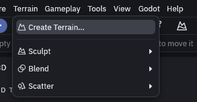
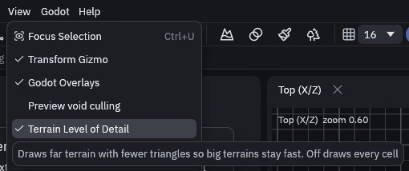
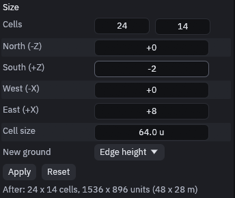
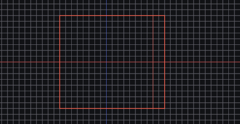
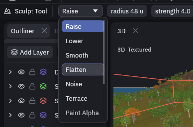
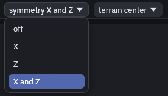
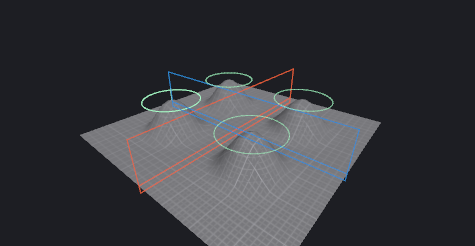

# Terrain

A terrain is a big grid of heights you sculpt like clay, with up to four textures painted over it. Use it for open
ground like hills, beaches and valleys, where shaping brushes by hand would take forever.

This page covers making one and shaping it with the Sculpt tool (G). Texturing it is on
[Terrain layers](terrain-layers.md) and [Terrain painting](terrain-painting.md).

A terrain can grow after you create it, up to 2048 cells along each axis, either with the **Size** block in the
Inspector ([Changing the size](#changing-the-size)) or by dragging its edge in a 2D view with the Select tool
([Dragging an edge](#dragging-an-edge)). It holds up to four layers, which you paint with the
[Blend tool](terrain-painting.md).

Since the ground is a heightfield, it cannot fold over itself, see [Caves and overhangs](caves-overhangs.md) for what to
do instead.

> [!TIP]
> For a world much bigger than one grid, link a Terrain3D landscape instead, the Sculpt tool works on it too. See
> [Terrain3D](../godot/terrain3d.md).

## Creating a terrain

1. Open the dialog

    Go to *Terrain > Create Terrain…* in the menu bar.

    

2. Pick a size

    **Resolution** and **Cell size** decide how big it gets, and the **Size** row under them shows the result in units
    and meters. The default of 129 x 129 vertices with 64 unit cells gives 8192 units, 256 m. See
    [Picking the cell size](#picking-the-cell-size) below.

    

3. (Optionally) Pick a starting shape

    **Shape** is the ground you start from. It's Hills by default, the others are Flat, Mountain, Island, Valley and
    Ridges. The rows under it tune the noise it is made from:

    | Row | Meaning |
    | --- | --- |
    | Height | How tall the ground gets, 512 u by default |
    | Feature size | How wide one hill or valley is, 2048 u by default |
    | Octaves / roughness | More octaves and a higher roughness add finer bumps on top |
    | Erosion | How many passes let steep slopes slump, 20 by default |
    | Seed | The same seed gives the same ground again |

    **Import PNG…** next to **Heightmap** reads a grayscale image instead (PNG, TGA or BMP), where brighter pixels are
    higher, up to **Height**. **Clear** goes back to the generated shape. Shape and heightmap only apply here, on
    creation.

4. (Optionally) Pick the layers

    **Base layer**, **Slope layer**, **Peak layer** and **Low layer** are the terrain's four textures, they start as
    `dev/green`, `dev/grey`, `dev/blue` and `dev/orange`. **Use Current** puts in the material you last clicked, and
    **tile** is how many units one repeat of it covers. **Paint layers from slope and height** is ticked by default, it
    paints the layers right away, see [Auto Paint](terrain-painting.md#auto-paint).

5. Click **Create** at the bottom

    The terrain is centered on the 3D cursor, or on the **Center** you type in once you untick **3D cursor**, and that
    height becomes the terrain's zero. You should see the new terrain selected, with the Sculpt tool already active.

## Picking the cell size

| Setting | Meaning |
| --- | --- |
| Resolution | How many vertices run along each side, one of 33, 65, 129, 257, 513 or 1025. More vertices hold more detail but cost more to draw and sculpt |
| Cell size | The distance in map units between two neighboring vertices, from 4 to 1024 |

257 vertices with 64 unit cells, for example, give 16384 units, 512 m.

Nothing sits between two vertices, so the cell size is the finest detail the terrain can hold. A mountain range wants
big cells, a garden small ones.

Picked wrong? You can [change the size](#changing-the-size) any time after creating the terrain.

**Chunk cells** in the Inspector (32 by default) splits the terrain into square pieces, and each piece becomes a mesh
with its own collision in Godot. Larger chunks mean fewer nodes there. The editor draws the terrain in these pieces
only while level of detail is off, see [Big terrains](#big-terrains).

## Big terrains

The editor draws far ground with fewer triangles than near ground, so even a terrain of 1025 by 1025 vertices stays
quick to orbit around and sculpt. It does this with a clipmap, rings of ground around the camera that get coarser
the farther out they are and follow the camera as it moves. Painted layers and holes stay sharp at any distance, only
the outline of far hills gets a little simpler.

To see every cell at full detail, untick **View > Terrain Level of Detail** in the menu bar. It is on by default and
the editor remembers your choice. Turn it off when you want to check the exact shape of distant ground.

A terrain the graphics card cannot hold is drawn at full detail instead, and the status bar says so. Godot builds the
same terrain either way, the setting only changes how the editor draws it.

## Changing the size

A terrain isn't stuck at the size you made it. You can add cells on any side, crop them off, or change the cell size,
and the ground you already sculpted stays exactly where it was in the map.

1. Select the terrain

    Click it in a view or in the Outliner. Its **Size** block sits in the Inspector under **Origin**.

2. Type the change

    | Field | What typing there does |
    | --- | --- |
    | **Cells** | Sets the total along X and Z. Both opposite sides grow or shrink evenly, with the odd cell going to the east or south side |
    | **North (-Z)**, **South (+Z)**, **West (-X)**, **East (+X)** | Changes that one side. A positive number adds that many cells and a negative one removes them, so `+8` on East adds 8 and `-2` on South crops 2 |

    

    Nothing changes yet. Your edits are a draft, drawn as an outline in the views, and the **After** line under
    **Apply** tells you the cells and size you'd get.

3. Pick what new ground gets

    **New ground** shows up once a side grows. **Edge height** continues the nearest edge, both the height and the
    paint, so the terrain simply gets longer. **Zero** gives the new cells height 0 and the first layer, for a flat
    apron to build on. The first new cell still slopes from the old edge down to 0, so the flat part starts one cell
    out.

4. Click **Apply**

    The terrain changes as one step, and Ctrl+Z puts it back exactly. **Reset** drops the draft instead.

Everything that was kept shows at the same world position as before: heights, paint and holes of the cells that
stay. If you add cells on the west or north side, the terrain's **Origin** moves out to match.

**Cell size** works differently, it rebuilds the grid with the new spacing:

* The terrain keeps its size in the map, to the nearest whole cell, so the cell count changes with it. Heights and
  paint are blended between the old vertices.
* When the size isn't a multiple of the new cell, the terrain grows or shrinks by up to half a cell, and **Whole cells
  change the size by** under **After** tells you how much. Changing the cell size back doesn't undo that rounding,
  Ctrl+Z does.
* Bigger cells throw detail away, and the Inspector warns you with **Fine detail is lost** before you apply. Smaller
  cells keep the shape but can't add detail that was never there.
* The sides apply first, then the cell size.

> [!NOTE]
> A terrain has between 1 and 2048 cells along each axis, and a cell size between 0.001 and 100000 units. A change
> that goes outside that, or that would crop away every cell, is refused with the reason shown in red, and **Apply**
> stays grayed out.

### Dragging an edge

You can also resize right in the **Top**, **Front** and **Side** views, as long as exactly one terrain is selected, unlocked, with no faces selected.
With the Select tool, move the pointer over one of its edges until the cursor turns into a resize arrow and the edge
lights up, then drag it out to add cells or in to crop them. The edge snaps to whole cells and the status bar shows the
new cell count. Each drag is one step that Ctrl+Z takes back.

A drag works like typing into that side's field and clicking **Apply** straight away. New ground continues the edge,
the way **Edge height** does, and a terrain never drops below 1 cell.

In the Front and Side views only the left and right ends grab, since the height of the ground comes from sculpting.
Type into the **Size** block instead when you want **Zero** ground or a new cell size.

### Adding tiles

Resizing grows a whole side at once. To build a level piece by piece instead, add ground one square tile at a time,
the way Terrain3D adds regions.

1. Press G and pick **Add Tile** in the first menu of the tool options bar.
2. Move the pointer over the terrain or the empty ground beside it. A square shows the tile that a click adds.
3. Click to add that tile, or drag to add several. Hold Shift to remove tiles instead, or pick **Remove Tile**.

A tile is as wide as the terrain's **Chunk cells**, so with 32 chunk cells and 64 unit cells it is 2048 units across.
New tiles start flat at the height of the terrain's origin. Behind the scenes the terrain grows to cover them and the
cells it gains around them become [holes](caves-overhangs.md), so only the tiles show, in the editor and in Godot.
Removing a tile cuts it out, and the terrain shrinks again when a whole border row or column of tiles is empty. The last
tile stays. Each click or drag is one step that Ctrl+Z takes back.

With several terrains, a tile goes to the one under the pointer, or else to the nearest one.

### Scatter on the terrain

[Scatter](scatter.md) painted on the terrain stays on the ground when you resize it:

* Instances over ground that is still there ride up or down with the new height, so nothing floats or sinks.
* Instances over cropped ground are removed by default. When there are any, a **Remove n scatter instances on removed
  ground** checkbox appears under **Apply**. Untick it to keep them where they are, floating over nothing, if you plan
  to move them yourself.
* Dragging an edge in always removes them, and Ctrl+Z brings them back.
* A scatter set that is locked or hidden, or sits in a locked or hidden layer, is left as it is.

## Sculpting

Press G, pick a mode in the first menu of the tool options bar at the top left, and drag over the terrain. It works on
the selected terrains, or on all of them when nothing is selected.

With Raise, keep the mouse button down and the ground keeps rising under the brush.

| Mode | What it does |
| --- | --- |
| Raise, Lower | Builds height up or digs it down for as long as you hold the button. A click makes a small bump |
| Smooth | Relaxes each vertex towards its neighbors, to soften lumps and sharp ridges |
| Flatten | Pulls the ground to the height where the stroke started, for building pads, roads and plateaus |
| Noise | Adds small random bumps, so flat ground looks less artificial |
| Terrace | Snaps heights to steps of **step** units (32 by default), for rice fields or stepped cliffs. The field shows up next to the mode |
| Paint Alpha, Erase Alpha, Paint Layer | Paint instead of shaping. The alpha modes are meant for displacements, Paint Layer paints the terrain layer you set in the **layer** field next to the mode. On a terrain the [Blend tool](terrain-painting.md) does this with more control |
| Hole, Unhole | Cuts whole cells out or fills them back, collision included. Use it for cave or bunker entrances, see [Caves and overhangs](caves-overhangs.md) |
| Add Tile, Remove Tile | Adds or removes a whole square tile of ground, also beside the terrain, see [Adding tiles](#adding-tiles) |

Ctrl+wheel resizes the brush, Shift swaps raise and lower, and holding Ctrl smooths whatever the mode.

The **strength** field in the options bar sets how fast the brush works. Raise and Lower move the center of the brush 8 units a
second per point of strength, whatever the **radius**, so the default 4 builds 32 units a second. For hills and islands
turn the strength up rather than holding for a minute.

Keep the radius above the terrain's cell size, a smaller brush only nudges the one vertex under it (the status bar
tells you when that happens).

To start over, *Terrain > Sculpt > Flatten*, or **Flatten** in the Inspector, sets the whole selected terrain back to
its zero height.

> [!TIP]
> Shape with a large brush and smooth after every rough pass. Small brushes leave lumps.

## Symmetry

To sculpt both sides of a valley or an island at once, turn on symmetry. The **Sculpt** and **Blend** tools both have the
control in the tool options bar, right after **strength** and the fields of the mode.

| Control | What it does |
| --- | --- |
| **symmetry off** menu | Pick **X** to mirror the west and east halves into each other, **Z** to mirror north and south, or **X and Z** for both. The closed menu then reads **symmetry X**, **symmetry Z** or **symmetry X and Z** |
| **terrain center** menu | Only shows while symmetry is on. It decides where the mirror planes sit: **terrain center** (the middle of each terrain), **world origin**, or **custom** |
| **x** and **z** fields | Only with **custom**, one per mirrored axis, the position of the plane in units. They start at the planes you were just using, so nothing jumps |

With symmetry on, the views draw the planes while Sculpt or Blend is the active tool, as a red outline for X and a blue
one for Z. A line follows the ground where each plane meets it, and a dimmer copy of the brush ring shows where the
mirrored dabs will land before you press.

Drag as usual. Every dab is applied at the cursor and at its mirrored spots, and the whole stroke is still one undo
step. A dab on a plane, or one that overlaps its own mirror, counts once, so the ground does not rise twice as high there.
Noise, blend noise and spray come out as a true mirror image instead of a new random pattern.

With **terrain center** each terrain mirrors around its own middle, and displacements mirror around the middle of all of
them together. Sculpt and Blend share the setting. Each map tab keeps its own, a new or opened map starts with the one
you were using but goes back to **terrain center** from **custom**, and it starts off again every time you launch the
editor.

> [!TIP]
> To mirror across several terrains side by side, or around a spot that is not their middle, use **world origin** or
> **custom**. Put the plane on a vertex line or halfway between two for an exact match, any other position
> only mirrors approximately.

The `sculpt` action, the `blend` tool and `terrain_edit` (`sculpt`, `sculpt_path`, `paint_path` and `holes` by `center`)
take a `symmetry` argument, `off`, `x`, `z`, `xz`, or an object `{axes, center, x, z}`. `set_editor` sets the one the
tool bar uses and `get_state` reports it, see [MCP](../mcp.md).

## In Godot

Every terrain becomes a `TrenchDotTerrain` node, a `StaticBody3D` (Godot's node for solid ground that never moves)
whose collision matches what it draws. For gameplay code, `height_at(x, z)` returns the ground height at a local
position, handy for placing things on the ground at runtime.

## MCP

The `terrain_edit` tool's `sculpt` op applies a single dab, and its strength is how far that dab moves the center, again
whatever the radius. Holding a stroke for one second at strength 4 matches a dab of strength 32.

The same size change is `terrain_edit` with `op: "resize"`, taking `north`, `south`, `west` and `east` in cells, or
`cells: [x, z]`, and `cell_size`. Add `dry_run: true` to read the cells, bounds, `scatter_removed` and `detail_lost` of
the result first. `fill` is `edge` or `zero` and `scatter` is `drop` or `keep`, as in the Inspector. See
[MCP](../mcp.md) for the limits.

Tiles are the `sculpt` op with `mode: "add_tile"` or `"remove_tile"` and a `center` on or beside the terrain.

`terrain_edit` with `op: "info"` says how the editor draws a terrain: `drawn` is `clipmap`, `chunks` or `hidden`, and
`fallback` says why a terrain is drawn in chunks while level of detail is on. `set_editor` with `terrain_lod` is the
**View > Terrain Level of Detail** switch.

