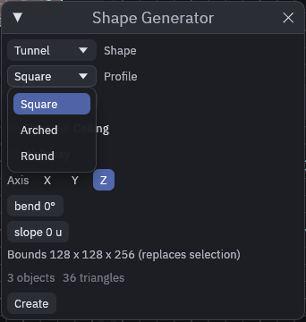
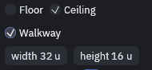
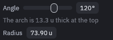
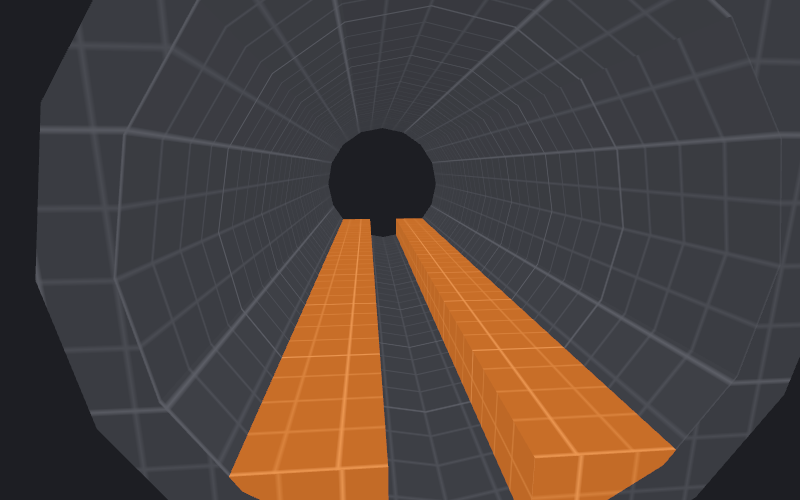
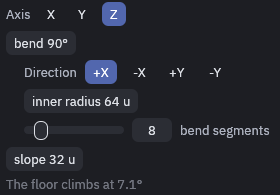
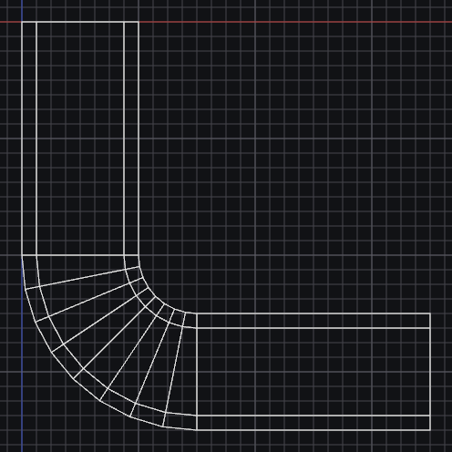

# Tunnels

The Shape Generator's **Tunnel** builds corridors, trenches, sewers, culverts and mine shafts out of brushes in one go.
It fills a box you draw, and from there it can turn a corner or climb a slope.

## Make a tunnel

1. Draw a box where the tunnel starts

    The box is the cross section at the start and the straight run of the tunnel. The tunnel runs along the Z length of
    the box, so a box 128 wide, 128 high and 512 long gives a corridor 4 m wide, 4 m high and 16 m long.

2. Open *Brush > Shape Generator…* (Ctrl+Shift+B) and set **Shape** to **Tunnel**

    The views draw the tunnel in cyan lines and follow every option you change below.

    

3. Click **Create**

    The brushes replace the box and stay selected, so you can change an option and click **Create** again to swap them
    for the next try.

## Pick a cross section

**Profile** sets the shape you would see if you cut the tunnel across:

| Profile | Cross section |
| --- | --- |
| **Square** | Two walls and a ceiling slab |
| **Arched** | Two walls under an arch, see [Flatter arches](#flatter-arches) |
| **Round** | A full round tube with a floor of its own. It fills the width and height of the box, so it is a circle only in a box as wide as it is high, and more **sides** make it smoother |

**thickness** is how thick the walls are, 16 u (0.5 m) by default. It stops at 40% of the smaller of the width and
height of the box, so a hollow always remains. Tick **Floor** to close the bottom of a Square or Arched tunnel with a
slab as thick as the walls, and untick **Ceiling** to leave a Square tunnel open at the top.

These settings give the usual kinds:

| You want | Settings |
| --- | --- |
| Corridor | Square, **Floor** on |
| Trench | Square, **Ceiling** off |
| Culvert or U channel | Square, **Floor** on, **Ceiling** off |
| Sewer | Round, or Arched with **Floor**, then **Walkway** on |
| Mine shaft | Square, **Floor** on, **Axis** Y |

A floor sits one thickness above the box bottom. When the tunnel joins a room, see
[Doorways and tunnel floors](brushes.md#doorways-and-tunnel-floors) to line the two floors up.

## Flatter arches

An Arched tunnel has an **Angle**. At 180 degrees the roof is a half round, or a half ellipse in a box lower than it
is wide. Lower angles give a flatter segmental arch that springs from the tops of the walls, which suits bridges,
cellars and old brick sewers. **Radius** is the radius of the arch circle and follows the angle, typing a radius sets
the angle.

The inside and the outside of the arch share their center, so the arch is thinner at its crown than the walls are. The
dialog says how thick it is at the top. It also tells you when it cannot give you the angle you asked for:

| Note | Why |
| --- | --- |
| The box height caps the sweep | The arch may rise at most half the smaller of the width and height, a taller box allows more |
| The arch needs this angle or more to stay 1 u thick | A flatter arch would leave the crown thinner than 1 u, thicker walls allow less |
| Too low and wide for an arch under 180° | No flatter arch fits at this thickness, so the roof stays a half ellipse |

## Sewers and culverts

Tick **Walkway** for two raised walkways along the walls with a sunken channel between them. **width** is how far each
one reaches in from its wall, at most 40% of the opening at the height of its top, and **height** how high it stands,
at most half the clear height. In a Round tunnel the walkways fill the bottom of the tube, so their outer edges follow
its curve, and the tube is narrower at their tops than across its middle.

## Shafts and side passages

**Axis** picks the length of the box the tunnel runs along. Z is the default, and X runs it the other way across the
map, for a side passage, without drawing the box again. Y stands it up as a vertical shaft. Its ceiling then lies on
the -Z side and its floor on the +Z side, so tick **Floor** to close it on all four sides.

## Corners and ramps

**bend** turns the far end of the tunnel in a smooth arc, up to 180 degrees. The box stays the straight run, and the
bend reaches out past it. While there is a bend, three more options show under it:

* **Direction** is the way the far end turns. It lists the four directions across the tunnel, so a tunnel along Z
  turns toward +X, -X, +Y or -Y.
* **inner radius** is the distance from the center of the turn to the inside wall, 64 u (2 m) by default. 0 turns the
  inside wall on the spot.
* **bend segments** is how many brushes each piece of the arc is cut into, at least one per quarter turn. More make
  it smoother.

> [!TIP]
> A 90 or 180 degree bend ends square on the grid, so a box or another tunnel drawn from the grid lines up with its end
> without a gap. Other angles end at a slant, and the dialog says so.

**slope** raises the far end by that many units over the length of the box, a negative slope runs downhill. The
dialog shows the angle the floor climbs at. Both ends stay upright on the ends of the box, so a room or another tunnel
butts on to either end without a gap.

> [!NOTE]
> A bend after a slope is level, it carries on at the height the slope reached. For a ramp that keeps climbing round a
> corner, like a spiral, sweep the end of a straight tunnel with [Sweep Faces](brushes.md#sweep-faces) and give it a
> **Rise**.

`create_brush` builds a tunnel with `shape: "tunnel"` and these arguments, each falling back to the dialog's default:

| Argument | Dialog option |
| --- | --- |
| `profile` | **Profile**: `square`, `arched` or `round` |
| `sides`, `thickness` | **segments** or **sides**, **thickness** |
| `angle` | **Angle** of an arched tunnel |
| `floor`, `ceiling` | **Floor**, **Ceiling** |
| `walkway`, `walkway_width`, `walkway_height` | **Walkway** and its **width** and **height** |
| `axis` | **Axis**, `z` when left out |
| `bend_angle`, `bend_toward`, `bend_radius`, `bend_segments` | **bend**, **Direction** as `+x`, `-x`, `+y`, `-y`, `+z` or `-z`, **inner radius**, **bend segments** |
| `rise` | **slope** |

When the box cuts an option back, the reply holds the value used under the same key and a `note` that says why.

