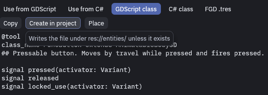
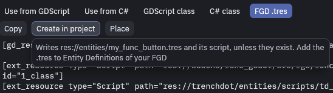
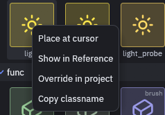
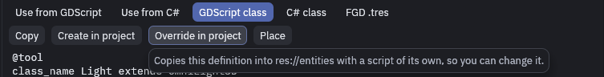

# Custom entities in GDScript

Any script can be an entity. Declare a **signal** for each output and a **method** for each input, then emit the
signal when the thing happens. This alarm has one output, `tripped`, and two inputs, `trip` and `disarm`:

```gdscript
@tool
class_name Alarm extends Node3D

signal tripped(activator: Node)

@export var armed := true

func _func_godot_apply_properties(props: Dictionary) -> void:
	armed = TrenchDotIO.to_bool(props.get("armed", armed))

func trip(activator: Node = null) -> void:
	if armed:
		tripped.emit(activator)

func disarm() -> void:
	armed = false
```

Make the activator the first `Node` argument of your signals, so chains further down still know who started them.

The script needs `@tool`, because maps are built in the Godot editor, where only tool scripts run their methods.

Map keys arrive in `_func_godot_apply_properties`. Read them through `TrenchDotIO.to_bool`, `to_vector3` and
`to_color`, which accept both text and already converted values.

Where you create nodes decides whether the scene keeps them:

| Where | Saved with the scene | Use it for |
| --- | --- | --- |
| `_func_godot_apply_properties` | Yes | Nodes the map should contain |
| `_ready` | No, made again each time the scene loads | What only the running game needs |

An entity with a *Scene File* is different: Godot saves the nodes that come from that scene as the scene file holds
them, so changes you make to them in `_func_godot_apply_properties` are lost. Nodes you add are still saved, and
changes to the scene's own nodes belong in `_ready`.

## Making it placeable

The editor and Godot learn about entity classes from your project's FGD, the list of entity definitions. Each
definition is a resource of its own, and the kind you pick decides what Godot builds:

| Your entity | Definition | What to set |
| --- | --- | --- |
| A point entity, at one spot, like a lamp or a pickup | `TrenchDotFGDPointClass` | *Script Class* to your script. To spawn a scene instead, set *Scene File*, a *Script Class* then replaces the script of the scene's root |
| A brush entity, built from brushes, like a door or a trigger | `TrenchDotFGDSolidClass` | *Script Class* to your script, and *Node Class* to the body it extends: `StaticBody3D`, `AnimatableBody3D` or `Area3D`. Left empty, Godot builds the body the script extends, or a `StaticBody3D` when the script extends `Node3D` or there is none. See [Collision](entities/collision.md) |

This is the definition of the alarm above, saved as `res://entities/alarm.tres` next to its script `alarm.gd`:

```
[gd_resource type="Resource" script_class="TrenchDotFGDPointClass" load_steps=3 format=3]

[ext_resource type="Script" path="res://addons/func_godot/src/fgd/func_godot_fgd_point_class.gd" id="1_class"]
[ext_resource type="Script" path="res://entities/alarm.gd" id="2_script"]

[resource]
script = ExtResource("1_class")
classname = "alarm"
description = "Trips when told to, until disarmed"
script_class = ExtResource("2_script")
class_properties = Dictionary[String, Variant]({
"targetname": "",
"armed": true
})
node_class = "Node3D"
```

Add it to *Entity Definitions* of the FGD that both your map settings and your game config use, see
[Project setup](../godot/project-setup.md#your-own-resources). The game config then exports it to the editor, with its
signals as outputs and its methods not starting with `_` as inputs. If an entity still builds as a plain node, see
[Entities that do nothing](../godot/entities-troubleshooting.md).

For a quick start, open the **Reference** panel and pick a class close to yours. On the *GDScript class* tab,
**Create in project** writes that skeleton under `res://entities/`.



On the *FGD .tres* tab, **Create in project** writes a definition and the script it runs, both named after the class
with `my_` in front, so `func_button` gives `res://entities/my_func_button.tres` and `my_func_button.gd`. Add the
`.tres` to *Entity Definitions* of your FGD, and Godot builds it.



## Override an entity

To change an entity that ships with the addon or the Gameplay pack, such as how `func_door` moves or what `light`
builds, override it instead of editing its files. An override is your project's own copy of the definition, with the
same classname, so your maps keep working and your copy is the one Godot builds.

Right click the entity's card in the Entities panel and choose **Override in project**, or open the entity in the
Reference panel and click **Override in project** next to **Create in project**. The button shows while a Godot
project is open.





It writes two files and wires them up:

| File | What it holds |
| --- | --- |
| `res://entities/<classname>.tres` | A copy of the definition, with a *Script Class* that is the script below. Its *Scene File*, collision and keys stay as they were |
| `res://entities/<classname>.gd` | A script that extends the original one, so you add your code under the first lines. A definition without a script gets a short template that extends its node class |

The copy also has to be in the FGD that Godot builds with. If your project has an FGD of its own, the copy is added to
its *Entity Definitions*. If it has none, **Override in project** creates `res://entities/project_fgd.tres`,
`project_map_settings.tres` and `project_game_config.tres`, and sets the project settings `func_godot/default_map_settings` and
`trenchdot/game_config` to them while they are still unset or name the addon's defaults, see
[Project setup](../godot/project-setup.md#your-own-resources). The status bar then says what was written. Build your
maps again in Godot, because a scene that was built before keeps the old nodes.

Nothing is written inside `addons/`, and nothing is written at all if a file is in the way. The status bar says which
one, so rename it or delete it and click again.

> [!NOTE]
> The script extends the original by its path, so fixes the addon or the pack makes to that script still reach your
> copy. The definition is a copy, so changes to the original's keys, inputs and outputs do not. To undo an override,
> delete the two files and its entry in `project_fgd.tres`.

## Calling I/O from code

Game code can use the same machinery as a map connection:

```gdscript
for door in TrenchDotIO.find_targets(self, "main_door", null):
	TrenchDotIO.invoke(door, &"open", "", null)

TrenchDotIO.fire_output(self, &"tripped", activator)
```

Prefer `invoke` over calling the method directly, it fits the parameter to the arguments like a map connection does
and handles the built-in inputs. `fire_output` fires every connection on that output by hand, useful when the entity
has no signal of that name.
