# Build your first room

TrenchDot is a brush editor for building playable Godot levels, in the way of TrenchBroom and Hammer. You work in a
loop: **block out** a room from brushes, **texture** it, **add entities** such as lights and doors, then **play** it in
Godot. This page goes around that loop once with a small room.

1. Block out the room from brushes and texture it, in step 4.
2. Add a light, a player start and a door, in step 5.
3. Build the map in Godot, in step 6.
4. Walk around in it and open the door, in step 7.

Steps 1 to 3 are the first setup. If you already have a Godot project set up with TrenchDot, skip them. If you come from
Hammer or TrenchBroom, [Coming from Hammer or TrenchBroom](editor/coming-from-hammer-trenchbroom.md) maps their keys
to TrenchDot's.

## What you need

* Godot 4.7 or newer, the .NET build if you want to write entities in C#
* The newest [TrenchDot release](https://github.com/Paraxdev/TrenchDot/releases/tag/beta). On Windows, run
  `trenchdot-windows-x86_64-setup.exe` and start TrenchDot from the Start menu. On Linux and macOS, download
  `trenchdot-linux-x86_64` or `trenchdot-macos-arm64` and make it executable with `chmod +x`.

## Ensure TrenchDot can see the Godot executable

Make sure TrenchDot can see your Godot install. To check if everything is detected correctly, go to
*File > Preferences… > Godot executable*.

If TrenchDot found Godot by itself, the line beneath the input field already says "Using" and the path. If it says
"Not found" instead, you need to find the executable on your disk.

For this, click the "…" button beside the input field


and find the executable starting with "Godot_v".

If you picked the correct executable it should say "Using" and the path you just picked.


## 1. Create a Project in Godot

Open Godot and click "Create" at the top left corner.


Pick a project name, for this tutorial it will be TrenchDotTest, and (optionally) select a folder where the project
should live.

Then hit "Create".

## 2. Opening the Project within TrenchDot

The first time TrenchDot starts, the 3D view shows a *Welcome to TrenchDot* card with the four steps of the loop and a
question, which editor's keys you know.

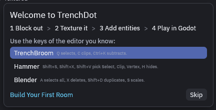

Click **TrenchBroom**, **Hammer** or **Blender** to use that editor's keys, or **Skip** to keep the TrenchBroom keys that
are already picked. It is the only thing the first start asks, and *File > Preferences… > Keymap preset* changes it
later. This page names the keys of the TrenchBroom preset.

Choose *Godot > Open Godot Project…*


or the **Open Godot Project…** button at the top right of the toolbar


and pick the project folder or any folder inside it. The editor reopens it on the next start.

## 3. Set up the project

Once TrenchDot detects that it's a new Godot project, it shows the *Set up this project* window.

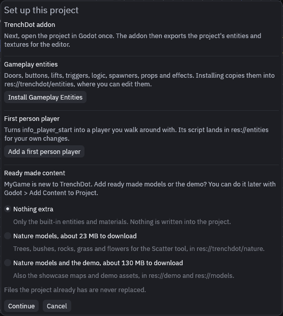

Here you can download the addon, which Godot needs to turn your maps into scenes and to talk to TrenchDot, and extra
content if you want. You can of course start without anything.

Some bare bones entities are always included, like a simple `info_player_start` and `light`.

1. Install the Addon

    Click the "Install the addon" button at the top to download TrenchDot's fork of FuncGodot into your project, this
    is crucial for TrenchDot.
    (Note: this pulls from GitHub releases. If you don't have internet access, download
    `func_godot-trenchdot-addon.zip` first and extract it into the project root to install it by hand.)

    Once you did that, click "Enable the plugin" so Godot loads it.
    (Note: close Godot first if it has the project open, otherwise Godot writes its own copy of `project.godot` back
    and the plugin stays off.)

2. Install the Gameplay entities

    Click **Install Gameplay Entities** below the addon.

    

    Doors, buttons, lifts, triggers, props and spawners come with this pack. Without it Godot builds them as plain
    shapes that have no collision and do nothing. The door and trigger helpers in the Gameplay menu install the pack
    by themselves the first time you use them, but installing it now, before Godot first opens the project, means no
    scene is ever built without it.

3. (Optionally) Extra Content

    TrenchDot has optional content you may preload: CC0 textures and models from Poly Haven and ambientCG, plus models
    made for TrenchDot. The licenses and a list of where everything is from are included.

    If you do not want any extra content you can go with "Nothing extra", the minimal entities are still included.

4. Open the project in Godot once

    Once the plugin is enabled, open the project in Godot (the window has an "Open Project in Godot Editor" button for
    that). The addon then creates a file called `trenchdot_game.json` in the project root. This is where TrenchDot
    learns your textures and entities from, and TrenchDot loads it within a second.

    The addon writes it again whenever files change, so there is no need to edit it by hand. Until it exists the status
    bar says there is no `trenchdot_game.json`, and the editor offers the core entities, plus the gameplay entities if
    you installed them.

To add entities of your own, see [Custom entities in GDScript](gameplay/custom-entities.md) and
[C# entities](gameplay/csharp.md). [Project setup](godot/project-setup.md) explains the resources that list them.

## 4. Build a room

First you block out the room, which means building its rough shape from plain brushes before anything else.

The editor has 4 main views: a 3D view you can fly around just like in Godot, and 3 wireframe views from the top,
front and side.

Brushes and operations depend on the grid size. In the toolbar you can set your grid size (smaller is finer).

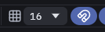

On an empty level you will be shown a small info text explaining how to draw. You can either hide it with "Hide tips"
or just start drawing, it goes away once the map has something in it.

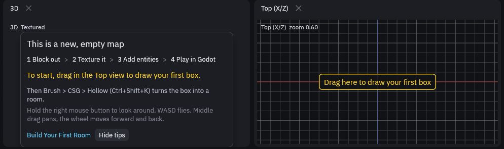

1. Draw your first box

    With the Select tool (Q), drag on empty space in any view.
    You should see a box being drawn. While holding your left click down, move the mouse to shape a rect.

    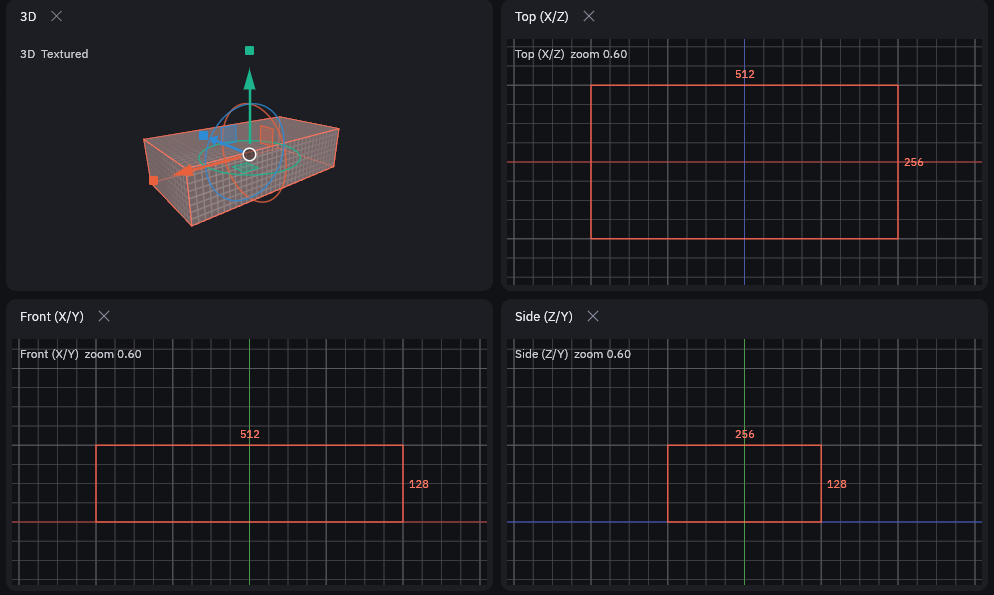

2. Add Height

    The new box is only 128 units tall. Look at the **Inspector** at the top right of the window. With the box
    selected it shows a *size* row with three fields: X is the width, Y the height and Z the depth, in map units.
    Click the Y field, type `256` and press Enter. The box grows upward and its bottom stays where it was.

    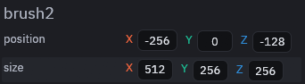

    You can also drag the height: in the Side view, hold your mouse over the top edge of the box until it turns yellow
    and drag it up. The 2D views start zoomed in close, so zoom the Side view out with the mouse wheel first, or the
    top edge has nowhere to go.

3. Making it Hollow

    Press Ctrl+Shift+K, or use the Hollow button in the toolbar.

    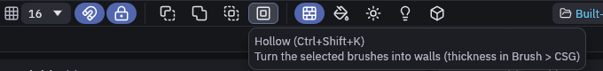

    The box is now split into walls, a floor and a ceiling, this is optimal if you want to make a smaller room or
    corridor. Now, using the fly controls (hold the right mouse button and use WASD), fly into the hollow box.

4. Cutting a doorway

    Using Escape you can deselect the selected brushes. Once nothing is selected, draw a rect in the Front view shaped
    like a doorway, 64 wide and 96 tall. Start it on top of the floor, one grid line above the bottom of the room, so
    the floor stays whole.

    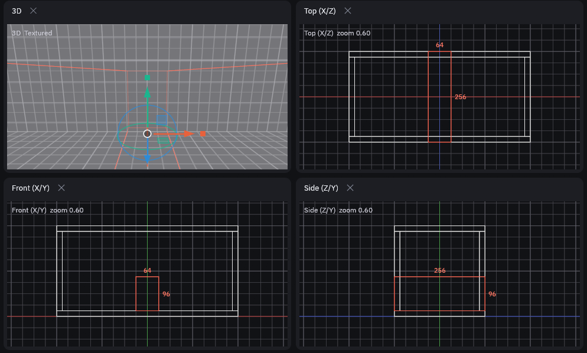

    A brush you draw in a 2D view takes its depth from the last brush you drew, here the whole room, so the Top view
    shows it running through both end walls. In the Inspector, set Z in the *size* row to `16`. The brush keeps its
    lowest corner, so it shrinks to the 16 units of the wall at the top of the Top view.

    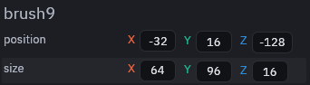

    Now, with the brush selected, hit Ctrl+K or use the Subtract button in the toolbar.

    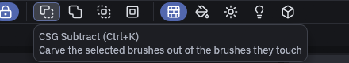

    You should see the brush vanish, and the doorway is cut out of the wall.

    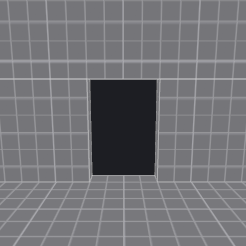

5. Texture it

    You should have 5 included textures for prototyping. To apply a texture to just one face (e.g. the door frame), drag
    the texture from the Materials tab onto the face (hold Shift to cover the whole brush).

    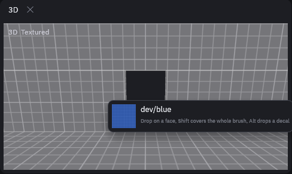

6. Saving the Map

    To see the changes in Godot we have to save the map. Press Ctrl+S, or use *File > Save*.

    The save dialog opens in your Godot project folder. Save it anywhere inside the project, a `maps` folder in the
    project root keeps things tidy, so for example `res://maps/room.tdm`.
    (Note: the folder name is up to you, but keep the map inside the project, so Godot can load it by its `res://`
    path.)

    Once saved, it shows up under *File > Maps in Project*.

    

## 5. Add a light, a player start and a door

Brushes are the walls, entities are everything else. Click the **Entities** tab at the top right of the window, next
to **Inspector**. It has a card for every entity class your project knows, and three of them are enough for a room you
can walk in. Type a name into its search field to find a card quickly.

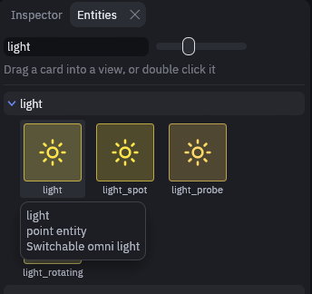

1. A light

    Drag the `light` card into the Front view, a little above the middle of the room, and hold Alt while you drop it.
    Without Alt it lands on the near wall, with Alt it lands inside the room, halfway across it. A small yellow marker
    shows where it is.

2. A player start

    Drag the `info_player_start` card onto the floor in the 3D view. It is the spot where the player begins, Godot
    puts the player there when the level starts. It shows as a green box.

    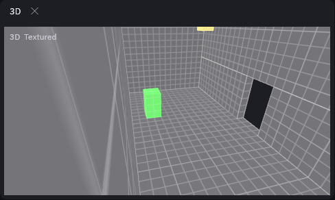

3. A door

    A door is a brush entity, it takes its shape from a brush you build. Press Escape to deselect, then draw the same
    doorway rect in the Front view as in step 4. Click the **Inspector** tab next to **Entities** and set Z in the
    *size* row to `16` again, so the brush fills the doorway. This time you keep it, so do not subtract it.

    With the new brush still selected, right click in the Front view and pick *Create Brush Entity > func_door*. The
    menu works on the selection, so it does not matter which of the brushes lies under the cursor.

    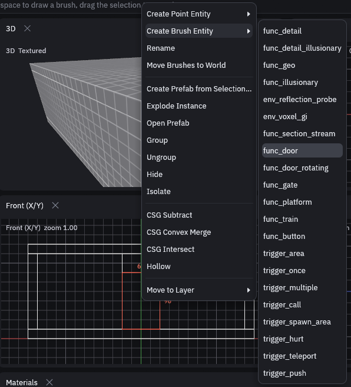

    With the door selected, set `travel` in the Inspector to `0 96 0`. It is how far the door slides when it opens, in
    map units, and 96 is as tall as the doorway, so it slides up into the wall and leaves the way free.

    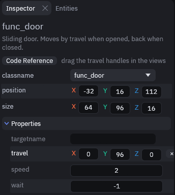

Save again with Ctrl+S. The door comes from the Gameplay entities pack of step 3, without it Godot builds the door as
a plain shape. [Placing and wiring](gameplay/placing.md) has the other ways to place and move entities.

## 6. See it in Godot

In Godot, a level is a scene: a tree of nodes, saved as a `.tscn` file, where each node is one thing such as a mesh, a
light or a camera. Godot writes paths inside the project with `res://`, so `res://maps/room.tdm` is the file
`maps/room.tdm` in your project folder. The map is turned into nodes by one node from the addon, `FuncGodotMap`.

1. In the Godot editor, choose *Scene > New Scene* and click **3D Scene** in the Scene panel on the left.
2. Press Ctrl+A (*Add Child Node*), search for `FuncGodotMap` and add it.
3. With the new node selected, set *Local Map File* to your `.tdm` in Godot's own Inspector, the panel on the right of
   the Godot editor. It works like the Inspector in TrenchDot but belongs to Godot.
4. Press **Build Map** at the top of that Inspector, then save the scene with Ctrl+S.

Brushes become meshes with collision and entities become nodes with their scripts, saved with the scene.
[Building maps](godot/building.md) explains the node's other settings. If an entity comes out as a bare mesh without
collision, TrenchDot's status bar says why, see [Entities that do nothing](godot/entities-troubleshooting.md).

Leave that scene open in Godot and every save in TrenchDot rebuilds it, straight away while its tab is the current
one, or when you switch back to it. Save the scene in Godot to keep the result. If a save does not rebuild, the status
bar says why, see [Rebuild on save](godot/live.md#rebuild-on-save).

> [!WARNING]
> A build deletes the children of the `FuncGodotMap` first. Put your own nodes next to the map node, or in
> an [overlay](godot/overlays.md).

## 7. Play it

Your player is your `info_player_start`. You give the start a script of your own, and every build turns it into the
player, standing where you placed the start and facing its way. The script below is short, it walks, looks around and
opens the door you look at.

The addon's `info_player_start` is only a marker, so your project gets its own definition of it, listed in a small FGD
on top of the addon's. [Custom entities in GDScript](gameplay/custom-entities.md) explains these resources.

1. In Godot's FileSystem panel at the bottom left, right click `res://`, choose *Create New > Folder…* and name it
   `entities`.
2. Right click `entities`, choose *Create New > Script…*, set *Inherits* to `CharacterBody3D`, name it `player.gd` and
   click Create. Replace everything in the script editor with this:

    ```gdscript
    extends CharacterBody3D
    ## First person player for a TrenchDot map. WASD walks, the mouse looks, E uses the door or button you look at,
    ## Esc frees the mouse and a click captures it again. It is the script of your info_player_start, so the map builds
    ## the player where the start stands, facing its way.

    const SPEED := 5.0
    const USE_DISTANCE := 2.5
    const LOOK := 0.0025

    var head := Node3D.new()
    var camera := Camera3D.new()

    func _ready() -> void:
    	var shape := CollisionShape3D.new()
    	shape.shape = CapsuleShape3D.new()
    	shape.position.y = 1.0
    	add_child(shape)
    	head.position.y = 1.6
    	head.add_child(camera)
    	add_child(head)
    	add_to_group(&"player")
    	Input.mouse_mode = Input.MOUSE_MODE_CAPTURED

    func _unhandled_input(event: InputEvent) -> void:
    	if event is InputEventMouseMotion and Input.mouse_mode == Input.MOUSE_MODE_CAPTURED:
    		rotate_y(-event.relative.x * LOOK)
    		head.rotation.x = clampf(head.rotation.x - event.relative.y * LOOK, -1.5, 1.5)
    	elif event is InputEventMouseButton and event.pressed:
    		Input.mouse_mode = Input.MOUSE_MODE_CAPTURED
    	elif event is InputEventKey and event.pressed and not event.echo:
    		if event.keycode == KEY_ESCAPE:
    			Input.mouse_mode = Input.MOUSE_MODE_VISIBLE
    		elif event.keycode == KEY_E:
    			_use()

    func _physics_process(delta: float) -> void:
    	if not is_on_floor():
    		velocity += get_gravity() * delta
    	var keys := Vector2(
    		float(Input.is_key_pressed(KEY_D)) - float(Input.is_key_pressed(KEY_A)),
    		float(Input.is_key_pressed(KEY_S)) - float(Input.is_key_pressed(KEY_W)))
    	var walk := basis * Vector3(keys.x, 0.0, keys.y).normalized() * SPEED
    	velocity = Vector3(walk.x, velocity.y, walk.z)
    	move_and_slide()

    func _use() -> void:
    	var from := camera.global_position
    	var query := PhysicsRayQueryParameters3D.create(from, from - camera.global_basis.z * USE_DISTANCE)
    	query.exclude = [get_rid()]
    	var node: Node = get_world_3d().direct_space_state.intersect_ray(query).get("collider")
    	while node and not node.has_method(&"use"):
    		node = node.get_parent()
    	if node:
    		node.use(self)
    ```

3. Right click `entities`, choose *Create New > Resource…*, pick `FuncGodotFGDPointClass` and save it as
   `info_player_start.tres`. In the Inspector, set *Classname* to `info_player_start` and drag `player.gd` from the
   FileSystem panel onto *Script Class*. Leave *Node Class* empty, the build then makes the `CharacterBody3D` that
   the script extends.
4. Create another resource there, a `FuncGodotFGDFile` saved as `fgd.tres`. Add
   `res://addons/func_godot/fgd/trenchdot_default_fgd.tres` to its *Base Fgd Files*, which keeps the light, the door
   and every other entity, and add `info_player_start.tres` to its *Entity Definitions*. A definition there wins over
   the one of the same classname in a base file.
5. Create a third, a `FuncGodotMapSettings` saved as `map_settings.tres`, and set its *Entity Fgd* to `fgd.tres`.
6. Select the `FuncGodotMap` from step 6, set its *Map Settings* to `map_settings.tres` and press **Build Map**. In
   the Scene panel the start is now a `CharacterBody3D` with `player.gd` on it.
7. Press F6 to play the scene.

| Key | Action |
| --- | --- |
| WASD | Walk |
| Mouse | Look around |
| E | Use the door you look at, pressing it again closes it |
| Esc | Free the mouse, a click captures it again |
| F8 | Stop the game |

The light you placed lights the room, and E slides the door up by its `travel`. That is the whole loop, block out,
texture, entities, play. Go back to TrenchDot, move the start or change the room, press Ctrl+S, and Godot rebuilds
the scene with the player in its new spot.

> [!TIP]
> To have every map in the project build with your FGD, point the project setting `func_godot/default_map_settings`
> at `map_settings.tres` instead, see [Project setup](godot/project-setup.md#your-own-resources). That page also
> adds a game config, so TrenchDot reads your FGD while you edit. This room does not need it, TrenchDot already offers
> `info_player_start`.

Your own player needs two things for the pack's entities. Triggers only react to bodies in the Godot group `player` on
physics layer 1, and doors and buttons move when your player code calls `use()` on the one it looks at, as this script
does. See [Let the player press it](tutorials/button-door.md#let-the-player-press-it).

## Try the demo project

The repository's `godot` folder, also in the release as `trenchdot-demo-project.zip`, is a project with the addon
installed and a finished example of everything above. Its main scene plays the showcase maps, saved in
`godot/demo/maps/showcase`, and you can open one under *File > Maps in Project*. The demo choice of *Godot > Add Content
to Project…* puts the same maps and scenes into your own project, and `res://demo/demo.tscn` plays them with F6.

## Next

To make the room do something, read [How entity I/O works](gameplay/io.md) and build
[Button opens a door](tutorials/button-door.md).

<div class="td-mcp" markdown>

## MCP

The content question does not open by itself in an editor that an MCP client drives: the first tool call other than
`get_state`, `screenshot` and `simulate_input` closes it, and a project opened with `open_project` is not asked about.
`project_content` adds the same content, see [MCP](mcp.md).

</div>
