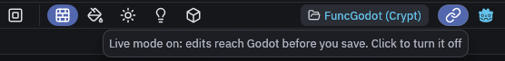
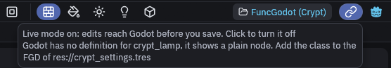

# Saving, live mode and hot reload

## Rebuild on save

1. Keep the scene open in Godot

    Open the scene with your `TrenchDotMap` in the Godot editor. The map node needs *Auto Rebuild On Save* on, which it
    is by default.

2. Save in TrenchDot

    Press Ctrl+S. Godot rebuilds the scene straight away, as long as its tab is the one Godot shows. A scene in another
    tab that uses the map rebuilds when you switch to its tab.

3. Check the status bar

    The status bar at the bottom left tells you what Godot did. When it worked, it should say:

    

Closing and reopening a tab, or reloading a scene, does not break this. Saving a [prefab](../editor/prefab-library.md)
rebuilds the maps of that scene that use it, directly or through another prefab.

Save the scene in Godot to keep the result. If the status bar says something else, the message tells you why:


| The status bar says | Do this |
| --- | --- |
| The scene is not the current scene tab in Godot | Switch to that tab, it rebuilds then |
| The current scene tab has no `TrenchDotMap` for the map | Open the scene that builds the map, or turn on *Auto Rebuild On Save* on its map node |
| Godot has no scene open | Open the scene with the map in Godot. If it is open, see [Two Godot editors](#two-godot-editors) |
| Godot is not running with the TrenchDot addon | Open the project in the Godot editor with the addon enabled |
| Godot rebuilt the map, but the map settings have no definition for some classes, so they build as plain nodes | Add the definitions, see [Entities that do nothing](entities-troubleshooting.md) |
| Godot rebuilt the map with warnings, see the Issues panel | Read them in the Issues panel, where they start with "Godot:" |

### Two Godot editors

Only one Godot editor can hold the live link port. A second editor with the same project warns in its Output panel that
the live link could not listen, and TrenchDot keeps talking to the first one, which may have no scene open.

Close the editor you do not use and the other one takes the link over within a few seconds. *Godot > Open Project in
Godot Editor* brings an editor that already has the project to the front instead of starting a second one.

## Live mode

Live mode pushes your edits into the scene open in the Godot editor before you save, so you can judge lighting and scale
in the real renderer.

1. Open the scene in Godot

    The map has to be saved inside the project once, and the scene open in Godot needs a `TrenchDotMap` that uses it.

2. Turn it on

    Click the link button at the right end of the toolbar, next to the Godot robot, or use *Godot > Live Mode*. The
    button lights up, and its tooltip says what it is still waiting for, if anything.

    

3. Edit as usual

    Every change shows up in Godot right away.

    

Live mode needs the Godot live link, which is on by default. Both sit in *File > Preferences*, where *Godot live mode*
is the same switch as the toolbar button.


Drags move nodes while you drag, and most edits rebuild only what they touched, so the preview keeps up. Toggling *Omit
From Export* on a layer and editing prefab instances rebuild the whole map instead, once you pause.

The preview is close to a full build but not always identical. Saving always does a full build, and quitting without
saving sends Godot back to the saved file, so nothing you tried in live mode sticks unless you save it.

### When live mode rebuilds the whole map

Godot rebuilds the whole map by itself when the scene no longer matches what a full build would give. When live mode
starts on a scene it does so right away, otherwise once you pause editing:

| When | Why |
| --- | --- |
| Live mode starts on a scene that was built with other entity definitions | The scene was built before you installed the Gameplay entities pack or added a definition, so some entities are plain nodes |
| Live mode starts on a scene that earlier live edits changed | The scene still holds live edits of an earlier session that you never saved |
| The entity definitions change while live mode runs | You saved an FGD or a definition in Godot's Inspector, a script class changed, or new files arrived, like an installed pack |
| You save a prefab the map uses | The scene still shows the prefab as it was |

Open scenes outside live mode keep their entities as they were built, and Godot's Output panel warns when one of them
was built with other entity definitions. Press **Build Map** in it and save.

### Entities without a definition

When live mode builds an entity whose class Godot has no definition for, the status bar names the class and the FGD to
add it to:


The live mode button's tooltip keeps the same note while the map uses that class:



Add the definition and save it, and Godot rebuilds the map by itself. The note goes away with your next save. See
[Entities that do nothing](entities-troubleshooting.md) for where a definition goes.

## Hot reload in a running game

To see your saves in a game that is already running:

1. Add the autoload

    In Godot, go to *Project > Project Settings > Globals > Autoload* and add this script:

    ```
    res://addons/trenchdot/src/trenchdot/runtime/trenchdot_hot_reload.gd
    ```

2. Run the game from the Godot editor

    The autoload only listens in games started from the Godot editor, unless you set its `enabled_in_exported_builds`
    to true.

3. Save in TrenchDot

    The game rebuilds the maps that use the saved file and emits `map_reloaded(map)`. Use that signal to put the player
    back at a spawn point or reset game state. The status bar should end with "running game reloaded 1 map(s)".

The autoload listens on port 7843, which must match *Running game hot reload* under *File > Preferences*. TrenchDot only
sends it saves while the live link is on.
