# Terrain3D

A [TrenchDot terrain](../editor/terrain.md) is one grid of heights, which is plenty for an island or a level. When the
world is a valley a kilometer wide, or a map that streams in square after square, you want
[Terrain3D](https://github.com/TokisanGames/Terrain3D) instead. It is a free Godot add-on that stores the land in
region files, draws it with level of detail and has its own sculpting tools. TrenchDot can link a Terrain3D data folder,
show the ground in every view, sculpt and paint it with the tools you already know, and stand scatter on it.

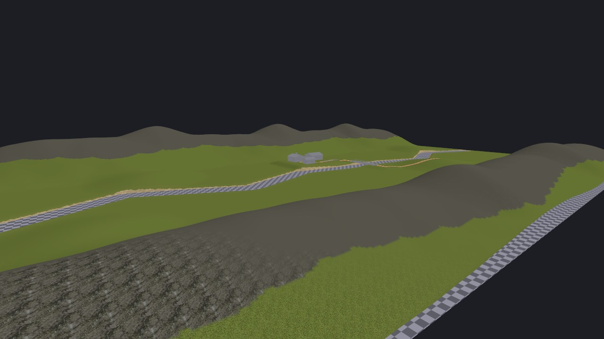

The pieces work like this. Godot is the only program that writes Terrain3D's own files, through Terrain3D's own API.
Whenever Terrain3D changes, the TrenchDot addon copies what it holds into a cache next to the files, and TrenchDot
reads that cache, or the region files themselves for a folder Godot has not exported yet. When you edit in TrenchDot,
the edit waits in the same folder until Godot applies it. So Terrain3D stays in charge of its data, and you can sculpt
in either program.

## Experimental

> [!WARNING]
> The Terrain3D bridge is experimental. Keep the data folder in version control, or make a copy, before you sculpt
> it from TrenchDot.

Terrain3D is made by other people, and the bridge depends on its files and its editor API. A new Terrain3D release
can change either, and until TrenchDot catches up the ground may show wrong or edits may be refused. The bridge was
tested with Terrain3D 1.1.0 on Godot 4.7. If something breaks, please
[open an issue](https://github.com/Paraxdev/TrenchDot/issues) and name both versions.

The bridge is off until you turn it on. Tick **Terrain3D bridge** under *Experimental* in either of two places:

* The *Set up this project* window, which opens on a project's first start and from *Godot > Add Content to Project…*.
  The section sits between *Gameplay entities* and *Ready made content*.

    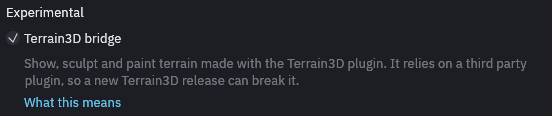

* *File > Preferences…*, in the *Experimental* row at the bottom of the list.

    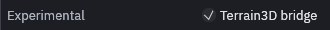

While it is off, *Terrain > Link Terrain3D…* and its command palette entry are hidden. A map that already links
Terrain3D, say one a teammate made, still shows and edits its terrain, so turning the switch off never hides your data.

<div class="td-mcp" markdown>

MCP clients reach the `terrain3d` and `terrain_edit` tools whether the switch is on or not.

</div>

## Installing Terrain3D

TrenchDot does not ship Terrain3D. Install it into your Godot project the way its own documentation says, from the
AssetLib tab in Godot or from the release zip, then turn it on under *Project > Project Settings > Plugins*.

It was tested with Terrain3D 1.1.0 on Godot 4.7, and data folders saved by 1.0.2 load too. TrenchDot says so in the
status bar for a version it has not been tested with and keeps working, because every file goes through Terrain3D.

> [!NOTE]
> The map builds without Terrain3D installed, it just has no ground until you install it. TrenchDot says so in the
> Inspector and in the build report, and your edits wait in the data folder.

## Linking a data folder

Godot creates the region files and exports the folder for TrenchDot, so check two things first. The project has to
be trusted: when *Restricted Mode* shows in yellow at the right of the status bar, click it and trust the project, see
[Project trust](running-godot.md#project-trust). TrenchDot also has to find Godot: when it does not, set
*File > Preferences… > Godot executable*, see [Finding the executable](running-godot.md#finding-the-executable).
Without both the link still works, but a new folder stays empty, a folder that holds regions shows its ground without
textures, and your edits wait in the data folder until Godot opens the scene.

1. Open the dialog

    Go to *Terrain > Link Terrain3D…* in the menu bar. It shows once the bridge is on, see [Experimental](#experimental).
    You need a Godot project open in TrenchDot first, since the data lives in one.

2. Pick a folder

    **Data Folder** lists every folder of your project that holds Terrain3D region files, and **New Folder**.
    For a new folder you type the **Folder Name**, which is created under `res://`, pick the **Region Size**
    (64 to 2048 vertices), the **Vertex Spacing** (meters between vertices, 1 by default) and how many **Regions** it
    starts with, centered on the origin. The line under them shows the size in meters.

    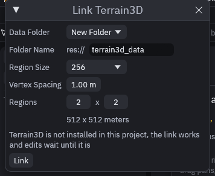

3. Click **Link**

    A node called **Terrain3D** appears in the current layer and the dialog closes. Saving the map has Godot build it,
    and a new folder gets its blank region files then. A folder that already holds regions shows its ground once
    TrenchDot has read the region files, and its textures once Godot has exported it, see
    [Without the Godot editor open](#without-the-godot-editor-open).

A map has at most one Terrain3D node. It stays where it is: you cannot move, rotate, duplicate or group it, or put it
in a prefab. Deleting it unlinks the folder and never deletes region files.

> [!NOTE]
> Godot builds a map only from a scene with a `FuncGodotMap` node set to that map. A project that holds just
> `maps/hills.tdm` builds nothing, so no ground and no `TrenchDotTerrain3D` node appear, and the **Terrain3D** dock in
> Godot has nothing to show. Add the map node as in [See it in Godot](../getting-started.md#6-see-it-in-godot), see
> also [The FuncGodotMap node](building.md#the-funcgodotmap-node), then save the map again. Your edits reach the
> region files without any scene when TrenchDot finds the Godot executable, from the `GODOT` environment variable or
> *File > Preferences… > Godot executable*, since it then applies them with a headless Godot.

## Adding textures

A new folder has no textures. Godot draws the ground as a checkerboard, the Inspector says "No textures" and
**Paint Layer** has nothing to pick. Terrain3D keeps its textures as texture assets, which you add in Godot. Once you
have, the 3D view draws them the way Godot does, blended pixel by pixel with their scale, so a rock face looks like rock
and not like its average color:

1. Select the Terrain3D node

    Open the scene with the `FuncGodotMap` of this map in Godot, add one first if no scene has it, see the note under
    [Linking a data folder](#linking-a-data-folder). Save the map in TrenchDot once so Godot builds it, then select the
    `Terrain3D` node under `TrenchDotTerrain3D`.

2. Add the texture assets

    In the **Terrain3D** dock at the bottom of Godot, click the empty entry with the plus in the texture list, then set
    its albedo and normal textures in the Inspector. Each asset gets the next id, starting at 0. Terrain3D's
    [texture guide](https://terrain3d.readthedocs.io/en/stable/docs/texture_prep.html) says how to prepare the images.

3. Save the assets to a file

    In the Inspector of the `Terrain3D` node, open the menu next to **Assets** and pick *Save As…*, for example
    `res://terrain3d_assets.tres`. Otherwise every build logs "free_editor_textures requires Assets be saved to a
    file". Saving it into the data folder itself, next to the region files, lets the next Terrain3D node a build
    creates for that folder pick it up on its own, see [What Godot builds](#what-godot-builds).

4. Save the scene

    Press Ctrl+S in Godot. The textures show in the TrenchDot Inspector and in the **Paint Layer** menu after this save
    or after the next build of the map. Only opening the scene does not update them. Textures exported by an older
    addon show as blurry thumbnails until Godot writes the cache again.

## What Godot builds

The next build of the map, from a save in TrenchDot or from *Build* on the `FuncGodotMap`, creates this:

```
FuncGodotMap
    TrenchDotTerrain3D
        Terrain3D
```

The `TrenchDotTerrain3D` [slot node](../GLOSSARY.md#slot-node) holds the `Terrain3D` node, whose *Data Directory* is your
folder. Rebuilds, *Clear Map*, live mode, the chunk streamer and hot reload never free or move it, the same as an
[overlay](overlays.md). If you already have a Terrain3D in a scene, add a `TrenchDotTerrain3D` as a child of the map by
hand and drag your Terrain3D under it, the build then keeps yours.

Select the `TrenchDotTerrain3D` node and the Inspector shows a **TrenchDot** section with read-only lines, so you can
see what it does without opening the files:

| Line | Shows |
|---|---|
| **Linked Node** | The `terrain3d` map node of the last build, or *none* when the map has no `terrain3d` node or was not built yet. |
| **Data Folder** | The folder of the `Terrain3D` child. |
| **Pending Edits** | How many edits from TrenchDot wait to be applied. They apply when the scene opens. |
| **Last Apply** | The newest apply, for example `#3: 2 applied, 1 refused (changed at 3, -2)`. A region is refused when Godot changed it since TrenchDot read it (*changed*), holds unsaved strokes (*dirty*) or has another region size (*size*). |
| **Cache** | How many regions are exported for TrenchDot, and how many have unsaved edits in Godot. |

The section is not saved in the scene.

A `Terrain3D` node the build creates gets the **Material** (a `Terrain3DMaterial`) and **Assets** (a `Terrain3DAssets`)
that sit in the data folder, found by their type and not by their name, so Godot shows the textures and the noise
hills right away. A folder from the Terrain3D demo has both. A node you set up yourself keeps its own material and
assets, the build never replaces what you chose. If the folder holds more than one file of a type, the build uses the
first by name and says so in its report. The ocean is not picked up from a file, turn on **Ocean** on the node or use
the checkbox in the TrenchDot Inspector.

Terrain3D always sits at the world origin and ignores its parent's transform, so keep the map node at the origin. The
build report warns when it is not.

In the Godot editor the slot keeps the cache current: about half a second after a Terrain3D stroke, when you save
the scene and after a build. You sculpt with Terrain3D's own tools as usual and the TrenchDot views follow, even before
you save the Godot scene. Regions you changed on disk, say through version control, are reloaded too, unless they hold
edits you have not saved.

## Seeing and shaping the ground

The 3D view draws the ground the way Godot does: every pixel blends the base and overlay textures that were painted
there, with the texture scale, the color map and the autoshader on slopes, and holes are cut out. Ground near the camera
is exact. Ground far away is a coarser copy, drawn as a [clipmap](../GLOSSARY.md#clipmap), a set of rings around the
camera that each have half the detail of the one inside, so a world of many regions stays smooth and the frame time does
not grow with its size.

While a big world loads, regions fill in over a few frames, because each frame uploads only a limited amount. Every
region gets its coarse copy first, then the ones nearest the camera are swapped for the exact ground. A region whose
data has not been read yet is not drawn at all, so you see the world background in its place until it arrives.

Beyond the regions it draws the [world background](../GLOSSARY.md#world-background) of the material, and a Terrain3D
with an ocean gets a water plane at its [sea level](../GLOSSARY.md#sea-level). The 2D views draw the region borders as
thin lines with the region number in the corner, once a region is big enough on screen.

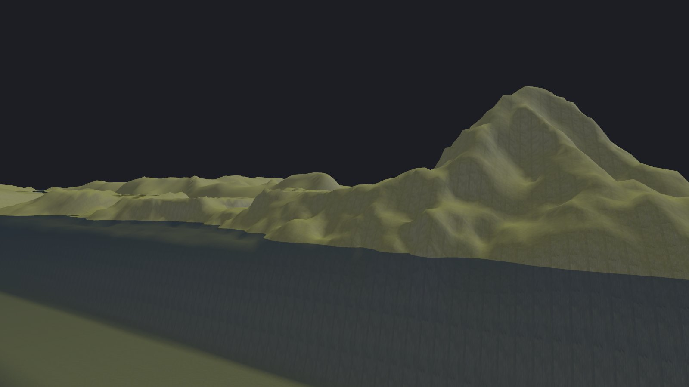

| World background | What the 3D view draws past the regions |
| --- | --- |
| None | Nothing, the ground ends at the last region |
| Flat | A flat plane at the material's ground level, blended into the region edges |
| Noise | Hills made from the material's noise settings, in the same shape as in Godot, though colors and fine detail can differ |

The water is a tinted plane that follows the camera to the horizon. Like Godot's ocean it hides the ground below it
more the deeper that ground lies, so shallow shores still show through. It does not copy the waves of the ocean shader.

**View > Terrain3D** switches each part on or off, for a closer look at the ground or a faster view. The menu shows
while the experimental preference is on or the map links a Terrain3D, and TrenchDot remembers the choices.

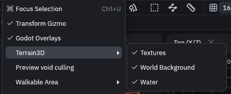

| Switch | When it is off |
| --- | --- |
| **Textures** | Each texture is drawn as its average color |
| **World Background** | Only the ground the regions hold, plus the blend at their edges, so picking and the look inside the regions stay the same |
| **Water** | The ocean is left out |

Click the **Terrain3D** node in the Outliner, or click the ground, to open its Inspector.

A selected Terrain3D node shows a light red wash and red boxes around its regions, so the ground looks pinkish while you work on it. That is the selection, not a warning. Press `Esc` to select nothing and see its real colors. Regions Godot has not received yet show in the Inspector.

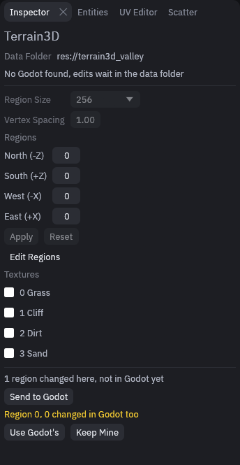

| In the Inspector | What it does |
| --- | --- |
| **Data Folder** and the line under it | The linked folder, and whether Godot is connected, not running, not found, or Terrain3D is not installed |
| **Region Size** and **Vertex Spacing** | Rewrite every region file. With the scene open in the Godot editor, Terrain3D does it there. With Godot closed, a headless Godot does it once you confirm, see [Changing the size with Godot closed](#changing-the-size-with-godot-closed) |
| **Look** | The material, assets and ocean of the node, see [The Look block](#the-look-block) |
| **North (-Z)**, **South (+Z)**, **West (-X)**, **East (+X)** | How many regions to add (positive) or remove (negative) on each side. The regions the draft adds are boxed in blue and the ones it removes in the warning color, and a note on the edge of the view says when they lie off screen. **Apply** makes it one undo step and **Reset** clears the draft |
| **Edit Regions** | Click squares of the Top view instead: an empty square adds a region, a filled one removes it |
| **Textures** | The texture assets of Terrain3D with their ids, the ids you paint with |

New regions start blank, at height 0. Regions can be left out, so an L shaped world stays L shaped, and Terrain3D holds
at most 32 regions per side.

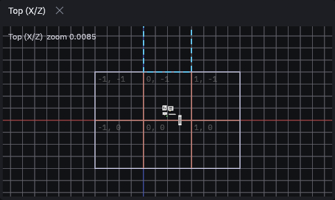

### The Look block

Under **Vertex Spacing** the Inspector shows what Godot draws the node with.

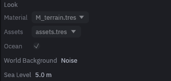

| Line | What it does |
| --- | --- |
| **Material** | The `Terrain3DMaterial` of the node. The list holds the `.tres` files of that type in the data folder and the folders just below it, and *None* |
| **Assets** | The `Terrain3DAssets` of the node, chosen the same way |
| **Ocean** | Turns the ocean of the node on or off |
| **World Background** | Which of None, Flat or Noise the material uses, read only |
| **Sea Level** | The height of the ocean in meters, shown while the ocean is on, read only |

A change here goes to Godot as one undo step, which you can undo with Ctrl+Z there, and Godot writes the cache again, so
the 3D view follows after a moment. The controls are greyed out unless the Godot editor is open with this scene, since
the material, assets and ocean live in the scene. A cache written by an older addon has no material or ocean, the
block then asks you to update the TrenchDot addon in Godot. If the world background is Noise and the cache has no noise
values yet, a line says the hills draw flat until Godot exports again.

With the node selected, the **Sculpt** tool (G) works on it with the same brush ring, radius and strength as on a TrenchDot
terrain. Raise, Lower, Smooth, Flatten, Noise, Terrace, Hole and Unhole work, and strokes cross region borders without a
seam. **Paint Layer** paints a texture id instead of one of four layers, or the color, wetness and marks described
[below](#color-wetness-and-navigation). Paint Alpha and Erase Alpha are for
displacements and leave Terrain3D as it is. The mode menu scrolls, Paint Layer, Hole and Unhole sit at its bottom.

> [!TIP]
> Radius and strength are in map units, 32 to a meter. When a stroke can only reach Terrain3D nodes, Sculpt uses its
> own pair, radius 1500 (a brush about 94 m across) and strength 64, since the brush terrain defaults of 48 and 4
> hardly show on a landscape hundreds of meters wide. That is the case when you select Terrain3D nodes but no TrenchDot
> terrain or displacement, or select nothing in a map that has none. Change the pair in the tool options bar or resize
> the brush with Ctrl+wheel. It is remembered until you close the editor. Selecting a TrenchDot terrain or displacement
> brings its own radius and strength back, and so does the Paint tool, which only colors brushes. Strength stops at
> 256, a larger value you type becomes 256.
>
> The Top view starts zoomed in close, at zoom 0.50 in its corner label. Scroll out to about zoom 0.02 to see a 512 m
> terrain whole.

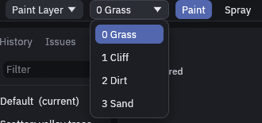

| Button | What a dab does |
| --- | --- |
| **Paint** | Replaces the base texture under the brush with the chosen id |
| **Spray** | Sets the overlay texture to the chosen id and raises how much of it shows, a little with every dab |

A stroke changes only the part of Terrain3D's data it is about, so painting a texture keeps the color and marks of the
ground. The texture scale and rotation you paint in Godot always stay as they are, TrenchDot has no brush for them.

> [!NOTE]
> The 3D view draws up to 32 textures, the ids 0 to 31, so it can look simpler than Godot for a texture beyond that.
> The data keeps all of them. Macro variation and projection are exported but not drawn yet, so a close up of the
> ground can look a little flatter than in Godot.

### Color, wetness and navigation

Paint Layer paints textures until you pick something else in the menu right after it. The other entries paint the
rest of what Terrain3D keeps for every vertex, the same things its own brushes in Godot paint.

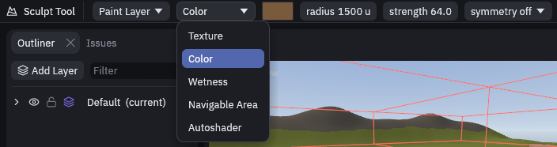

| Entry | What a stroke paints |
| --- | --- |
| **Texture** | A texture id, with Paint or Spray as above |
| **Color** | A tint toward the color of the button next to the menu, a sandy brown at first. Use it to make grass look dry or muddy in patches |
| **Wetness** | The **roughness** value next to the menu, -50 % at first. Negative ground is wetter and shinier in Godot, positive is drier |
| **Navigable Area** | A mark that the ground is walkable. Terrain3D's navigation baking in Godot only covers marked ground |
| **Autoshader** | A mark that Godot textures this ground by its slope and height, while the autoshader is on in the material |

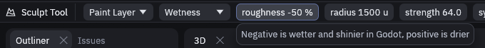

Color and wetness build up the longer you hold the mouse button, faster at a higher strength, and fade out toward the
edge of the ring. The two marks are on or off, every vertex inside the ring gets them at once. Hold Shift to take paint
away again: color goes back to white, which tints nothing, wetness back to 0 and the marks are cleared. Each stroke is
one undo step, and a save sends it to Godot like any other edit.

You see the color right away in the Textured, Lit and Baked views. Wetness and the marks are hard to see on their own,
so while you paint one of them the 3D view washes the ground with it: navigable ground purple, autoshader ground
brown, wet ground blue and dry ground brown, stronger the further the value is from 0. The wash goes away when you pick
another entry or tool.

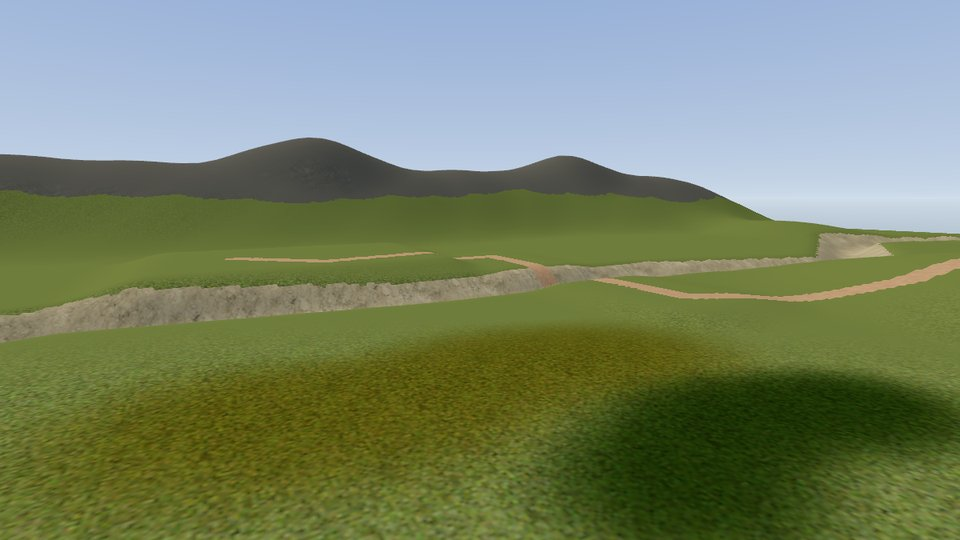

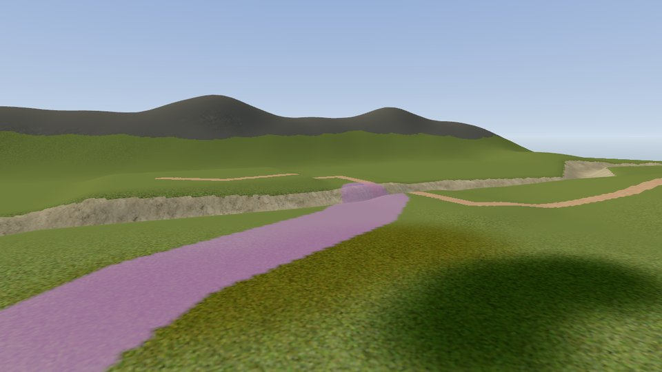

## Sending your edits to Godot

Your edits live in the TrenchDot map until you send them. The Inspector says "3 regions changed here, not in Godot yet"
and a save (Ctrl+S) sends them. *Terrain > Send Terrain3D to Godot* or the **Send to Godot** button does it without
saving. What happens next depends on Godot:

| Godot is | What happens |
| --- | --- |
| Open with this scene and the live link on | The edit lands in the open scene as one undo step called "TrenchDot terrain edit" and is saved to the region files at once |
| Not running, but found | TrenchDot runs it headless for a few seconds to apply the edit. Set the **Godot executable** in Preferences if it is not found |
| Not available | The edit waits in the data folder and Godot applies it the next time it opens the scene |

A project in Restricted Mode is never handed to Godot. The edits wait in the data folder, and the Inspector says
"Godot: not reached". Click **Restricted Mode** in the status bar to trust the project, then save again.

An undo in TrenchDot after a send makes the region differ again, and the next save sends it back. An undo in Godot
undoes the whole send.

Region files that change on disk while Godot is closed, after a git pull for example, show in TrenchDot only once
Godot opens the scene again and the next send reports those regions as changed in Godot.

### When both sides changed a region

Each region is the unit of conflict. Godot applies your edit only if the region is the one you started from and has no
unsaved edits in the Godot editor. Otherwise it leaves that region alone and still applies the rest.

When the Godot editor holds unsaved edits in the region, the Inspector says "Godot has unsaved changes in region 0, 0,
save the scene there and send again". Save the scene in Godot, then click **Send Again** under that line.

When Godot saved a different region than the one you started from, the Inspector shows a line like "Region 0, 0
changed in Godot too", with the region outlined in the warning color in every view. Two buttons settle it:

| Button | What it does |
| --- | --- |
| **Use Godot's** | Drops your edit of that region and takes the one from Godot, as one undo step |
| **Keep Mine** | Sends your edit anyway, replacing what Godot has |

So unsaved work in Godot is never overwritten behind your back, and edits in different regions never conflict.

A region you sculpted or removed at another region size than Godot's terrain has, for example because you changed the
region size in Godot and closed it without saving, shows "Region 0, 0 was made at another region size than Godot's
terrain has". Godot cannot take such an edit, and the removal would take away another area at Godot's size, so there is
no **Keep Mine**, only **Use Godot's**. To keep your change instead, set the region size in Godot's Terrain3D node back
to the size you made it at and send again.

## Scatter on Terrain3D

Pick the Terrain3D node as the only target of a [scatter set](../editor/scatter.md#targets). The Scatter panel then shows
**Follows Terrain3D**. Instances land on the surface Godot samples, and when the ground changes, in TrenchDot or in
Godot, they follow it. Godot puts each instance at Terrain3D's own height, so props never float or sink. An instance over
a missing region or a hole keeps the height it had, and the build warning names the first ones in map units and in meters
from the map node. A new dab or fill places nothing where Godot has no height, so a bare ring beside a hole and a bare
strip at the edge of the world are expected.

## Without the Godot editor open

A folder Godot has never exported has no cache yet, so TrenchDot reads its region files itself, and the Inspector
counts "Reading region files 3 of 12" meanwhile. The ground then shows plain, without textures or a world background,
since those come from the material and assets of the scene, which only Godot reads. The Inspector says "Read from the
region files" and leaves out the Look block and the texture list. You can sculpt, paint and send as usual. TrenchDot
writes nothing into the folder for this, and reads it again whenever a region file comes, goes or changes.

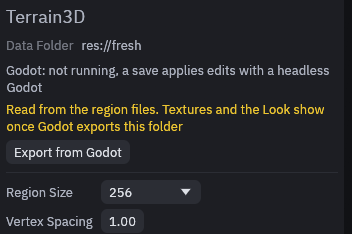

Click **Export from Godot** under that line to get the textures too: the open Godot editor, or a headless Godot when
none is open, writes the cache, and the textures show after about 10 seconds. You can run the same step by hand:

```sh
godot --headless --path path/to/project --script res://addons/func_godot/src/trenchdot/terrain3d_cli.gd -- export res://terrain3d_data
```

Use `apply` instead of `export` to apply the edits waiting in the folder. It exits with 0 on success and prints a JSON
result on its last line. If it says the class is missing, open the project in Godot once so Terrain3D registers.

The cache is `.trenchdot/` inside the data folder, see [Terrain3D cache](../format/terrain3d-cache.md). It is safe to
delete, **Export from Godot** writes it again, and the terrain3d MCP tool does that on its own. Add it to your
`.gitignore` if you do not want it in version control.

A headless Godot reads the region files with a bare Terrain3D node, not the one in your scene. It gives that node the
`Terrain3DMaterial` and `Terrain3DAssets` it finds in the data folder, so a folder that holds both exports its textures,
and for a folder with no cache yet its world background too. A folder without them, or with the files somewhere else,
exports no textures: the Inspector says "No textures" and the 3D view stays grey until the Godot editor saves the scene
or builds the map once, which writes the texture list from the *Assets* of your Terrain3D. The ocean and the resources
you picked in a scene are only known to the Godot editor, so a headless export keeps the material, ocean and resources
of the last cache, unless the cache comes from an older TrenchDot addon that did not export them, then it takes the
folder's files like a new one. To refresh those from the folder, delete `manifest.json` in `.trenchdot/` and export again.

### Changing the size with Godot closed

**Region Size** and **Vertex Spacing** work with Godot closed too, as long as TrenchDot finds the Godot executable.
Pick the new value, and the Inspector asks "Rewrite all 6 region files with a headless Godot? A backup is kept in the
data folder". Click **Change Settings** and a headless Godot rewrites every region file within a few seconds, or click
**Cancel** to keep the old value.

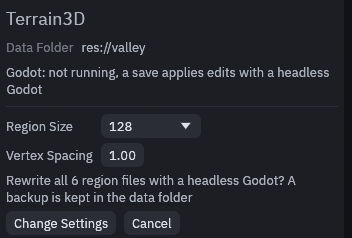

Before Godot writes anything, it copies the region files and `manifest.json` into `.trenchdot/backups/` in the data
folder, in a folder named after the time in UTC, and keeps the last three. Changing the size back can leave extra flat
regions, so to undo a change exactly, close Godot, delete the region files in the data folder and copy those of the
backup in their place.

Your Godot scene still has the old spacing. The next time the Godot editor opens it, the addon gives the Terrain3D node
the new spacing and marks the scene changed, so save it there.

Sometimes nothing can be rewritten. The greyed out control or **Change Settings** button then says why when you
hover it, or the status bar does after you click:

| Message | Why, and what to do |
| --- | --- |
| "Send your edits first, edits made at the old region size cannot be sent after it changes" | Your unsent edits only fit the old size. Save, then change it |
| "... holds TrenchDot edits Godot has not applied yet ..." | Edits Godot has not applied yet wait in the data folder, for example from another map. Open the scene in the Godot editor once so it applies them |
| "the regions at ... hold Terrain3D instances, which only their scene can move ..." | Terrain3D's instancer meshes live in the scene, so change the size in the Godot editor with the scene open |
| "Open the scene that shows this Terrain3D in the Godot editor first" | A Godot editor runs on the project, so TrenchDot leaves the files to it |
| "Turn on the live link, TrenchDot only rewrites the region files when it can tell no Godot editor has them open" | *Godot live link* is off in *File > Preferences…*, turn on **rebuild maps in Godot on save** |

The command line does the same with `settings`, the data folder, the region size and the vertex spacing:

```sh
godot --headless --path path/to/project --script res://addons/func_godot/src/trenchdot/terrain3d_cli.gd -- settings res://terrain3d_data 512 1.0
```

## Good to know

| | |
| --- | --- |
| Renderers | The showcase scene is checked in Forward+, Mobile and Compatibility |
| Maps | A map with a Terrain3D node is saved as [version 2](../format/nodes.md#terrain3d), so older editors and addons ask for an update instead of dropping the link |
| Scale | Up to 32 x 32 regions of 2048 vertices. Far ground is drawn as a coarser copy in TrenchDot, and the cost of the 3D view stays flat as the world grows |
| Old caches | A cache written before this addon version has no noise values, ocean or full size textures. The 3D view draws flat hills, no water and blurry textures until the Godot editor exports again |
| Running the game | Terrain3D picks its level of detail around the active camera. A scene without a `Camera3D` logs "Cannot find clipmap target or active camera. LODs won't be updated" |
| Scatter models | A Godot that never imported the model files, such as a headless build of a fresh checkout, logs "scatter model res://... not found" and places nothing. Open the project in Godot once, or run `godot --headless --path path/to/project --import` |
| Navigation | The navigation bake of TrenchDot reads collision from the map. Use Terrain3D's own navigation baking for the ground |
| Not shown | The instancer meshes of Terrain3D are not drawn in TrenchDot, and their heights follow the ground when it changes. The meshes of a kept [overlay](overlays.md), like a tunnel, show as a dashed box too |
| Not the same | The ocean is a plain tinted plane, not the waves of the ocean shader, and the Noise background matches Godot in shape, not in every detail. Picking and sculpting never use either |
| Not painted | The texture scale and rotation of Terrain3D are left as Godot painted them |
| Units | Terrain3D works in meters, TrenchDot converts with the units per meter of your game, 32 by default |

<div class="td-mcp" markdown>

## MCP

The `terrain3d` tool does everything the Inspector does. `op: "link"` takes a `data_directory` and, for a new folder,
`create: {region_size, vertex_spacing, columns, rows}`. `info` and `probe` read the folder and the surface, `regions`
and `grow` add and remove regions (`grow` takes `dry_run`), `send` and `resolve` talk to Godot and `settings` changes
the region size, spacing, material, assets and ocean. `export` has Godot write the folder's cache again, like Export from Godot in the
Inspector, and names the regions it wrote. A script cannot call `send`, `settings`, `export` or `resolve` with
`take: "mine"`, a save sends the edits anyway.

`settings` also takes `material` and `assets`, the res paths of a saved Terrain3DMaterial and Terrain3DAssets (an empty
string clears one), and `ocean_enabled`, as one undo step in Godot, like the Look block of the Inspector. `info` adds
what the 3D view draws with: `resources` and `ocean` of the cache, the `background` mode and whether it has noise values,
and `clipmap`, the layers and regions held, the GPU bytes and the triangles of the last frame. `set_editor` takes
`terrain3d_textures`, `terrain3d_background` and `terrain3d_water`, the switches of **View > Terrain3D**.

`info` names in `source` what it read, `"cache"` or `"region_files"` for a folder Godot has not exported, and the tools
wait for those files to be read. `settings` replies with its `route`, `"live_link"` through the Godot editor or
`"headless"` with Godot closed. A headless change adds the `backup` folder and any `problems`, and refuses `material`,
`assets` and `ocean_enabled`, which need the scene.

`terrain_edit` and `scatter` accept the id of the Terrain3D node. Its `paint_texture` op takes a `texture` id and
`mode: "base"` or `"spray"`. The id is 0 to 31. When the node's textures are listed, the id has to be one of them, and
the reply names the ids the node has when it is not. When Godot lists no textures yet, any id from 0 to 31 is accepted
and the reply carries a `note`. `paint_color` takes a `color` and `paint_wetness` a `roughness`, both blend in by
`strength` and take `erase`, and `paint_navigation` and `paint_autoshader` take `on`. Each paints at a `center` or
along `points`. `probe` adds the `navigation` and `auto` marks, the `color` and the `roughness` of the nearest vertex.
`run_action sculpt` takes `channel`, `color`, `roughness` and `erase`, and `set_editor` sets the entry and its values
of the tool bar with `terrain3d_paint`. The showcase [script](https://github.com/Paraxdev/TrenchDot/blob/main/examples/mcp/terrain3d_valley.json)
builds the valley from the picture above this way, see [MCP scripts](../mcp-scripts.md). Its description lists what
the project needs: the showcase materials, the glTF nature pack for its trees, and texture assets 0 to 3 for the paint
to show.

</div>

## See also

* [Terrain](../editor/terrain.md) for TrenchDot's own terrain and the Sculpt tool.
* [Scatter](../editor/scatter.md) for the sets that follow the ground.
* [Overlays](overlays.md) for the other node that survives every build.
